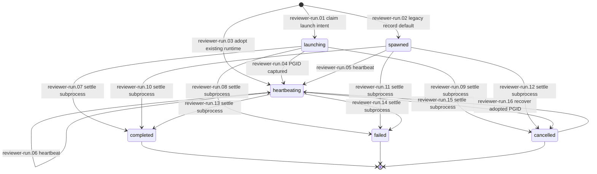

# Adversarial Review

HAMVALIDORPHAN-01: automatic review queues cannot orphan a hammer-validated
head. The watcher restores its last delivered review and evaluates ordinary
closure in the same poll. Shared rescue classification retains hammer ownership;
existing validation, leases, retry limits and escalation remain authoritative.
See the [recovery contract](docs/RUNBOOK-ama-closure.md#hammer-head-without-a-live-closer-hamvalidorphan-01).
Offline regressions cover queued recovery and crashed-worker retry exhaustion;
read-only observation after normal deployment remains pending. Existing smoke
promises are unchanged.

LAC-2094: finite CLI result entrypoints allow pending stdout/stderr writes to
finish before exiting. Merge-lease `status`/`list` preserve the complete JSON
document and retained attempts on pipes, including slow consumers. See the
[output contract](docs/RUNBOOK-ama-closure.md#cli-output-completion-lac-2094)
and [offline proof and sibling sweep](docs/validation/cli-output-lifecycle.md).
This changes no persistent schema/model, lifecycle states/transitions or
declared smoke promises. Live recovery acceptance remains separate from source
publication. Run the focused regressions with:

```bash
node test/run-tests.mjs cli-output-lifecycle.test.mjs
```

```
           /\                                                 /\
 _         )( ______________________   ______________________ )(         _
(_)///////(**)______________________> <______________________(**)\\\\\\\(_)
           )(                                                 )(
           \/                                                 \/
```

**A cross-model review loop for agent-generated work.** The agent that
*builds* the artifact is never the agent that *reviews* it. The reviewer
runs an adversarial prompt against the builder's output, a remediation
worker fixes the findings, and the reviewer re-checks until the work
converges or the configured round budget is spent.

Same-model self-review is a rubber stamp. This project exists to make
the rubber stamp expensive enough to fail loud.

---

## The thesis, in one paragraph

LLM-generated work can be fluent and wrong at the same time. When the
model that produced the work is also the model that judges the work, its
critique is bounded by the same blind spots that produced the bug —
sycophantic toward its own style, blind to its own habitual errors, and
unable to discover problems it didn't already know how to look for. The
fix is structurally simple: route the review to a *different* model with
*different* training data and *different* failure modes. Claude reviews
Codex; Codex reviews Claude. Each catches a class of issues the other
misses. Wrap that handoff in a deterministic loop — staged prompts,
machine-parseable verdicts, structured remediation replies, byte-stable
delivery contracts, per-risk-class round budgets — and you get a quality
gate that scales with agent volume instead of collapsing under it.

That's the whole idea. The rest of this repo is the engineering around
making it run, every day, against real PRs, without humans in the loop.

---

## What's here, honestly

This repo started as the production code-review pipeline for an internal
agent fleet. It has since been refactored toward a small **kernel** plus
pluggable **adapters**, so the same review loop can run over any
"subject" — not just GitHub PRs. Both layers are in this tree.

| Layer | Status today |
|---|---|
| **Kernel** (`src/kernel/`) — verdict parsing, remediation-reply validation, prompt-stage selection, adapter contracts | Stable. Small (~5 files), typed, regression-tested. Don't fork it. |
| **Adapter axes** — subject channel, comms channel, operator surface, reviewer runtime | Contracts stable. Reference adapters shipped. |
| **GitHub PR domain** (`src/watcher.mjs`, `src/follow-up-*.mjs`, GitHub PR + Linear adapters) | **Production.** Runs continuously against the maintainer's repo fleet. Battle-tested. |
| **Research-finding domain** (`domains/research-finding.json`, `markdown-file` + `slack-thread` + `linear-triage` adapters) | **Reference / demo.** Proves the kernel runs over a non-PR subject end-to-end. Adapters are fixture stubs that write JSONL transcripts; not a live Slack integration. |
| **Other domains** | None shipped yet. The kernel is ready; you just need adapters, prompts, and a fixture test. See [`CONTRIBUTING.md`](CONTRIBUTING.md). |

If you're evaluating whether to fork this, the test you actually care
about is: *the production GitHub-PR loop has run in anger for months
against multi-agent traffic, with byte-equivalence assertions on every
durable artifact.* That track record is the load-bearing part. The
pluggability is real but only one non-PR domain ships today.

Known sharp edges — the rough texture that we'd rather name out loud
than hide — are catalogued in [`KNOWN-SHARP-EDGES.md`](KNOWN-SHARP-EDGES.md).

---

## Five-minute path

You can drive the full review → remediation → re-review → convergence
loop from a fresh clone, with no network and no credentials:

```bash
npm install && bash demo/research-finding-walkthrough.sh
```

The walkthrough:

1. Builds a temporary fixture root.
2. Copies the `research-finding` domain config, the six staged prompt
   files, and the shared simplicity/cost guidance.
3. Drives a markdown subject through the reviewer (a deterministic stub),
   the verdict parser, the remediation-reply validator, the JSONL
   transcript adapter, the re-review path, and convergence.
4. Asserts the `.slack-thread-transcripts/subject.md/slack-thread.jsonl`
   contents are byte-equivalent to the expected transcript.

Exits non-zero if any kernel or adapter invariant fails. The same
contracts the demo exercises are the contracts the production
GitHub-PR pipeline depends on.

The full unit + adapter test suite runs the same way:

```bash
npm test
```

CI runs both on Node 22 and Node 26 on every PR.

### ACPX Discovery

When the Codex reviewer runtime uses ACPX, the module resolves the ACPX
binary in this order: `ACPX_CLI`, then `acpx` on `PATH`, then
`AGENT_OS_OPENCLAW_INSTALL_ROOT` / `openclaw.install_root` as
`<install-root>/tools/acpx/node_modules/.bin/acpx`, then the historical
`~/.openclaw/tools/acpx/node_modules/.bin/acpx` fallback.

### AgentOS Reviewer Runtime Routing

The GitHub-PR watcher resolves `roles.adversarial.orchestration_mode`
once per poll tick. In the default `native` mode, `domains/code-pr.json`
continues to select the reviewer runtime, normally `cli-direct`. In
`agentos` mode, the watcher forces the reviewer runtime to `agent-os-hq`
so first-pass reviews launch through HQ orchestration instead of a direct
CLI subprocess.

The watcher refreshes that runtime adapter before startup recovery and
again at the beginning of each poll tick. Invalid orchestration-mode
config is logged through a deduped persistent-failure signal, and the
adapter refresh keeps the last-known-good mode (or `native` before any
good value has been seen) so GitHub App token refresh is not skipped by
a config typo in this adapter refresh path. This resilience is scoped:
later strict config reads in the same tick can still fail and stall
review work until the bad `orchestration_mode` value is corrected. The
mode-mismatch signal covers failures while rebuilding the runtime adapter
itself. Most `agentos` deployment mistakes, such as a missing `HQ_ROOT`,
`HQ_PARENT_SESSION`, `HQ_PROJECT`, or `hq` binary, are validated lazily at
review spawn time and surface as reviewer dispatch failures until the
watcher environment is fixed. The primary adapter is rebuilt only when the
resolved mode or `domains/code-pr.json` mtime changes. Each enabled secondary
domain likewise reuses its own reviewer-runtime adapter across poll ticks and
rebuilds it when that domain config's mtime or the process-wide orchestration
mode changes, preserving
adapter-owned pools, caches, and leases without mixing state between domains.

### Operator comment trust

PR discovery and label controls accept trusted author associations (`OWNER`,
`MEMBER`, `COLLABORATOR`) and configured identities. For other actors, they
also check live repository permission (`admin`, `maintain`, or `write`).
Adding an operator to `roles.adversarial.operator_logins` is optional for
those trust checks when the live permission lookup succeeds.

Linked-spec context uses a narrower check: `fetchLinkedSpecContents` in
`src/prompt-context.mjs` follows links from the PR body and from comments
whose authors have a trusted association or are allowlisted. It does not
look up live permissions for comment authors. If GitHub reports an operator
as `CONTRIBUTOR` (for example, with private org membership), add their login
to `roles.adversarial.operator_logins` to have spec links in their comments
included in reviewer and remediation prompts. Otherwise those comment links
are silently ignored even when their PRs and labels pass the live permission
check. Operators with a trusted association need no allowlist entry for
linked-spec comments.

For operators without a trusted association, the allowlist entry is required
for comment-linked specs even if a live permission check grants PR intake
and label control access.

---

## Why this works — the design notes worth reading

The review loop is intentionally boring in its boundaries. The
opinionated parts are:

**1. The builder is never the reviewer by default.** Routing is by PR-title
prefix (internal worker classes) for the GitHub-PR domain, and by
`domains/<id>.json` wiring for other domains. The routing table is a flat enum,
not a heuristic, because heuristic routing would re-introduce same-model review
under load. Operators can deliberately pin the first-pass reviewer with
`ADVERSARIAL_REVIEW_DEFAULT_REVIEWER=codex|claude|gemini`; that pin overrides
the Gemini default layer except for the Gemini-on-Gemini hard guard. When unset,
the base opposite-agent route is Codex PRs to Claude, Claude Code PRs to Codex,
Clio PRs to Claude because Clio dispatches Codex-family writers, and
Gemini-family PRs to Codex. `reviewer.gemini.mode=always-on` then routes Codex,
Claude Code, and Clio first-pass reviews to Gemini by default through the same
effective route helper used by the watcher and operator surfaces. Gemini never reviews Gemini-built
PRs; those stay on Codex even under a Gemini pin. Invalid override values fail
at watcher startup with a `FATAL config` log line, and same-family override pins
are stamped into the posted review body as an explicit waiver of the default
cross-model guarantee. The waiver is audit-only: it does not change the merge
gate or require an extra human approval by itself.

When a provider is *grounded* — a hard 429/`exhausted` probe state, or the AFH
soft-grounding verdict (`afhGrounding` on `hq fleet quota status --json`, which
catches a flapping provider the hard gate misses) — the assigned reviewer cannot
spawn at all, so `src/afh-reviewer-fallback.mjs` walks an ordered fallback:
current reviewer → the per-tag cross-model primary → Gemini → Claude, skipping
candidates that would violate the builder-family refusal. Both Claude accounts
are refused for Claude-family builds, including last-resort fallback. A
`[claude-code]` PR uses Gemini during a Codex outage when Gemini is eligible and
available; if Gemini is also grounded or disabled, review dispatch holds until
an eligible cross-model reviewer recovers. Fallback is stateless and
per attempt, so it auto-reverts the moment the provider recovers — there is
nothing to un-pin. Every failure of the quota read (missing `hq`, non-zero exit,
timeout, unparseable JSON, absent verdict) fails open to the configured
primary/Gemini route with a degraded-read breadcrumb; it never blocks a tick.
Set `ADVERSARIAL_AFH_REVIEWER_FALLBACK=0` to disable the hop entirely.

When Claude account selection reports a hold, AFH skips Claude as a fallback
candidate, including when corporate account evidence is unknown or stale. Unknown
evidence alone does not trigger a switch away from an assigned Claude reviewer;
its spawn preflight retains the account hold. Worker-class fallback requires an
explicit admitted Claude account, including on legacy quota projections without
account evidence. A hold discovered at final spawn admission releases the claim
and refunds any spill reservation before another candidate runs. Reviewer quota preflight uses only
the selected reviewer's account: a corporate Claude selection cannot change
Gemini's Google quota check. Both Claude accounts resolve the governed model from
the canonical `claude-reviewer` role; the selected broker provider binds token
mints and renewals to the account.

Codex reviewer routes also prefer corporate capacity, including spills and all
fallbacks. Fresh measured quota and a serving broker admit the selected account;
corporate exhaustion or explicit broker unavailability permits independently
admitted personal capacity. Unknown or stale corporate evidence holds. Typed
corporate quota exhaustion records a bounded account cooldown before releasing
capacity. Every Codex spawn logs `codex_account=corporate|primary`; the claimed
account also selects quota preflight and broker token minting/renewal. See
[account routing](docs/CCX-04-corporate-review-fallback.md).

**2. The reviewer prompt is adversarial, not consultative.** The standard
reviewer prompt explicitly tells the model: *"You did NOT write this code.
Your job is to find problems. Do NOT summarize. Do NOT praise."* Full
text is in [`docs/internal/SPEC-original.md`](docs/internal/SPEC-original.md)
and `prompts/code-pr/reviewer.first.md`. Sycophancy is the failure mode
this prompt is built to defeat.

**3. Verdicts are parsed, not interpreted.** `src/kernel/verdict.mjs`
extracts a `Comment only` / `Request changes` decision from a structured
markdown body. Anything else is a parser failure, not a soft signal.
This is what makes the loop a *gate* rather than a suggestion.

**4. Remediation replies are validated against a contract.** The
remediation worker's reply must be a JSON object with `addressed[]`,
`pushback[]`, `blockers[]`, and `reReview`. `src/kernel/remediation-reply.mjs`
rejects malformed replies before the loop advances. This is what makes
remediation idempotent — the worker can re-run and the kernel can tell
whether progress was made.

**5. Round budgets are per-risk-class.** Low-risk subjects get one round
to converge; critical-risk subjects get more. The final round uses a
*lenient* prompt that escalates only substantive, evidence-bearing
findings as blocking — so the loop terminates predictably instead of
chasing diminishing returns. Spec-touch findings (contract drift)
remain blocking even on the lenient round, because silent drift is the
class of failure that round budgets are *not* designed to forgive.
Follow-up priority is derived from the structured blocking-findings
section and verdict, not from security-related keywords that may appear
in summary or non-blocking prose. A stated `Request changes` is always
critical even when its blocking section contradicts it; unknown or
unparseable blocking state also fails safe as critical.

**6. Delivery is byte-stable and idempotent.** Every reviewer verdict
and remediation reply is written as a JSONL record with a stable
delivery key (`domainId` + `subjectExternalId` + `revisionRef` + `round` +
`kind`). Retries are content-identical. This is what makes the loop
durable through daemon bounces, network blips, and crashed workers.

**7. Failure is loud, not graceful.** A malformed PR title does not
silently fall back to "same-model review" — the watcher posts a comment,
writes a terminal failure record, and refuses to start. A reviewer
output that lacks a `## Verdict` section throws, not warns. The
philosophy is that the cost of a missed quality gate is higher than the
cost of an explicit, recoverable failure.

A reply that echoes the output template is not a review either
(REVIEWVALID-01). Before anything is posted, `src/kernel/review-reply.mjs`
checks the raw reply of every direct reviewer model and every oversized-diff
chunk. Hosted `agent-os-hq` artifacts first shed their model preamble and an
optional whole-reply Markdown fence. Validation still precedes lossy section
trimming, so normalization cannot hide duplicate sections or trailing text. The
final posting body is validated too. Validation, sanitization and finding parsing
share fence handling: headings and finding cards inside examples are not review
sections or actionable findings, and examples remain intact in the posted body.
It rejects a reply if:

- at least two fields of a finding card are whole-value template placeholders
  (`<Title>`, `<path>`, `<range>`, `<one paragraph>`, `<text>`; the list is
  derived from the prompts' `Output requirements:` block), or an entire Summary
  or Suggested fixes body is `<text>`. Fenced code and arbitrary prose labels
  are excluded from placeholder detection;
- any text other than the optional `## Adversarial Review …` header comes
  before the first required heading;
- a required heading outside fenced code appears twice;
- `## Verdict` is not the last section, or anything follows its verdict line;
- the effective verdict is `Request changes` but no blocking finding is listed
  (`request-changes-without-findings`, REVIEWVERDICTEMPTY-01). Non-blocking
  findings alone do not satisfy this rule. `Comment only` and `Approved`
  remain valid with no findings.

A rejected reply exits with a `[reviewer-output]` tag. The watcher retries it
on the bounded `reviewer-output` path and records the reason in
`failure_message`. It is never posted and never stored as a verdict. As
defence in depth, `parseReviewFindings` uses the same corroboration rule: a
section with at least two whole-value known placeholders in one finding card
(title, file, lines, problem, impact or fix; case-insensitive) reads as `unknown` with
`malformed: 'template-placeholder'`. The rescue classifier then reports
`malformed-review` and the closer refuses, so neither treats a placeholder as
an addressable finding. Markup titles such as `<path>`, `<text>` and
`<AuthProvider>`, and virtual paths such as `<stdin>`, remain addressable
findings when they lack corroborating placeholder fields.

**7a. But refusing is not the same as dropping.** The reviewer is resolved
from the worker-class prefix in the PR title, and a dependency bot cannot
produce one — so for a while those PRs were written to a *terminal*
`unroutable-bot-author` row: no reviewer, no retry, no escalation.
`adversarial-review#909` and `#910` sat that way for 14 hours, and `#909` was a
major bump of the native driver behind `reviews.db` itself. Nothing had failed;
nothing could route them. They were not rejected, they were dropped.

ASR-04 changed the disposition: a PR that the security-surface classifier
(`src/security-surface-classifier.mjs`) flags is **enqueued** to the Argus
security queue (`data/argus-security-jobs/`) instead. The row carries
`review_status='argus-security-queued'`, which is deliberately *not* terminal —
the watcher revisits it every tick so a new head re-enqueues, and the adversarial
gate reports `pending` rather than `success`, because an unanswered security
question is not an approval. Two boundaries hold that in place:

- a **human** PR with a bad title prefix is still terminal-`malformed`; that
  finding is accurate and the author can act on it, and blurring it into the bot
  branch would destroy the distinction the bot branch exists to make;
- a **manifest-touching human** PR is enqueued *additively* — the manifest
  trigger routes on the file, not the author, and the normal adversarial code
  review still runs alongside the security review.

`ADVERSARIAL_ARGUS_SECURITY_ROUTE=0` rolls the whole route back to the
pre-ASR-04 terminal behaviour (loudly — every such write logs
`ARGUS_ROUTE_DISABLED`). `npm run argus:backfill` recovers rows already stranded
in the old status; open rows also self-heal on the next watcher tick.

The Argus drain reserves a shared Gemini identity before spawning its review
child when Gemini is enabled. A structured child outcome penalizes that identity
only for a recorded Gemini failure other than quota exhaustion or identity
unavailability. Claude/Codex failures and errors before model execution release
the reservation cleanly; a child that exits without a usable outcome retains
the conservative failed-lease handling.

A narrow dependency-bot auto-adjudication path handles simple non-major,
non-native manifest bumps without waiting for a separate Argus worker; `0.x`
minor bumps are treated as major for this policy and route to verification. It
records the exact dependency inputs, hands the exact head to clean merge
authority, and leaves the Argus job pending when CI has not reached a terminal
green/red answer yet so the next watcher tick can retry instead of completing a
job that never merged.

For the seam diagram and the kernel/adapter contract details, read
[`docs/ARCH-adversarial-review-adapter-architecture.md`](docs/ARCH-adversarial-review-adapter-architecture.md).

---

## How the pluggability works

The kernel does not know whether the reviewed subject is a GitHub PR, a
markdown file, a design memo, a Slack thread, a policy change, a
generated research finding, or anything else. A domain config wires four
pieces together:

- `domains/<id>.json` chooses the adapters, the reviewer runtime, the
  prompt set, and the per-risk-class round budgets.
- A **subject-channel** adapter discovers the subject, reads its content,
  prepares remediation workspaces, records remediation commits, and
  finalizes terminal state.
- A **comms-channel** adapter posts reviewer verdicts, remediation
  replies, and operator notices with stable delivery keys.
- An **operator-surface** adapter syncs external triage state (e.g.
  Linear issues) or records human override events.

The reference implementation for a non-PR domain is `research-finding`.
It uses:

- `domains/research-finding.json`
- `prompts/research-finding/reviewer.first.md`
- `prompts/research-finding/reviewer.middle.md`
- `prompts/research-finding/reviewer.last.md`
- `prompts/research-finding/remediator.first.md`
- `prompts/research-finding/remediator.middle.md`
- `prompts/research-finding/remediator.last.md`
- `src/adapters/subject/markdown-file/index.mjs`
- `src/adapters/comms/slack-thread/index.mjs`
- `src/adapters/operator/linear-triage/index.mjs`

Adding your own domain is "new domain config + new adapters where the
existing ones don't fit + new prompt set + new fixture test." It does
**not** require changes under `src/kernel/`. If you find yourself wanting
to change the kernel to make your domain fit, pause and ask whether
you're exposing a true shared need or leaking adapter behavior in. Either
answer is fine, but it's worth the pause.

The full worked walkthrough is in [`CONTRIBUTING.md`](CONTRIBUTING.md).

---

## The production pipeline (what runs every day)

For the GitHub-PR domain, the loop is wired through two long-running
daemons on the maintainer's host:

```
┌────────────────────────────────────────────────────────────────┐
│ ai.laceyenterprises.adversarial-watcher                        │
│   - polls GitHub for new agent-built PRs                       │
│   - validates worker-class title prefix                        │
│   - dispatches first-pass reviewer (opposite-agent by default, │
│     or ADVERSARIAL_REVIEW_DEFAULT_REVIEWER when set)           │
│   - posts the structured review to the PR                      │
│   - parses the verdict, writes a durable state record          │
└────────────────────────────────────────────────────────────────┘
                                │
                                ▼ when verdict = "Request changes"
┌────────────────────────────────────────────────────────────────┐
│ ai.laceyenterprises.adversarial-follow-up                      │
│   - 120s tick loop                                             │
│   - claims one remediation job from the JSON queue             │
│   - spawns a remediation worker on the PR branch               │
│   - validates the remediation reply against the kernel         │
│     contract                                                   │
│   - reconciles to "re-review requested" / "stopped" / "blocked"│
│   - retries durable PR comment delivery                        │
└────────────────────────────────────────────────────────────────┘
```

When a remediation pass converges (reviewer flips to `Comment only`,
or the round budget exhausts), the loop moves to closure. The watcher
projects the durable adversarial-review state onto the PR head SHA as a
GitHub commit-status context — `agent-os/adversarial-gate` by default,
overridable per deployment via `ADV_GATE_STATUS_CONTEXT` — which can
be required in branch protection if you want merge to depend on a
passing verdict. Overrides are restricted to log-safe context names
matching `[A-Za-z0-9._/-]+` with a 100-character maximum.

On Agent OS hosts with the Adversarial Merge Authority enabled
(`roles.adversarial.merge_authority.enabled`), closure uses the **MSM
two-path merge model** (operational reference:
[`docs/RUNBOOK-ama-closure.md`](docs/RUNBOOK-ama-closure.md)):

- **Hammer — the common path.** When the final review carries findings
  (blocking, or non-blocking under the default strict posture), the PR
  needs a rebase, or CI needs repair, the watcher dispatches exactly one
  hammer terminal-remediation worker (`templates/hammer-prompt.md`). The
  default `watcher.ama_hammer_dispatch_mode: inline` contract waits for
  that `hq dispatch` inside the posted-review phase. Operators may set
  `watcher.ama_hammer_dispatch_mode` /
  `AGENT_OS_WATCHER_AMA_HAMMER_DISPATCH_MODE` to `background` to submit
  the same closer call to a bounded process-local PR@head queue and
  return retained ownership (`ama-pending`,
  `ama-closer-dispatch-backgrounded`) immediately; the closer lease and
  dispatch record still prevent duplicate launches on later ticks. A queued
  entry checks the live PR state and head again before it launches. The
  hammer remediates the findings, rebases onto the current base, holds
  the merge bar of required checks plus changed-surface tests, waits out
  GitHub required checks on the exact post-remediation head within a
  bounded remote-CI window, and merges under its own lease with
  `--match-head-commit`.
- **Daemon inline merge — the rare path.** When the final review is
  fully clean (zero blocking AND zero non-blocking findings, both
  classifications known), GitHub reports required checks green and the
  PR mergeable, and the live head still matches the reviewed head, the
  watcher daemon clicks merge inline through a bounded subprocess under
  the shared merge lease (`src/ama/daemon-merge.mjs`) — no agent is
  spawned. `strict_mode` defaults on; turning it off permits daemon
  merge over *known non-blocking* findings only.

TERMLEASE-01: terminal non-merge closer leases (`superseded`,
`failed-without-merge`, `deferred`) release on the same dispatch pass once ledger
or matching dispatch evidence proves the launch ended or is absent. Live or
unproven launch/retry evidence retains the hold; `succeeded` stays sticky.
Superseded dispatches release their matching rekeyed lease and keep supersession
on the dispatch record. Retained terminal blockers name the launch after inline
or background settlement. The synthetic handoff smoke exercises same-pass
terminal reclamation; deployment verification is in the closure runbook.

A PR body may declare a merge-order hold with the bare full-line trailer
`Protects-Against-Unsafe-Merge-Until-PR: #1234`.

Every autonomous merge path that can land a PR must honor that declaration
before calling GitHub merge. The watcher evaluates it before choosing between
daemon inline merge and hammer dispatch, and the hammer prompt re-checks it
immediately before its lease-guarded `gh pr merge` call for already-running
workers. The parser is intentionally line-oriented: any exact full-line trailer
arms the hold, including inside fenced code blocks. Documentation examples must
break the trailer name, for example
`Protects-Against-Unsafe-Merge-Until-PR (example): #1234`, when they should not
arm a real hold.

There is no standing merge-agent in this model — no agent whose only job
is to click merge — and both paths share one eligibility predicate
(`src/ama/merge-eligibility.mjs`) that fails closed on empty required
checks, non-mergeable state, and stale heads. The hard kill switch is
`roles.adversarial.merge_authority.autonomous_merge_execution_enabled:
false` followed by a watcher bounce: with it off, neither path executes;
the watcher writes a fail-closed audit and leaves the PR for manual
operator intervention. To roll back only background hammer dispatch, return
`watcher.ama_hammer_dispatch_mode` to `inline` or unset the environment
override; unknown or unreadable values fail safe to inline.

RDR-02 adds the ledger-independent stop used by `rdr stop --reason` and
`hq halt --confirm --reason`. Both merge consumers read
`<HQ_ROOT>/control/halt/active.json` and `merge-kill.json` through
`src/fleet-stop.mjs`: the daemon checks before closure and before each merge
subprocess, and `bin/ama-check.mjs` refuses the hammer's final eligibility
check. Presence (even malformed content or a dangling link) and unreadable
state refuse merge. Refusal reasons identify the latch as `fleet-stop-active`
or `fleet-stop-merge-kill` (active takes precedence when both exist); read errors
return `fleet-stop-unreadable`, log the failing path class and error code, and
page through the existing alert sink once per distinct cause per process
lifetime. Recovery logs only for the state root that recovered, without paging;
deliberate halt markers never page from this evaluator. Consumers treat the
`fleet-stop-` prefix as an
intentional deferral. Reads are uncached; matching `rdr resume --epoch N`
restores the file latches and eligibility without a configuration reload.
A stop at the merge boundary releases the lease and defers, without a permanent
failure or manual-close page. Closure admission checks the same fence before
dependency reads and excludes intentional stops from wait-exhaustion paging.
An already-issued GitHub request cannot be recalled.

Deploy both RDR-02 repositories before activation. The build manager must
confirm the registered watcher process has adopted this reader and drain any
older hammer processes; check owners, launchd domains and restart paths in
Agent OS `scripts/os-restart.sh`. The `refusals` smoke scenario uses disposable
file state. On a disposable installation, stop with the ledger unavailable,
verify daemon and hammer refuse within one tick, reject the wrong epoch, then
resume the matching epoch and verify eligibility returns. Restore the ledger
and reconcile through HQ twice, observing one arm/disarm audit pair. No SPEC
section 7 account or hardware step blocks this slice. Gate changes require the
normal cross-model convergence loop; do not admin-merge this change.

Two autonomous-close lanes keep a fail-closed daemon attempt from parking
for manual merge, without ever loosening a safety gate:

- **Daemon-fail-closed hammer fallback (attributed PRs).** When the
  daemon clean-path fails closed on a *remediable* gate — CI not green,
  a conflict (`pr-not-mergeable`), or a moved head (`stale-head`) — on an
  identity-resolved fleet-worker PR, the watcher hands it to the SAME
  capped hammer instead of parking. The hammer re-validates the required
  gate at the post-remediation head and merges under its own lease.
  *Non-*remediable gates still fail closed (no blind merge-clicker):
  `worker-identity-unresolved`, `verdict-not-eligible`, `lease-not-held`.
  Every hammer dispatch, this fallback included, is bounded by the per-PR
  hammer-retry-cap (per-head 2, lifetime 6) and fails loud with a GBI
  operator alert at the ceiling.
- **Operator-approval lane (un-attributed PRs).** An operator/agent
  infra-fix PR that no hq worker opened has no launch-provenance, so the
  daemon's worker-identity gate fails closed by design. An explicit,
  *head-scoped* `operator-approved` (or `merge-agent-requested`) label IS
  the accountability that substitutes for the missing worker identity:
  the daemon then merges the clean PR under an operator-accountable lease.
  It substitutes for identity ONLY — the settled-success verdict,
  strict-clean review, green-checks, mergeable, and head-match gates all
  still apply, a red gate never merges, and a stale-head approval is
  refused. The accountability (label, actor, event id) is written to the
  merge audit.

Accountability is never absent from an autonomous merge: it comes from a
resolved worker identity, a remediable-gate hammer under the cap, or an
explicit operator approval at the exact head.

The older `merge-agent` worker class survives as the operator fallback
lane: a fresh current-head `merge-agent-requested` label dispatches it
with the AMA admit-gate bypass
(`AMA_OPERATOR_MERGE_AGENT_OVERRIDE=true`), and it also serves hosts
that have not enabled AMA. That lane's merge path is watcher-owned,
not an inline branch inside `src/follow-up-jobs.mjs`: launches are audited
under `data/follow-up-jobs/merge-agent-dispatches/`, duplicate same-head
launches are suppressed by that ledger plus the live
`merge-agent-dispatched` lifecycle state, and a review body whose
structured `## Blocking issues` section still contains a real finding is
refused with `skip-blockers-present` (the ARP-06 / #157 safety gate)
regardless of labels. See the operator label reference in
[`docs/RUNBOOK-ama-closure.md`](docs/RUNBOOK-ama-closure.md) §5.

Operator surface, when something needs intervention:

```bash
npm run retrigger-review        # re-run first-pass review for a PR
npm run retrigger-remediation   # re-queue remediation for a PR
npm run reset-pr                # clear durable state for a PR
npm run follow-up:stop          # stop an in-flight remediation
npm run follow-up:reconcile     # reconcile drifted queue state
```

Full operator runbook: [`docs/follow-up-runbook.md`](docs/follow-up-runbook.md).
Living contract: [`docs/SPEC-adversarial-review-auto-remediation.md`](docs/SPEC-adversarial-review-auto-remediation.md).

---

## Hammer merge logic

Daemon and closer merge requests share FIFO arrival order. A closer releasing
without merge retains its PR's original arrival across heads for restoration
before `nextEligibleAt` plus one configured watcher poll interval (unscaled).
An absent closer returning later joins at the tail; a live registered waiter
keeps its order through its invocation deadline. Exponential backoff lets ready
waiters proceed. Daemon releases preserve closer memory and its fixed expiry
while their reservations re-enter at the tail. Status/list separates FIFO
`ageSeconds` from `invocationAgeSeconds`, measured from `registeredAt` when present.
Consecutive chargeable failures park the head with `repeated-no-merge-release`
after the existing attempt cap.
Planned CI-wait yields and retryable aborts retain backoff but reset consecutive
failure counting; non-permanent daemon failures yield too. Yields retain the
gate charge; aborts refund it atomically with release identity. Only daemon
reservations requeue; the next CLI invocation registers a fresh waiter with its
remembered arrival and a fresh invocation deadline. Parking and merged/closed
releases clear remembered arrivals across heads. Focused offline merge-lease
fixtures verify bounded retention, daemon preservation, mixed-role backoff, head
changes, status ages and terminal cleanup. Both parking caps use the existing audit, closing-status and page path.
Only confirmed dead same-host watcher identities permit early reservation pruning. Closers release
before the first remote-CI wait, including read retries and UNKNOWN sampling, then
reacquire and refresh the exact-head gate. LAC-2097 retains the exact validated
head and CI across disjoint base advances when protection is explicitly
non-strict. Strict/unknown protection requires complete base containment;
overlap requires rebase even with CLEAN mergeability. LEASEFAIR-02 handles a
required rebase in the same run, holds the reacquired
lease through one bounded CI wait on the new head, then rebuilds its audit and
predicate before merge. Both CI waits share one absolute deadline, set before
the first wait from the once-scaled nominal bound; rebase time, sleeps and gate
reads consume the remaining budget. Expired reacquisition or base probing cannot
start a retry source mutation. Conflict, red CI and expiry release with their
actual reasons. Deferred daemon reservations retain their arrival before the retry
acquires. Contention notices report the queue position; the existing
bounded-wait page is a lease wait, not a safety hold. The lifecycle states are
unchanged; the clean smoke verifies FIFO service without preemption. Additional offline regressions are in `hammer-self-rebase`, `ama-merge-lease`,
`ama-daemon-merge`, `watcher-daemon-clean-merge` and `leasepark-ci-wait` tests.
HAMLEASE-01 progress reports occur at least 25 seconds apart, with a maximum
gap of 40 seconds (25 seconds plus the fixed 15-second polling ceiling, excluding
synchronous I/O); the waiter data-model documents the polling contract.

LEASEFAIR-03 gives closers a progress-aware lease wait: a 900-second nominal
stall bound and six-hour nominal ceiling, each load-scaled once. Service advances
reset the stall timer; all roles retain FIFO order. Exact-head green exhaustion gets
two in-run retries and then next-pass recovery without failure charges. The
per-base JSONL history retains 4096 lease events; the clean smoke verifies grants
and releases for both roles, including the retry CI hold. See the
[history contract](docs/data-model/merge-lease-history.md).
LEASEFAIR-04 keeps daemon reservations through twice the configured watcher poll
interval, scaled once for host load and capped below the timer limit. Ineligible,
moved or merged heads release their reservation immediately. Confirmed dead
same-host watchers lose their reservations before queue selection. Holder release
wakes the first daemon PR at its reserved head through the existing per-head cap.
The clean offline smoke verifies service at 299 seconds and an exact-head release
wake; no deployment configuration or migration is needed.
CLI polling doubles from 250ms to a fixed 15-second ceiling, independent of
host load. Both release paths wake sleeping CLI waiters through a directory
watch of the matching holder file; the existing daemon wake is unchanged.
Ambiguous directory events wake only on a holder metadata change, preserving
macOS release notifications without spinning on queue writes.
Watch failures fall back to polling. Focused merge-lease CLI tests cover prompt
release wakeup, FIFO ordering, fixed polling and watch failures.
Status/list includes arrival time, role and position; history records re-entry
and parking with the release reason. Synthetic merge-lease and daemon-merge
regressions cover starvation, backoff, parking, drafts and bounded polling.
See the [waiter contract](docs/data-model/merge-lease-waiters.md).
LAC-2098 separates the acquiring CLI's PID/lifetime from its parent holder PID.
Each invocation owns a fresh waiter ID and bounded cleanup on timeout, failure
and SIGINT/SIGTERM/SIGHUP. Only confirmed same-host acquisition absence allows
early pruning; live/reused/unknown and foreign-host requests retain their existing
deadlines. The clean smoke verifies dead-child/live-parent empty-lane progress;
`cli-waiter-lifecycle` fixtures cover real fixture-child signals, immediate poll
timer cancellation and fixed 250ms cleanup backoff under lock contention.
Runtime acceptance requires separate read-only observation after deployment; see
the [RCA](docs/RCA-LAC-2098-cli-waiter-lifetime-2026-10-24.md) and
[waiter contract](docs/data-model/merge-lease-waiters.md).

LAC-2087 extends cleanup to posted-review candidate exits, including operator
skip before any closure attempt. The clean smoke proves abandoned daemon waiter
removal with a live watcher PID, preservation of other FIFO requests and next
closer acquisition. The concrete coexistence operation owns cleanup after a soft
caller deadline even on terminal/stacked-base exits before closure dispatch or
rejection; eventual eligible contention retains its reservation.
An in-process guard excludes overlapping passes for the same review root/repo/PR,
including changed heads, until the handler and concrete operation both settle.
The handler rejects malformed owner/repo identifiers and nonpositive or unsafe PR
numbers before acquiring that guard; decimal PR number strings remain accepted.
Other PRs continue; a later poll resumes after settlement. Late failures are
logged and observed by the step's existing promise race. Cleanup uses the stored
review base when candidate base metadata is missing. The clean smoke verifies
these boundaries without catching the detached operation in the test harness.
`daemon-waiter-lifecycle` fixtures also exercise head changes,
terminal candidates, an unchanged active holder fence and concrete active
closure ownership across a soft caller deadline. No lifecycle states
or merge gates change. Runtime recovery requires separate read-only observations
after normal deployment; see the [lease runbook](docs/RUNBOOK-ama-closure.md#leasefair-01-fair-merge-lease-service).

When the hammer closes a PR (the common MSM path),
`templates/hammer-prompt.md` directs one linear flow. The verify-head,
publish, and merge procedures live in `bin/hammer-*.sh` and are rendered by
`bin/hammer-procedure.mjs` into the same persistent shell so the verified
head and merge lease survive between phases. The wrapper prints each phase's
bounded diagnostic tail, status, outcome, and lease state. A blocked phase
stops the flow; a rebase-conflict outcome returns control for local resolution.

HAMSELFREBASE-01 keeps a successful server-side rebase in this flow: verify-head
fetches the exact resulting SHA, detaches the scratch checkout and synchronizes
initialized submodules before changed-surface revalidation. Publish and recovered
attestations compare the live head with `HAM_PRODUCED_HEAD`; required checks and
merge remain bound to that head under the merge lease. LEASEFAIR-01 releases
before the first remote-CI wait and reacquires before merging; LEASEFAIR-02
retains that lease through one retry CI wait if the base policy requires it. Foreign pushes still
stop with `head-changed`. Existing lifecycle states are unchanged.

Old-head update-branch acknowledgements now poll without repeating the mutation.
A later head needs an exact ordered full-tree replay onto the pre-mutation base
before a pushed provenance edge is published. It still needs fresh exact-head
checks, audit/range proof and the full predicate. The clean offline smoke proves
two queued validated PRs drain across unrelated advances, preserving source heads
and leaving no holder/waiters. Focused `rebase-result` and `hammer-self-rebase`
fixtures cover invalid candidates and bounded failure cleanup. See the
[LAC-2097 RCA and deployment acceptance](docs/postmortems/LAC-2097-validated-closer-convergence.md).

1. **Acquire the merge lease** for `(repo, base, PR)` — no merge happens without it.
2. **Remediate all adversarial findings** the final review raised — blocking and
   non-blocking.
3. **Rebase onto the base branch** if the head is behind, and confirm the rebased
   head is content-equivalent to the reviewed head (or re-validate it).
4. **Push the validated head.**
5. **Release while waiting for GitHub required checks**, then reacquire and
   confirm the exact green head satisfies the strictness/overlap base policy.
6. **`gh pr merge --match-head-commit <validated head>`** while holding the lease.
7. **Append the terminal audit and release the lease.**

HAMATTESTRETRY-01 keeps audit delivery failures on the existing deferred retry
path. Publication retries transient GitHub errors five times under the lease,
then retains a validated base/head edge in AMA audit state. A later hammer can
post that edge before its provenance check only when the current head, last
reviewed base and authenticated App identity match. Different inputs retain the
exact-head review fallback. Failed recovery delivery marks the lease release as a
retryable `audit-comment-unavailable` abort, preserving the pending edge for retry.
Existing lifecycle states and smoke promises remain unchanged; offline recovery
fixtures live in `test/hammer-attestation-retry.test.mjs`.

The hammer does **not** run a local test battery or a pre-push CI mirror as a
merge gate — GitHub required checks are the sole CI authority. This removes the
original merge-agent state machine's fatal flaw of running heavy local suites
inline before every merge.

---

## Repository map

```
adversarial-review/
├── README.md                   ← you are here
├── CONTRIBUTING.md             ← worked example: add a domain
├── DEPLOYMENT.md               ← maintainer-local audit of paths
├── KNOWN-SHARP-EDGES.md        ← honest list of rough edges
├── GLOSSARY.md                 ← decoder ring for internal names
├── AUTHOR_TAGGING.md           ← internal worker-class taxonomy
│
├── src/
│   ├── kernel/                 ← stable review-loop logic
│   │   ├── verdict.mjs
│   │   ├── remediation-reply.mjs
│   │   ├── prompt-stage.mjs
│   │   └── contracts.d.ts
│   ├── adapters/
│   │   ├── subject/            ← discover + read + mutate subjects
│   │   ├── comms/              ← deliver reviewer + remediation messages
│   │   ├── operator/           ← maintainer-facing triage surfaces
│   │   └── reviewer-runtime/   ← invoke reviewer/remediator processes
│   ├── watcher.mjs             ← GitHub-PR polling daemon
│   ├── follow-up-*.mjs         ← remediation queue + reconciler
│   └── *.mjs                   ← supporting modules
│
├── frontend/                   ← ARF: the review frontend, a standalone app
│   ├── server/                 ← its own API, store, and governance reads
│   ├── frontend/               ← Screens A/B/C; no build step
│   ├── gate/                   ← the load-independent arm/disarm gate contract
│   ├── supervisor/             ← `arf up` / `arf status` / `arf gate …`
│   └── scripts/                ← standup-verify.mjs: boots it, asserts every surface
│
├── domains/                    ← wiring configs
├── prompts/                    ← staged reviewer + remediator prompts
│   ├── code-pr/                ← production prompt set
│   └── research-finding/       ← reference non-PR prompt set
├── bin/                        ← operator and closer CLIs: lease, audit, predicate, hammer procedures, context, bounded runner
│
├── test/                       ← kernel + adapter + end-to-end tests
├── demo/                       ← offline walkthroughs
├── scripts/                    ← operator helper scripts
├── launchd/                    ← macOS supervisor templates
├── tools/                      ← deploy templates + bounce helper
├── hooks/                      ← provenance commit-msg hook
│
├── docs/                       ← operator-facing docs
│   ├── ARCH-adversarial-review-adapter-architecture.md
│   ├── SPEC-adversarial-review-auto-remediation.md
│   ├── STATE-MACHINE.md
│   ├── follow-up-runbook.md
│   ├── MACOS-TCC.md
│   ├── NOTE-arf-standup-from-adversarial-review.md
│   ├── INCIDENT-*.md
│   └── internal/               ← historical specs (safe to skip)
│
└── .github/workflows/          ← CI: test.yml (npm test on Node 22/26 + CDM audit)
```

---

## Adding a domain

Start with [`CONTRIBUTING.md`](CONTRIBUTING.md). It walks through the
`research-finding` domain file-by-file and shows how to add your own
subject adapter, comms adapter, prompt set, fixtures, and byte-
equivalence assertions without changing the kernel.

If you hit a place where the kernel doesn't fit your domain, open an
issue with the case before patching the kernel — there's a good chance
the right answer is a small kernel extension, but it should be a
deliberate one.

---

## Operating in the maintainer's deployment

To rename the GitHub status context that gets required in branch
protection (for instance, when you don't want `agent-os/adversarial-gate`
appearing in your org's governance language), set the
`ADV_GATE_STATUS_CONTEXT` environment variable on the watcher and on
`npm run check-branch-protection`; non-empty values win over the
default, whitespace is trimmed, and values must match
`[A-Za-z0-9._/-]+` with a 100-character maximum so logfmt-style
diagnostics remain unambiguous.
Treat a rename as an explicit migration: update branch protection and
every watcher/probe deployment to the same override before relying on
the new context.

If you're running this against the maintainer's hosted environment (or
reproducing it), the operator docs are:

- [`docs/follow-up-runbook.md`](docs/follow-up-runbook.md) — the day-to-day operator runbook
- [`docs/RUNBOOK-reviewer-workspace.md`](docs/RUNBOOK-reviewer-workspace.md) — reviewer snapshot and audit state
- [`docs/SPEC-adversarial-review-auto-remediation.md`](docs/SPEC-adversarial-review-auto-remediation.md) — the living contract
- [`docs/STATE-MACHINE.md`](docs/STATE-MACHINE.md) — the two durable state machines
- [`docs/MACOS-TCC.md`](docs/MACOS-TCC.md) — TCC popup handling on macOS hosts
- [`tools/adversarial-review/DEPLOYMENT-FROM-FRESH-MAC.md`](tools/adversarial-review/DEPLOYMENT-FROM-FRESH-MAC.md) — five-step path to a running watcher on a clean macOS host
- [`DEPLOYMENT.md`](DEPLOYMENT.md) — audit of maintainer-local paths still in source
- [`tools/adversarial-review/DEPS.md`](tools/adversarial-review/DEPS.md) — full dependency contract

### Watcher dispatch health

`src/health-probe.mjs` emits `watcher.no_progress` after three consecutive
polls with waiting first-pass PRs and no reviewer process start. Set
`ADVERSARIAL_WATCHER_SILENT_POLL_THRESHOLD` to a positive integer to change
the threshold, or `ADVERSARIAL_WATCHER_HEALTH_PROBE=0` to disable the probe.
Re-reviews are excluded from the waiting sample. A live reviewer removes only
its own PR from that sample, including processes inherited after a watcher
restart; other waiting PRs still accumulate the no-progress streak. Quiet
polls break the waiting streak.

The first transition into no progress queues a digest notice through the
durable alert sink; subsequent stalled polls emit telemetry without another
notice. A new process start resets the streak and emits `watcher.recovered`
if an incident was active, even when single-wave dispatch already finalized
that poll. Recovery is telemetry only. Stage, fallback and repeated PGID
callbacks count once per PR in a poll. `recoveredFromSilentPolls` counts all
polls without a new start since the last start, including quiet polls; it is
separate from the consecutive waiting streak.

This probe measures dispatch liveness. A process that starts and then fails
still counts as progress, and quiet retry-backoff polls do not trigger it.
Crashloops and processes that never post a review remain covered by the
review-freshness pager, with credential-outage gating for classified auth
failures. Inspect reviewer failure evidence when dispatch health is healthy
but freshness is stalled.

Inherited-process reconciliation reads persisted spawn records synchronously
only when the poll observed waiting PRs. Invalid record entries are ignored.
The scan remains proportional to the number of records; capacity admission
keeps its own fresh reads rather than sharing a potentially stale health
snapshot across starts and settlements within a poll.

### Secret-source contract

If your wrapper exits at startup with
`[secret-source] FATAL: could not resolve OP_SERVICE_ACCOUNT_TOKEN`, the
canonical resolution order is, in declared precedence (first match wins):

1. `OP_SERVICE_ACCOUNT_TOKEN` already in the process environment.
2. `ADV_OP_TOKEN_FILE` — path to a file containing the trimmed token.
3. `ADV_OP_TOKEN_ENV_FILE` — path to a shell-style env file with
   `OP_SERVICE_ACCOUNT_TOKEN=...` or `export OP_SERVICE_ACCOUNT_TOKEN=...`.
4. Legacy compatibility file:
   `$AGENT_OS_ROOT/agents/clio/credentials/local/op-service-account.env`
   or `$HOME/agent-os/agents/clio/credentials/local/op-service-account.env`.
5. `$ADV_SECRETS_ROOT/op-service-account.token`.
6. `$HOME/.config/adversarial-review/secrets/op-service-account.token`.

The full table — including what each source means, how the fail-once
diagnostic is shaped, and why the wrappers sleep before exit — is in
[`tools/adversarial-review/DEPS.md`](tools/adversarial-review/DEPS.md)
under "OP_SERVICE_ACCOUNT_TOKEN resolution."

If you're not running the live deployment, you can ignore all of the
above and stick to the five-minute path at the top of this file.

---

## A note on internal vocabulary

A few terms in the docs and prompts (Clio, the `[claude-code]` /
`[codex]` / `[clio-agent]` worker classes) are names from the
maintainer's operating substrate. None of them are required to use this
project. If you see one and wonder what it means, the decoder ring is
[`GLOSSARY.md`](GLOSSARY.md).

---

## License

Apache-2.0, with patent grant. See [`LICENSE`](LICENSE).

Apache-2.0 was chosen over MIT because adversarial review is the kind of
work where an explicit patent grant matters: someone, somewhere, will
have a patent on "automated cross-model code review" before long, and a
permissive-but-grant-bearing license is the cleanest answer.

### Recover a ledger/title builder mismatch (ROUTEPROV-01)

The watcher cross-checks the latest build completion for the PR and its LRQ before
selecting a reviewer. Builder identity survives head moves, including human
follow-up commits. Confirmed ledger provenance wins over the creation-time
title. It records `builder_class_mismatch` in `data/builder-routing/`; absent or
unconfigured provenance records `builder_class_inconclusive` and keeps title routing.
Failed ledger queries also record `builder_class_inconclusive`, but defer the PR's
claim before reviewer assignment or spawn so the next poll tick can retry.
Lookups use the configured session-ledger backend: SQLite is read through the
shared read-only adapter; Postgres URL DSNs use direct loopback port 5432. If that
rewrite is unavailable (including database-name-only and libpq keyword/value
targets), the adapter warns and uses the configured target. Each Postgres query
uses a read-only transaction and retries transient connection failures up to three
total attempts with 100/200ms backoff; permanent failures defer without retries.
The operator CLI retries transient `gh pr view` failures up to
three total attempts with bounded backoff before failing.

For an already-open mislabeled PR, preview from the deployed review-tool root:

```sh
node bin/reroute-builder-review.mjs --repo laceyenterprises/agent-os --pr 7418
```

After reviewing the confirmed mismatch, add `--apply --reason 'ROUTEPROV-01 recovery'`
to request an audited exact-head rereview. This preserves the title and all holds,
refuses terminal PRs and active reviewers, and does not increase remediation budget.
The normal watcher claim guards remain authoritative. Deploy and restart the
watcher before using recovery so it selects the reviewer from ledger provenance.

Follow-up workspace cleanup uses `retention.ephemeral.follow_up_workspaces_keep_hours`
(default 72), measured from the latest terminal timestamp. Pending and in-progress
ledger records protect a workspace even if an older terminal record remains.
Preserved `.resume-backup-<time>-<pid>` workspaces follow their owning job's retention.
The existing maintenance sweep moves eligible workspaces to trash for deletion.

Reviewer snapshot caches expire unused snapshots after seven days and evict least
recently used snapshots to keep each repo within 8 snapshots and 4 GiB of logical
file bytes. Registered environment knobs `ADVERSARIAL_REVIEWER_SNAPSHOT_MAX_COUNT`
and `ADVERSARIAL_REVIEWER_SNAPSHOT_MAX_GB` override these defaults (positive integers).
These settings do not extend the shared YAML schema. Current and live-PID-pinned
snapshots are protected; limits can temporarily be exceeded by active reviews or
one oversized current snapshot. Dead reviewer pins are ignored on the next cache
sweep. Cleanup runs when a reviewer prepares a snapshot for that repo.

### Oversized reviewer prompts

Claude print-mode prompts travel on stdin, with explicit `--model`/`--effort`
flags. Before routing a full prompt, the reviewer checks both delivery and
context budgets. An oversized prompt stays with the selected cross-model
reviewer and is split into bounded chunks if no alternate route fits.
Every chunk must fit. File units that fit are reviewed intact; oversized files
are split by line, with elision only for lines that cannot fit alongside their
file and hunk headers. Elided additions produce synthetic blocking findings;
elided context and deletions produce non-blocking evidence notes. A hard ceiling or
chunk-cap failure records terminal `reviewer-prompt-too-large` evidence and
queues the existing `reviewer.oversized_agy_prompt` operator alert.
The size preflight throws `ReviewerPromptTooLargeError`; `reviewer.mjs` exits
with reserved code 76, which the CLI runtime classifies as terminal. Quoting
`[reviewer-prompt-too-large]` in model output or stderr does not select this
class. Transient chunk failures retain their normal retry classification and
do not send the terminal size alert. Chunked reviews sum available provider
usage (marked partial when some chunks omit usage), and rejected Codex chunks
use the same forensic writer as single-shot reviews.

GEMTIMEOUT-01: a Gemini claim starts with one load-scaled call budget plus
five minutes for preparation and posting (25 minutes at idle defaults). Once
its chunk plan exists, local IPC extends the parent's process timer and the
matching session's persisted timeout and lease to that plan plus process slack.
The load multiplier applies only to each requested call budget; neither composed deadlines
nor the aggregate cap are scaled again. LAC-2100 bounds each chunk to the smaller
of that requested budget and `floor((cap - 120000 - 300000) / chunks)` ms,
reserving two minutes of chunk slack and five minutes of process slack. Shares
are static; a fast chunk does not increase a later chunk's allocation. Explicit
call allocations also clamp agy's print timeout to the smaller of its configured
value and the allocation minus 30 seconds, with a one-second CLI floor. Below
31 seconds the call abort timer remains authoritative. Preparation and retries
consume the call budget too. Plans retain `requestedPerChunkTimeoutMs`, unconstrained `requiredMs`, prompt bytes
and the allocated deadline in diagnostics. An envelope unable to fit even one
millisecond per chunk plus both slacks still refuses with exit 77 and a sized
`minimumCapMs`; source/prompt sizing must be corrected within existing limits.
Both process deadlines are bounded by the
unscaled chunk cap (six hours by default) and Node's timer limit. Deadlines stay
anchored to process start: preparation consumes the same five-minute reserve
as posting, so four minutes of preparation leaves about one minute for posting
when chunks exhaust the plan. Stale or terminal claims cannot be extended.
Offline regressions cover single/multiple chunks, maximum load, timer expiry,
lease fencing and orphan recovery:
`node test/run-tests.mjs reviewer-timeout.test.mjs reviewer-chunk-timeout.test.mjs reviewer-process-deadline.test.mjs process-group-spawn.test.mjs watcher-reviewer-pool.test.mjs`.
After deployment, naturally scheduled Gemini reviews should record a single-call
lease initially and a larger lease only when they build a larger chunk plan.
Detached reservations use persisted plan budgets only for Gemini, resolving both
candidate (`repoPath`/`prNumber`) and persisted (`repo`/`pr`) identities. Codex
and Claude reservations retain their streamed process ceiling even when an active
claim records the legacy 20-minute database timeout.

Environment overrides follow the existing `ADVERSARIAL_REVIEW_AGY_ARGV_MAX_BYTES`
mechanism (no shared configuration-schema keys):

- `ADVERSARIAL_REVIEW_<CLAUDE|CODEX|GEMINI>_CONTEXT_TOKENS`: prompt context
  allocation, default 150000 tokens, with 64 KiB reserved for runtime instructions.
- `ADVERSARIAL_REVIEW_BYTES_PER_TOKEN`: conservative code estimate, default 2.
- `ADVERSARIAL_REVIEW_<CLAUDE|CODEX|GEMINI>_DELIVERY_MAX_BYTES`: off-argv
  delivery limit, default 16 MiB. Antigravity keeps its existing argv budget.
- `ADVERSARIAL_REVIEW_LONG_LINE_MAX_BYTES`: minimum line size eligible for
  elision, default 32 KiB (minimum configurable value 1024 bytes), capped at
  one quarter of the chunk budget. A line that fits is always reviewed in full,
  regardless of this threshold. Markers retain up to 1024 bytes at each end,
  original byte length, and SHA-256. Review bodies block only on elided additions;
  head-keyed metadata, including diff-line kind, is saved under `data/review-elisions/`.
- `ADVERSARIAL_REVIEW_CHUNK_HARD_MAX_BYTES`: diff plus extra-context ceiling,
  default 8 MiB, measured on the raw diff plus extra context before elision.
  This bounds preprocessing work even for a single generated line; content
  above it remains an operator-owned size refusal.
  `ADVERSARIAL_REVIEW_AGY_CHUNK_MAX_CHUNKS` bounds all chunked reviews (default 20).

Set context allocations to the deployed model's supported input budget after
reserving space for tools and output. Every `hosted-reviewer-selection` event
logs the checked model, full prompt bytes, and resolved budget, including
prompts that fit. A new PR head or operator retrigger is
required after a terminal size failure; lease recovery does not retry it.
Exhausted non-infrastructure failures create a durable, head-keyed decision in
`data/review-failure-decisions/`. This is an informational failure record; it
does not consume choices or change the gate. Use the existing retrigger,
operator risk approval, or hold/closure controls to act on the failure. The
operator-decision alert outbox carries the record and deduplicates by its ID
and blocker-series ID. Clearing the no-progress lane starts a fresh series
and allows another page on the same head; the current failure reason is
refreshed in the record. The green fail-open gate displays the record ID;
this record does not authorize automatic merge. Record and elision-evidence
writes are best-effort and cannot suppress a page or fail a completed review.
A new head still re-arms review through the existing REVIEWSTALL-01 policy.


## Producer-owned evidence readers

PRM-06 centralizes quota, broker, launch-status, dispatch and publication envelope
interpretation against pinned producer types and captured examples. Account
holds and reviewer-route logs identify the producer and exact unavailable field;
AMA audits retain the same diagnostics in `harnessResolution.diagnostics`.
Account order, thresholds and retry authority stay unchanged. Both routers use
SDK normalization through an explicit weekly-only admission policy. Unusable
weekly evidence holds current floors even when the SDK can measure a short
window. Floors without `weeklyMeasurementReason` retain their legacy fallback.
The [reader contract](docs/producer-contract-readers.md#weekly-evidence-and-admission-policy)
records the evidence/admission truth table and public export fixture refresh.

## State machines and smoke verification (SMV v1)

CIBLOCKINFRA-01 keeps zero-step and Actions billing/quota failures in a bounded,
visible CI wait without spending remediation rounds or arming automated stops.
One durable workflow/head rerun has a CI recovery owner; repeated blocks page
the operator. Proven publications and unpublished commits precede holds; stale
waits clear under lock and max-rounds stops stay charged.
Successful current-head replacements release only infrastructure-only old stops,
with one-time audit refunds; real and mixed failures keep their normal handling.
The existing disposable `smv-refusals` smoke covers the wait, bounded rerun, recovery and real
failure distinction. Focused offline evidence is in
`test/ci-infrastructure.test.mjs`; runtime owners verify the recorded wait and
refund reasons after normal deployment using the
[runbook](docs/RUNBOOK-ama-closure.md#actions-billingquota-blocks-ciblockinfra-01).


RCV-08 adds permanent no-work charge/refund receipts and serialized hammer budget
accounting. The existing launch-terminal reconciliation edge now requires the
RCV-07 versioned verdict for full refunds; terminal PR and hammer review authority
remain unchanged. Focused offline `ama-hammer-retry-cap`, `ama-dead-hammer-rearm`,
`hamrefund-01`, `closerreuse-01-replay`, `session-ledger-read-adapter` and
`load-aware-operational-waits` fixtures cover accounting and waits. Existing smoke
promises remain unchanged. After normal deployment, the owner runs the separate
[read-only activation probe](docs/RUNBOOK-ama-closure.md#recovery-no-work-accounting-rcv-08);
missing runtime observations remain pending for RCV-09 operator activation. Wait
evidence retains the latest actual dispatch snapshot with its own 24-hour age
limit when a later recovered charge has no snapshot. This verification promise
lives in `post-merge-verify.json`; RCV-08 introduces no new state machine.


LAC-2100 changes Gemini timeout allocation within the existing aggregate ceiling.
Current-head review, cross-model selection, verdict validation and merge gates
remain required. Lifecycle states and disposable smoke promises are unchanged;
focused offline fixtures cover observed sizing, saturation, allocated agy print
timeouts, parent/lease budgets and ownership fencing. Read-only organic acceptance after normal deployment is
declared in `post-merge-verify.json`; see the [RCA](docs/RCA-LAC-2100-chunk-budget-2026-10-24.md).

FINDINGSBATCH-01 retains non-blocking findings in the existing SQLite review
store. Findings move from pending to applied or dropped with a reason; daily
batches move from prepared to launched to completed, with one active batch per
repository/area. Strict-off reviews require durable capture before merge, and
handed-off non-blocking-only reviews follow the same daemon policy. Current-head
review, checks, leases and execution switches remain required. The daily
decision-only worker
re-checks current main and pushes tested fixes. FINDINGSSHAPE-01 leaves all-declined
batches complete without a PR; provisional applied outcomes trigger one PR-shaped
publication follow-up on the same pushed branch, batch ID and idempotency key.
The publisher opens one normal-review PR through `hq pr open --spec-ref none`.
Before GitHub publication reads, the collector requires the terminal preparation
launch's `branch_pushed` milestone to be `done`; missing or failed push evidence
records `batch-push-evidence-missing` locally without a GitHub request. Ref queries
preserve branch path slashes while encoding each segment.
Existing marked PRs, including terminal PRs, are recovered before dispatch; the
launch ledger, a per-batch lock and durable submission intent fence duplicate
publishers after restarts or lost receipts. Uncertain/failed publication retains
its fence for recovery of that same launch. The outcome schema and merge-bound
settlement stay unchanged. See the
[batch recovery contract](docs/data-model/review-findings.md#non-blocking-backlog-findingsbatch-01).
Collection reads
the batch PR's body and merge state through the retrying GitHub transport;
plain, bold or HTML-comment marker lines may include surrounding whitespace.
A failed sweep startup or fleet-stop interruption retries on the next poll
without advancing the daily deadline; claimed batches retain their dispatch keys
and concurrent polls cannot overlap a sweep. Valid batch PR evidence clears any
prior batch error while outcomes remain pending until merge. Hourly collection
passes collect worker outcomes, dispatch publication follow-ups
when needed, and observe batch PR merges without claiming new batches or repeating
preparation launches.
Dropped findings retain no result PR reference. Simplicity advice is a separate
snapshot ledger with unassigned, dropped, assigned and completed applied/declined
states. Only the final posted review of a source PR merged at or after the
simplicity migration receipt can dispatch; historical backfill cannot launch old
advice. Supersession, unmerged close and unverifiable/pre-cutoff merge timestamps
record a dropped disposition on unassigned notes; reopen, receipt and metadata
refreshes can restore current advice. Assigned snapshots remain immutable.
Notes join a pending finding area or reserved `_simplicity`; advisory-only
batches have no findings, and mixed-batch advice may touch its cited paths outside
the finding area. Every note needs a boolean application outcome and nonempty
reason, normalized to one line. Applied advice requires the same marked, merged
batch PR as applied findings. Settlement retains only the validated outcome
projection in `result_json`; backlog health includes waiting/assigned-unsettled
notes, age and batch errors. No new smoke promise
or CI gate is added; offline behavior cases cover capture, batch, closure and reporting.
The SRE session verifies three merged captures before
backing up config, disabling strict mode and bouncing the watcher, then confirms
next-day batch PRs and complete applied/dropped coverage. Also observe advisory-only
and mixed batches, historical-note exclusion, terminal note dispositions and
normalized applied/declined results as declared in `post-merge-verify.json`.
Read per-area size,
age and batch errors through `pipeline-health` JSON (`nonBlockingBacklog`) or
`node bin/review-findings.mjs backlog --db <existing-review-db>`.

DOCSFASTPATH-01 sends Markdown/image-only changes under `docs/` to the existing
daemon merge lane, with a signed docs-fast-path attestation and green exact-head
checks. Under the merge lease, every attempt revalidates live gates before
recording an attestation. Base tip advancement requires a fresh docs-only range
on the same base branch; terminal audit metadata records that refreshed range.
Explicit review requests keep full review, withdrawing the waiver with a pending
gate status at admission, classification or live merge checks. Failed withdrawal
retains the fast-path wait for retry. No durable review status or smoke promise is added; offline
regressions are in `test/docs-fast-path.test.mjs` and
`test/ama-daemon-merge.test.mjs`. Deploy the companion signer/ledger migration first.
SRE separately observes the next three docs-only merges within about ten minutes
of green checks, without reviewer/closer and with recorded attestations, plus a
non-docs change receiving review. See the
[closure runbook](docs/RUNBOOK-ama-closure.md#docs-only-daemon-merge-docsfastpath-01).

Docs fast-path record failures release the merge lease and remain deferred.
The watcher preserves child stdin and observes subprocess rejection without
changing process handlers. Missing/invalid stdin fails promptly if the child
cannot be terminated; late rejection remains observed. Audit diagnostics include
the exit code (including zero) and a redacted stderr tail bounded to 2,000
characters, without repeated diagnostic suffixes. The exact-head audit allows
three failed record attempts with 60-second then 120-second backoff, then parks
as `attestation-record-retry-exhausted` with `needsOperator`. A new head starts
a new budget. These transitions are covered by offline fixtures; after deployment,
SRE verifies a natural docs-only merge records its attestation and the watcher
stays running. See the [closure runbook](docs/RUNBOOK-ama-closure.md).


REVIEWSIMPLE-01 adds an optional simplicity/cost note to review records and an
observational applied flag to existing remediation completions/audit text.
The note has no lifecycle, verdict, strict-mode or round-budget authority.
Offline fixtures `simplicity-note.test.mjs` and `simplicity-note-prompts.test.mjs`
cover those boundaries. After normal deployment, the SRE session separately
samples the next 20 reviews, counts notes, and confirms none changed verdicts
or added rounds; this read-only observation is declared in
`post-merge-verify.json`, outside the smoke harness.

LAC-2093 bounds lease-held validation through `bin/hammer-validate.mjs`: the
absolute ceiling scales from 360 seconds, but 120 seconds without child output
fails with status 124 regardless of load. Pytest reports real collection and test
phase boundaries and uses local ledger routing; explicit disposable-Postgres
test settings remain intact. Standalone TERM/INT/HUP cancellation initiates group TERM,
with KILL after five seconds even if its leader has exited. Unconfirmed cleanup
returns 125 and retains private scratch for canonical teardown. Failure exits through
the existing lease-release trap before any validated-head audit or merge. Head,
base and file-overlap gates remain mandatory. Existing review-row and closer-lease
states and smoke promises remain unchanged. Offline regressions: `test/run-bounded.test.mjs`; deployment
acceptance and historical evidence: [LAC-2093](docs/validation/lac-2093.md).

LAC-2093 recurrence: newly rendered closers run their persistent script through
`bin/hammer-controller.mjs run`. A private registration binds the exact HQ launch
to the shell group before execution; dispatched acquisition refuses an
unregistered shell. Validators share that group. Terminal/parked launch
evidence, failed launch reads past a bounded grace window (HAMCTLPOLL-01; lease
and merge steps still require a fresh permitted read, with a bounded three-read
load-aware gate budget that the unreadable grace accommodates) and signals
transition `running` → `stopping` → `quiescent`,
or `cleanup-unconfirmed` on missing drain proof. Cancellation defers trap release
until confirmed drain; the existing full lease-generation fence protects other
holders. An empty census before the shell exit event waits for that event,
preserves the script's exit status and grants no signaling or lease-release
authority by itself. FD-4 handshakes correlate replies by per-request UUID and
advertise gate timeout budgets; stale replies cannot authorize a later step.
[Controller data](docs/data-model/hammer-controllers.md) describes the
two-second TERM grace, one-second drain bound and retained scratch. Focused
offline `hammer-controller` tests extend source acceptance; the existing
`smv-handoff` smoke promise is unchanged. Deployed organic cancellation and
next-contender progress remain separate runtime-owner acceptance.

LAC-2108 restores the controller's required read-only census inside the macOS
worker boundary: the packaged stdlib Python helper reads one kernel-filtered
`kern.proc.pgrp` sysctl snapshot of exact PID/PGID/birth records (the records
`ps` reads, with no same-user restriction on setuid members), while owner
assertion uses `getpgid`. Darwin never executes setuid `/bin/ps`; a refusal
names the helper and states that no operator process-introspection change is
needed. Python resolves through the existing `HQ_PYTHON3` / `AGENT_OS_PY` /
`python3` convention with isolated imports. Both operations retain a two-second
bound; denied, incomplete or inconsistent evidence fails closed. Other hosts
retain `ps`. No sandbox or ledger policy changes. Actual-provider offline tests
cover readiness, exit 7 and complete matching-group drain; [RCA and acceptance](docs/validation/lac-2108.md)
separate those fixtures from loaded organic worker proof. Existing lifecycle
states and the `smv-handoff` smoke promise are unchanged.


Launch evidence uses the pinned SDK 0.4.0 `readDispatchStatus` and public
`statusVocabulary`. Explicit terminal/succeeded false values win independently;
missing booleans fall back to vocabulary. Legacy launch aliases remain unknown.
The SDK artifact is installed through the npm lockfile before service startup.
Offline consumer regressions use its recorded token-refresh, fleet-quota,
worker-class and launch-row examples, with per-producer version/hash diagnostics.
See the [fixture refresh procedure](docs/producer-contract-readers.md#recorded-producer-examples-lvr-10).
Wire-only terminal evidence is recorded even without a status string: closer
records use `succeeded` or `failed`, and explicit `succeeded: false` prevents a
success record. Merge cancellation may confirm terminality without a status
string; remediation success requires both terminal and succeeded evidence.
These observations do not prove that a PR merged.
Wire-only terminal ledger rows also override stale `starting`/`running` worker
observations and enter final-cap reconciliation. Successful launches persist
`lastObservedStatus: unverified-terminal-success` until independent closure
evidence is available; launch success alone never proves a merge. Merge-agent
retry predicates resolve missing statuses to `succeeded`/`failed` only after
terminality is confirmed, retaining the existing retry budget and label gates.
Normalized terminal events retain both SDK booleans; status probes accept
wire-only evidence and preserve explicit false values. Terminal wire evidence paired with an active or
unknown status string is persisted as `succeeded` or `failed`, rather than an
active closer status. Merge-agent phantom-handoff reconciliation and pending
comment retries project `status: succeeded` with explicit `succeeded: false`
as `failed` before crossing the status-string boundary.
Decision-blocked and waiting launches release active closer leases and capacity,
while their dispatch receipts retain PR ownership through decision resolution
and resumed execution. Resumed workers fence both redispatch and inline daemon
merge on subsequent polls until confirmed terminal launch/retry evidence.
Positive resumed execution also restores fleet capacity accounting, including
when the deferred lease was rekeyed to the worker's new head.
Confirmed terminal ledger evidence overrides a stored parked observation;
unknown ledger evidence preserves parked ownership.
Producer-terminal decision states retain ownership; wire-only live probes with
no status string return an `unknown` wait reason without interrupting arbitration.
The offline `test/hq-dispatch-status-json.test.mjs` uses public SDK serializer
examples across reviewer, remediation and merge-agent boundaries, including
negative false/alias/malformed mutations. `test/agent-runtime-os-dispatch.test.mjs`
covers the app-contract projection, including nested live status and explicit
false precedence. The `test/launch-request-status.test.mjs` table covers every vocabulary
status, wire precedence, retry descendants, and parked/resumed ownership without a
second dispatch. The clean sandbox smoke also verifies repeated resumed-owner
fences and terminal release. No live action or configuration change is required after deploy.

LAC-2082 adds one selected-role broker remint and identity re-pin when required
PR-context capture rejects a reviewer credential. Existing lifecycle states,
outage settlement, budgets and smoke promises are unchanged. After normal
deployment, verify a naturally scheduled context capture and exact-head review
posted under that bot identity using the
[owner runbook](docs/RUNBOOK-gemini-reviewer-app.md#required-pr-context-reads-lac-2082);
source publication alone is not live recovery.

HAMATTEST-02 records authenticated hammer publication provenance before CI can
stop a run. Pushed edges carry the reviewed verdict through the same chain
reader as validated edges; exact-head CI remains mandatory. An explicit
`rereview-exact-head` decision executes through the existing pending-review
transition and per-head orphan reservation as soon as ownership is certainly
absent. The reasons persist in watchdog evidence. The clean sandbox smoke
checks that closure ownership honors that head-bound decision even at the review
ceiling, and carries an attested clean verdict into ordinary merge eligibility.
Immediate review requests start the ownerless idle clocks; a failed or refused
request reaches bounded review recovery and one exhaustion page. Known API
publications survive scratch-sync failures without a fallback push, and transient
post-rebase snapshot reads retry within the update-branch cap.
No lifecycle states are added. Focused offline acceptance is in
`test/hammer-pushed-attestation.test.mjs`, `test/remorphan-01.test.mjs` and the
rendered publish/rebase and watcher claim-loop fixtures.

Review-body capture records individual findings and remediation evidence in
`data/reviews.db`. The read-only JSON command
`node bin/review-findings.mjs show --db <database>` exposes them to corpus
readers. Bounded, offline `backfill` and `link-job` commands repair historical
records from stored bodies and jobs. See the
[finding data model](docs/data-model/review-findings.md) for schemas, cursors,
attribution limits and replay instructions. Finding statuses are historical
read projections; existing lifecycle transitions and smoke promises are unchanged.
Reads batch linked evidence in three queries per populated page; attribution
uses one multi-path diff per commit. Disputes wait for a posted comment and
nonempty evidence head, and CLI failures retain their diagnostic on stderr.

REMEDBRANCH-01: follow-up creation holds unresolved PR head branches in pending
and retries without a worker or round charge; three failed lookups stop for
operator inspection, with explicit requeue resetting the attempt budget. The
handoff smoke checks hold, bounded exhaustion and recovery. Settled clean reviews
bypass branch reads and legacy branch holds;
the handoff smoke verifies settlement without a worker or round charge and
that unchanged workspace HEADs cannot acquire publication debt from reply hashes.
Reviewer pass/run metadata preserves branch and builder tag across
runtime paths. A `committed-unpublished` stop retains the local commit/workspace,
names job and commit in the PR comment, and reports failed publication without an
operator-decision notice. Confirmed publication changes the gate to pending
review, preserving the retained evidence. See the [queue contract](docs/data-model/follow-up-jobs.md#branch-and-publication-contract-remedbranch-01).

PRM-06 activation requires a read-only `hq fleet quota status --json` check on
the deployed producer before a submodule bump or reader deployment: both
`openai-oauth` and `openai-oauth-corp` floors must contain measured weekly
objects with finite numeric percentages in [0, 100]. Hold activation otherwise.
Repeat after deployment, inspecting probe/broker state and account hold reasons.
Weekly reset/expiry can hold accounts until the next successful weekly probe;
unknown evidence alone does not trigger AFH fallback. This live check is separate
from the unchanged offline smoke promises. See the [activation contract](docs/producer-contract-readers.md#activation-and-verification).

OPDECPAGE-01: operator-decision notices observe closure ownership without changing
lifecycle states or merge authority. In-flight hammer launches and pending retries
hold delivery at any age; the idle backstop scales from 45 minutes with host load.
Pages name `no-route`, `retry-cap`, `non-retryable: <outcome>` or `backstop`.
See [operator decision notices](docs/follow-up-runbook.md#operator-decision-notices-reviewnotice-01).

ITP-11: Gemini logins are token holders for `gemini-reviewer`. Durable holder
claims fence independent watcher admission, retain live processes across
restart and terminal run states, and preserve auth-probe backoff. Cleanup or drain
failures retain the durable claim; dead-owner recovery retries workspace cleanup.
Release retains its local receipt and admission guard until durable persistence,
so overlapping readiness passes recognize the watcher's own claim.
Terminal records without PGIDs do not hold admission, and proven recycled PGIDs
are excluded by start-time identity checks. The clean smoke exercises two synthetic
holders under one identity, refuses a third independent lease, verifies durable
cleanup/drain fencing, retains the local receipt during an in-flight release
and concurrent readiness, re-admits a terminal pre-spawn failure, and starts
authenticated recovery immediately after a failed review releases a drained
holder. A successful probe for an obsolete declaration keeps admission fenced
without adding authentication backoff.
When the raw pool mapping has no `gemini-reviewer` entry, the holder plan keeps
`reviewer.gemini.identities` (or the HQ owner) even if another role's pool is
invalid or conflicts with a legacy account policy. Declared reviewer pools
still fail closed, including mismatched legacy holder order. Conflicts warn as
`pool-config-conflict` with only the key path, once per key per process.
The scoped reviewer config cache cannot weaken ordinary config validation.
Synthetic regressions are in `test/agy-reviewer-identities.test.mjs` and
`test/config-token-pool-migration.test.mjs`; existing smoke promises are unchanged.
Operator cutover still requires ITP-19 approval;
model-ID/display-name declaration compatibility must be resolved first. See the
[Gemini holder runbook](docs/RUNBOOK-antigravity-gemini-reviewer.md#gemini-reviewer-token-holders-itp-11-ccx-08-compatibility).

HAMMERQUOTAREAD-01: quota status retries may use a snapshot under ten minutes old.
Missing usable evidence defers before launch with the resolver's hold reason in
AMA audits; no new launch state is introduced. After deployment, inspect
`harnessResolution` for evidence source and age when investigating quota holds.

BRANCHPROBE-01: null head-repository metadata requires Git confirmation before
branch-missing abandonment. Failed confirmation reuses the transient dispatch
state, releases the unlaunched pending lease and preserves retry budget for the
next poll (30-second hint). The handoff smoke verifies confirmation and recovery;
after deployment, existing branches must never receive `live-head-branch-missing`.
Unidentified forks retain a per-head six-hour window, then stop in `no-dispatch`
with `live-head-fork-unresolved` and require operator inspection. The smoke also
verifies expiry preserves launch budget and prevents further same-head probes.

MERGESIGNAL-01: after head advancement, only a merged completion signal for the
target head can settle closure as succeeded. An obsolete reviewed-head signal
follows the absent-signal path and cannot suppress target hammer dispatch.
The offline `ama-closer-dispatch-priority` fixtures verify target dispatch,
lease outcome and one mismatch diagnostic; existing smoke promises are unchanged.

[state-machines.json](state-machines.json) maps the six owned lifecycle objects.
LAC-2092 keeps Linear incident acceptance with its external owner: live
incident/severity labels and legacy leading SEV issue titles suppress terminal
pipeline sync and stale reopening. Already-matched state sync skips label reads
without writing or retrying. Ordinary ticket synchronization and all six
review/closure lifecycles retain their behavior. The deterministic
`operator-incident-acceptance` fixture verifies the LAC-2089 chronology offline;
deployment and behavioral acceptance follow the
[operator procedure](docs/follow-up-runbook.md#comment-only-to-merge-example).
A terminal flag means this attempt or decision is quiescent; explicit recovery
may start another attempt. Closure owner is a computed decision, not a stored PR
status. Its initial/final node is an evaluation boundary. Lease removal is not
permission to merge. Semantic source fingerprints track state writers, guards and terminal sets:
review the state/edge inventory, update the map and independent graph snapshot,
then regenerate the diagrams with `diagrams()` in `test/helpers/smv-contracts.mjs`.

Producer contract readers preserve each caller’s literal terminal policy and fail
loudly if its canonical members drift from the producer vocabulary. Legacy aliases
remain local compatibility policy. Dispatch-status probes have a separate vocabulary;
parser diagnostics add no lifecycle states or retry authority. The reviewer-run and
hammer-dispatch state/edge inventory and smoke promises are unchanged.

NXA-01: posted-review consumers receive the same immutable observational
`passSnapshot`; adopted callers share the resulting decision and retain live mutation checks.
The [read-lifetime contract](docs/RUNBOOK-ama-closure.md#posted-review-read-lifetime-watcherlatency-01)
documents generation invalidation, partial-read provenance and durable timing
anchors. `node test/run-tests.mjs test/merge-agent-pass-snapshot.test.mjs` verifies
source counts across consumers/passes, head/effect invalidation, immutable history,
terminal/retry launch evidence, runner-less checks and action evidence parity with
synthetic I/O. No lifecycle state, transition or smoke promise changes.

Closer decision snapshots retain queued preflight and stop-recovery generations
through in-flight status reads and dispatch results. Explicit operator/safety
holds override stale automated no-progress decisions, even during drain. Valid
semantic and attested clean review carries retain ordinary merge eligibility at
the review ceiling; exact-head checks and merge predicates remain mandatory.

CIREDOWNER-01: red CI with remediation rounds left belongs to the remediator
while a pending/in-progress job exists for the PR, regardless of revision and
repository-name case, or a posted current-head review has findings awaiting job
creation. Closure reuses the gate's live-job observation and reads terminal
history only when no live job exists. A same-head terminal job created before
the latest review cannot suppress that review's job-creation wait. That wait
expires at the existing five-minute deadline, using the closure-wait durable
anchor. NXA-04 also preserves admission for a completed non-final round at its
pushed head with a review of the prior head: watcher CI admission requeues red
CI for the remaining round. An active non-final job without a proven publish
retains its existing failed-CI retry owner even when its review head is missing.
Otherwise clean verdicts, terminal jobs and expired
missing-job waits select the hammer with `ci-red-clean-verdict`. Wait reports
use `active-remediation-job` only for a live PR job; otherwise they use
`remediation-job-missing`.
The hammer still re-proves findings remediation, exact-head review, green checks
and lease ownership before merge. After normal deployment, observe the next
naturally clean-reviewed red-CI head selecting hammer; offline fixtures alone
do not establish production recovery. Existing smoke promises are unchanged.

NXA-02: `nextAction(snapshot)` (`src/pr-next-action.mjs`) is the pure, total
successor to `decideClosureOwner`. NXA-03 adopts it for hammer wake routing and
NXA-04 for remediation closeout; HAMATTEST-03 executes its head-bound exact-head
review decision through the ownerless watchdog, before the historical review
ceiling. Explicit decisions and selected review intents bind both the current and reviewed heads; NXA-05 reports retain the selected workflow through bounded waits and pages;
watchdog queueing still requires proven ownership absence. Closer routing and
recovery now adopt the same decision; compatibility adapters project the selected workflow.
Disagreements and overdue decisions go to a bounded local log. Overdue alerts use the closure-wait
path only with `AMA_NEXT_ACTION_OVERDUE_ALERTS=1`. The
[shadow runbook](docs/RUNBOOK-ama-closure.md#shared-next-action-shadow-nxa-02) and
[reason inventory](docs/NEXT-ACTION-REASON-INVENTORY.md) describe rows, sources
and rollout acceptance. `node test/run-tests.mjs test/pr-next-action.test.mjs
test/pr-next-action-shadow.test.mjs test/next-action-disagreements.test.mjs`
verifies them with synthetic I/O. No lifecycle state, transition, state
projection or smoke promise changes.

NXA-05: closer routing, queued preflight, stop reports and no-progress ownership
consume the shared decision. Rescue adapters retain recovery/deferral and head
bindings. Legacy comment-only final jobs remain final for red-CI repair even
when their nominal round counter is below the global ceiling. Alerts and real
retry caps retain a recovery actor;
only explicit intent selects operator hold. Changed proof or PR facts create a
new immutable generation. Unchanged facts share the original decision. Existing daemon CI/bootstrap preflight refreshes the shared generation before
mutation; qualified repair fallback remains head-bound and capped. Existing
closure-wait storage supplies a durable anchor when progress evidence is absent.
The no-progress ledger optionally retains `nextAction`; drain preserves its debt.
Lease/receipt reconciliation, real capacity caps, pending launch reservations,
physical worktree checks, semantic reversal proof and all merge safety stay in
force. The handoff smoke checks selected ownership through drain/capacity and
safety-stop observations. Live operator/SRE acceptance remains pending; no live
operation or rollout is performed by this change. See the
[caller adoption procedure](docs/RUNBOOK-ama-closure.md#closer-and-recovery-adoption-nxa-05).

NXA-07 removes the replaced decision tables, repair reason allowlists,
final-round resume/grace branches, independent rescue/recovery selection and
background mergeability refusal. Every adopted adapter consumes the same
snapshot/decision generation; changed execution facts invalidate it. Physical
merge predicates, reversal/content/identity/HCP proof, terminal settlement,
claim CAS, leases, bounded retries, queues and external class caps remain.
The offline adapter matrix covers seven synthetic incident families and
combined unknown/stop evidence. Rollback uses source revision `4d06237c`.
First live hammer observations for each earlier caller remain pending separate
operator/SRE rollout evidence. This source change performs no live operation.

NXA-06: daemon selection and decline handoff consume that same generation.
Live head/check/source-proof changes re-decide before mutation. Live facts
returned in `liveGate` survive adoption of `nextActionShared`. Same-head
daemon retry exhaustion selects capped hammer repair before operator approval;
existing ownership, holds and safety refusals retain priority. Confirmed terminal
and explicit hold decisions return before alternate admission. Unknown reads
retain recovery ownership, and command success retains receipt reconciliation
until remote termination is confirmed. The shared lease, strict/domain policy,
HCP/identity and exact-head merge safety remain authoritative. Decline evidence feeds the shared policy. Focused offline evidence:
`node test/run-tests.mjs test/daemon-next-action.test.mjs
 test/closer-next-action.test.mjs test/ama-daemon-merge.test.mjs
 test/watcher-daemon-clean-merge.test.mjs test/daemon-route-disagreement.test.mjs`.
The handoff smoke checks changed daemon CI evidence, operator-approved retry
exhaustion, live hammer ownership and unconfirmed merge receipts. Operator/SRE
observation of the first natural daemon candidate and first decline-routed hammer remains pending; an unneeded hammer
observation stays explicitly pending. See the
[daemon adoption procedure](docs/RUNBOOK-ama-closure.md#daemon-decisions-and-decline-recovery-nxa-06--cidedupe-01).

NXA-04: normal and recovered remediation closeout use one shared successor.
`reReview.nextAction` supplies suppression and comments with one owner, reason,
head and anchored UTC deadline. Pending CI completes the worker round under an
observer. Non-final rounds register durable re-review intent during closeout
and signal the watcher when that request is accepted or already pending;
the watcher holds admission until green CI or requeues remediation on red CI,
including recovered publication whose CI is already red. Proven publications
delegate failed-CI retries to watcher admission; in-job retries cover unproven heads.
Final pushed heads retain their existing hammer observer and suppression.
A proven final push goes to hammer after settlement or as failed-CI repair. Unproven heads retain exact-head review. Verdicts, round/retry budgets,
delivery claims, authenticated cancellation and execution safety remain intact.
The handoff smoke checks pending-to-hammer redecision; scoped coverage is
`node test/run-tests.mjs test/remediation-closeout-next-action.test.mjs
 test/follow-up-reconcile.test.mjs test/remediation-completion-comments.test.mjs`.
Live acceptance awaits a separately authorized first suppressed-push hammer,
including remote merge evidence. Rollback reverts this closeout adapter while
retaining accepted wake adoption. No production operation is part of this PR.

NXA-03: the closure wake consumes the shared immutable snapshot/decision pair.
Repair intent may wake on failed required CI, conflict or proven final push;
execution still enforces existing launch and merge safety. Attempt keys rearm
one wake per reconciled retryable no-merge launch on the same head, including
after lease removal. Live owners and unreadable retry chains keep ownership.
The handoff smoke verifies shared routing and attempt rearming. Offline coverage:
`node test/run-tests.mjs test/hammer-wake-next-action.test.mjs
 test/event-driven-hammer-wake.test.mjs test/wake-closeout.test.mjs`.
Live acceptance remains pending: separately approved classification of 20 live
shadow disagreements and the first eligible hammer through its terminal audit,
remote outcome and next watcher pass. Workers do not perform this watch or deploy.
Rollback restores source revision `4d06237c`, including the matching caller contracts.
No launch or merge authority, lifecycle state, CI cadence or runner change.

LEASEDEADPID-01: ownership ignores pending leases whose local watcher is dead or
whose pending reclaim window expired, using the same predicates as closer dispatch.
PID probes require a matching `holderHost` or a legacy hostless lease; foreign
hosts use only age expiry. Both reclaim predicates accept ISO time or numeric
epoch milliseconds (including zero) for `now`.
LEASELIVE-01: dispatched leases retain a recorded in-flight launch at any age,
using the same launch-status check as closure ownership, including live retries.
Known-terminal launches retain the 30-minute age/outcome rule and sticky success.
Missing launch IDs or unreadable status use the existing worker execution timeout
schema ceiling (24 hours) plus a 30-minute margin. Dispatch, periodic reclamation,
closure arbitration and remediation exclusion share this rule. Dead watcher PIDs
only shorten pending-lease recovery. Offline launch fixtures cover both dispatch
sites and the periodic reaper. After deployment, a running launch older than
30 minutes must retain its lease without another closer being dispatched. Live pending leases still wait and page at the existing bound.
The next evaluation routes a reclaimable lease through ordinary arbitration;
the acquisition path owns reclamation. The offline `ci-blocked` smoke verifies
dead-watcher final comment findings route to hammer, live watchers wait, foreign
watchers expire by age using a numeric clock, and ownership evaluation leaves the
lease intact. No operator action is needed.

Each object's `codeSources` includes every transition's source file. The draft
column and shared admission-depth query affect queue eligibility; account holds
use the existing pre-spawn claim release and do not add lifecycle states.
ITP-12 account holds settle against the effective result session UUID, including
after a fallback replaces the original session. Unreadable fleet quota remains
unavailable when all declared pool selections are held; those holds still reach
account admission. Runtime adapters with no declared ID hold leased accounts just
like other unsupported runtimes. These repairs retain the existing smoke promises;
the offline reviewer-account consumer tests cover these refusal paths.
ITP-14 uses the same selection owner for declared hammer/remediator pools.
ITPREMEDHOLD-01 keeps remediators on the legacy class path when their pool is
undeclared or has no usable evidence; a selected account takes managed dispatch
even when config or health routing selects local execution. Only positive pool
exhaustion holds a pooled remediator. Hammer unknown-evidence deferral is unchanged.
There are no new lifecycle states or live smoke promises. Offline acceptance is in
`test/worker-token-pool.test.mjs` and `test/verify-reviewer-token-owner.py`.
Posted-orphan recovery can heal an empty stored reviewer head from the GitHub
review's commit ID. Settlement requires a non-empty recovered head and retains
null-safe comparisons against the inspected session and prior head, so a
replacement claim cannot be posted by an older reconciliation.
The suppressed comment-only final round hands its recorded worker-pushed head
to the hammer. A green-CI wake accepts that exact head despite the older review;
merge still requires HAM terminal validation. Unrecorded pushes stay stale.
HAMREDCI-01 also resumes that proven final-round handoff when CI fails: the
hammer owns check repair before exact-head green CI and merge, even with zero
remaining findings or strict non-blocking remediation disabled. Non-conflicting
heads with only pending CI or a known rollup without external checks keep their
bounded wait from the proven push; empty rollups remain non-green. Blocking or
unknown blocking findings, structural blocks, hard-stop labels and merge leases
retain their gates.
Ownerless recovery routes settled final rounds and exhausted review cycles to
the hammer even after head movement, using shared review-admission evidence.
Transient quota-status (including explicit `holdReason` without an outer reason)
and stacked-base read failures refund recovery attempts;
genuine quota exhaustion still spends them. Exhausted pages name both outcomes'
reasons. The existing lifecycle states and smoke promises are unchanged.
The offline `test/wake-closeout.test.mjs` regression exercises the pending-to-green
handoff through the real closer dispatcher and preserves re-review suppression.
Certified HAM contention parks retain bounded deferral recovery while GitHub
mergeability is UNKNOWN, including alongside pending CI. Queue backoff and expiry
remain authoritative; recovery waits for green CI and resolved mergeability
before a daemon merge, and red CI still routes to bounded repair.
Retryable UNKNOWN deferral requires an open PR at the validated head; moved
heads and closed PRs retain their terminal refusal. A shared CI deadline reached
before the next snapshot retains that classification from the last exact-head
UNKNOWN snapshot; real hold reasons still receive their ordinary refusal.
CLOSERSTOPTRANSIENT-01 restricts input-change holds to the explicit audited
`DETERMINISTIC_STOP_REASONS` allowlist. Finding and review-evidence refusals
remain held; CI, lane contention, auth/environment and unclassified merge
failures use a durable five-minute transient backoff (`hammer-stop-transient-backoff`).
Changed inputs may release sooner. Each new stop gets its own window, while
repeated polls retain a released stop. Legacy transient-only holds release once
on upgrade with `transient-stop-upgrade`; release audits name reasons and stop
keys. Next-action carries the transient classification through both projections.
Per-head, series and lifetime caps and terminal-PR guards still apply; no
executed attempts are refunded. See [the hold-store contract](docs/data-model/hammer-stop-hold.md)
for the vocabulary audit and migration shape.

HOLDCONTRACT-01 unifies deterministic/transient hammer stops, companion waits,
operator-label holds and stacked-base holds under a validated owner, predicate
list, absolute deadline, escalation identifier and reason. Legacy records retain
their paging horizons and delivery receipts. One evaluator serves existing owners
and the poll sweep, including subjects skipped by the no-progress scheduler;
remote evidence probes keep their existing cadence. Fresh evidence or receipts
are re-evaluated within a poll; operator-label CI clearance excludes the stored
pipeline contexts and requires readable gate names and exclusion policy. Subject
snapshots retain the observed default branch for stacked-base clearance. Poll
claims recover after the load-aware paging lease and process receipt memory is
bounded to 10,000 entries. Release
precedes escalation and still grants no dispatch or merge authority. See the
[shared hold contract](docs/data-model/closer-holds.md) for predicates and writer inventory.

COMPANIONFLOAT-01 gives pure companion stops a separate event wait. Closure
recovery polls the companion PR and base submodule gitlink every five minutes;
normal submodule float owns the update. Merge re-evaluates the wait; only a
base gitlink containing the authoritative merge commit allows ordinary closer
admission. Unrelated base movement and transient timers cannot dispatch it.
Exact pure-wait charges are credited once, while genuine blockers retain their
caps. Closed-unmerged companions or a missing float after the 24-hour backstop
plus one-hour margin escalate once, naming the dependency and automated owner.
See the hold-store companion contract for fields, migration and offline fixtures.

Packaging stops and deferrals retain earlier deterministic hammer refusals until
success. Packaging-only audit history also reasserts an unreleased persisted
refusal before all dispatch routes, including ownerless recovery, without state
writes or another page when inputs are unchanged; changed base, mergeability,
checks or review inputs release the persisted refusal normally. Unknown or
transient predicates prevent classification as a pure packaging stop.
The closer evaluates legacy infrastructure cleanup even without audit history.
Stops combining packaging and deterministic reasons
retain the refusal after packaging reasons are stripped.
Legacy infrastructure cleanup without a current stop returns `none` after
marking release, preserving ordinary admission. Release write failures log and
retain the current decision; no dispatch statuses or lifecycle edges are added.
NXA-03 exhausted CI repair wakes under the shared next-action decision,
including the stale verdict on the unreviewed head and current-head final
adjudication. Rescue projects a
`[ci-regression-stopped]` or `[ci-regression-hammer-owned]` row with exhausted
remediation or recorded final-round evidence to the final hammer only with live
failed external checks on the candidate head, restricted to configured required
contexts when present, carrying those names into its prompt. Ownership and wake admission
exclude the pipeline's adversarial-gate status; an empty same-head verdict
alone cannot establish an unreviewed CI-repair head. LAC-2081 supersedes wake-refusal cleanup. Unknown `dispatching` intents retain
same-PR/head exclusion until receipt or successful absence proof. CLOSERGATE-01 excludes all pre-receipt
intents from global launch admission and capacity; keyless legacy records retain
stale/orphan active-record escapes, and terminal PR metadata bypasses holds.
CLOSERINTENTRECON-01 makes closure orchestration and the recovery reaper invoke
that same fenced reconciliation before deferring to an unresolved intent, at
most once per named intent per pass and only for a dead/expired lease holder or
an elapsed intent deadline. The intent is located at
`lease.rekeyedFromHeadSha || lease.headSha`; per-PR admission also includes that
pre-rebase head. Reconciliation validates the current rekeyed lease and compares
its full snapshot across yielded reads before mutating it under the existing
lease lock. Proven absence defers the current lease on that pass; a canonical
receipt promotes it; unreadable or ambiguous evidence preserves the wait.
Live submitters within the deadline retain ownership. Query budgets, absence
rules, operator settlement and retry charging are unchanged.

Admission treats an unreadable current-head lease as held (`lease-unreadable`)
and logs a warning; confirmed terminal PRs still stop dispatch. A failed intent
reconciliation in the recovery reaper warns and leaves that lease excluded from
age-only release while processing other leases. Successful absence recovery
returns the persisted terminal/deferred lease snapshot, including its updated
timestamp, rather than the pending discovery snapshot. Closure rekeys a live
older-head lease before reading the current-head handoff lease, then refreshes
the held lease by its own identity after reconciliation. These guards
change no durable states, transitions or existing smoke promises.

Native per-PR snapshots and bounded live directory/CLI PR reads retire confirmed
closed/merged intents as `completed` (`pr-terminal`) without changing leases or
retry budgets. Terminal state discovered during reconciliation stops downstream
dispatch admission. Unreadable PR state permits canonical exact-key local receipt
recovery; otherwise it holds without mutation or paging. Live PR reads allow one
transient retry within a 5-second total budget (3 seconds per call).
Inspection raises one durable page per attempt naming PR, head and reason.
A unique HQ idempotency key and a fenced
prepared/submitting boundary let native reconciliation recover an exact receipt
or settle proven no-submission. CLOSERPENDINGDEAD-01 also re-takes a matching
pending submitting intent on the first poll after restart when its local watcher
and submitter are proven gone, a bounded process scan finds no dispatch key and
the subsequent exact-key ledger read is empty. New intents record watcher/child
PID and start time; child identity writes preserve missing, replaced or settled
intents. Process argument continuation lines remain part of dispatch-key
matching. System PID 0 rows are accepted without permitting zero-valued
process handles. A scanned watcher overrides earlier ESRCH evidence: matching
identity is live, verified reuse is gone, and unverified identity holds.
Unknown liveness preserves the original deadline. The
existing lease and admission gates still control the new launch; no merge
permission is added. Focused offline regressions are in
`test/ama-pre-receipt-intent.test.mjs` and
`test/ama-closer-dispatch-priority.test.mjs`; `smv-ci-blocked` covers early release,
live-child refusal, macOS PID 0 scanning and unverified-watcher retention. SRE
acceptance: at the next watcher restart with a pending closer intent whose submitter is proven dead and
key absent, observe hammer dispatch on the first poll. LEGACYINTENT-01 also
settles a legacy no-key intent when the canonical ticket ledger has no rows at or after its attempt
time. The audited single-PR command defaults to dry-run and shares automatic
reconciliation. CLOSERINTENT-01 also settles keyed intents after their dispatch deadline
on successful empty-key evidence, or through audited empty closer-ticket evidence.
New attempts never inherit predecessor receipt IDs; adoption requires the closer ticket
and matching supplied repository/head context. Absent or null ledger repository
metadata supports older schemas; a missing closer ticket or explicit identity mismatch
still refuses adoption. Explicit foreign receipts settle only the new attempt as
`no-dispatch`, supersede its pending lease, refund its retry increment and clean
unused artifacts. Live-claim retry probe failures settle `dispatch-failed`, release
the new pending lease and preserve predecessor evidence on its original head;
the existing bounded failure charge remains. Load-aware ledger reads retry transient failures
and preserve reason/detail evidence; unchanged failures log once. Unprovable absence reaches a fixed diagnostic
inspection deadline and retains ownership; no lease, budget or merge gate is
waived. See [the owner runbook](docs/follow-up-runbook.md#interrupted-dispatch-intents-lac-2081).
Hammer launch ownership includes all transitive dispatcher retries. A live
logical-job claim refusal restores ownership only after a fresh probe proves a
live descendant of a non-null predecessor LRQ. The original head keeps the LRQ,
scratch and prompt; a different target head records only a `no-dispatch` pointer.
Later admissions resolve that pointer back to its owning launch before probing
liveness. Live descendants are selected by newest update and stable launch ID,
and retain their own complete status projection.
Unproven refusals consume the existing bounded failure budget. Prompts are unique
per attempt. Malformed metadata cannot break unrelated chain reads; incomplete
retry evidence retains the base status but prevents cleanup and re-dispatch.
Terminal retry chains still permit cleanup. Repository fallback inputs share the
same ownership identity, including PR-number fallbacks from dispatch context,
PR metadata and top-level input; interrupted admission preserves the current PR's deferred predecessor artifacts;
other PRs' terminal scratch is reclaimed immediately. Unlaunched attempts remove
their own prompt and scratch. SCRATCHLEAK-01 additionally retains recorded live
processes and launch lease holders during terminal cleanup, gives pytest one
replaceable `tmp-tests` base under scratch, and sweeps aged terminal backlog
without a recursive in-use probe or an unbounded size prerequisite. Cwd probe
timeouts have a bounded terminal-only escape while positive process/lease/retry
evidence remains protective. SCRATCHLEAK-02 persists an oldest-first candidate
cursor across passes and restarts; ledger timeouts retain and advance past
inconclusive candidates without spending the scan budget. The offline scratch
suites pin retention, eventual backlog reclamation and admission races.
Final-round closure stall receipts remain independent of immediate primary-change
alerts; successful launch/head progress restarts the stall deadline. A retained
running/starting closer advances the deadline from its recorded launch or confirmed
dispatched lease progress, including on existing wait rows. Only running/starting retained dispatches supply launch progress; stalled,
blocked, unknown and succeeded-awaiting-audit-or-merged-signal holds supply none. Future-dated
timestamps seed new rows at the first observation but cannot advance existing
waits until reached. Repeated polls do not reset that clock. LOADAR-01 scales
the thirty-minute base (including the existing env override) through the shared
load-aware helper; confirmed live launches report "still running after N minutes"
at the bound. Retry cadence, page receipts and ownership remain unchanged.
Operational budgets, probes, reads and lease deadlines share that policy; see
the [wait inventory](docs/load-aware-wait-inventory.md) for bases and fixed exceptions. Other blockers and immediate pages retain their
existing behavior. See the
[closure wait data model](docs/data-model/ama-closure-waits.md) for receipt scope.

WATCHERTIMER-01: load-aware helpers accept nominal budgets and scale each once.
Every result is bounded by Node's `2^31 - 1` ms timer limit, including disabled
scaling, oversized nominal values and `Infinity` policy caps. Seconds round
down at the platform ceiling so conversion to milliseconds stays safe. Derived
reviewer timers clamp sums and slack without another multiplier. The
timer clamp (`timerDelayMs`) rejects `NaN` and non-numeric inputs with a
`TypeError`; numeric infinities saturate at the 1 ms/platform bounds. The poll
deadline consumes the already-scaled reviewer timeout and retains its 30-minute
floor, with a fixed 24-hour ceiling for both workload and configured deadlines.
Configured deadlines must resolve to positive finite numbers; invalid numeric
or function results throw before the watchdog timer or poll work starts.
The ceiling permits a full idle-host single-repo pass (50 × 15 minutes plus
slack) but treats a pass still running after one day as hung. The existing
`smv-refusals` sandbox smoke covers the 20-repo/5x-load deadline and timer cap;
focused poll-guard tests additionally exercise real timers and capture overflow
warnings. After deployment, confirm org discovery completes without
`TimeoutOverflowWarning` or immediate `POLL_DEADLINE_EXCEEDED` exits. See the
[call-site audit](docs/load-aware-wait-inventory.md#watchertimer-01-timer-safety-audit).

LVR-12 adds the opt-in offline kit at `test/helpers/load-time-kit.mjs`, extending
the existing idle-host timeout fixture. Its camelCase exports correspond to the
LVR-11 helpers: `underMaxLoad(t, { maxMultiplier })`, `assertTimerCeiling(ms,
{ baseMs, ceilingMs })`, `assertScaledOnce(ms, { baseMs, multiplier, ceilingMs,
scaleInputs })`, `FakeClock`, and `runConcurrently(actions, { schedule, timeoutMs })`.
`underMaxLoad` configures synthetic load and CPU evidence at the selected policy
maximum (default 6, supported range 1–20), with test-context cleanup. Assertions
honor the nominal floor, policy cap and platform timer ceiling; pass `scaleInputs`
when a saturated cap could conceal repeated scaling.

`new FakeClock(t, { monotonic, wall })` supplies independent monotonic and wall
milliseconds through `monotonic()` and `time()`, plus mocked Date and Node timers.
`await clock.advance(ms, { wallMs })` advances timers and drains bounded Promise
continuations; advance polling loops one interval at a time. Wall adjustments
do not advance timers. Context mocks restore automatically. `runConcurrently`
starts small cooperative async jobs behind a barrier, returns results in input
order and accepts unique ordered checkpoint labels. Each job receives an async
checkpoint function; its real-time deadline remains active under fake timers.
Jobs must clean up their own effects; this helper does not terminate processes.

Run `node test/run-tests.mjs load-time-kit.test.mjs load-time-regressions.test.mjs`
for kit tests and the synthetic CLOSERINTENT-01, GEMTIMEOUT-01, LEASEFAIR-04 and
timer-overflow regressions. The existing `lvr-12-review-kit` deployment assertion
remains pending (exit 75) until the kit reaches the deployed checkout through the
ordinary submodule float. Production budgets, lifecycle states and stores do not
change.

ALERTTIMEOUT-01: canonical alert delivery scales its nominal 35-second child
budget once, capped at five minutes and the platform timer maximum. Transient
failures use the existing bounded exponential retries; permanent request or
sink errors dead-letter immediately. A dead-lettered SEV1 persists an
`alert-delivery-failed` record naming the event and PR in sink health and the
watcher heartbeat's `alert_delivery_failure` field. This independent local
signal survives subsequent polls and restarts without sending another page
through the failed transport. Existing lifecycle states and smoke promises
are unchanged. Offline regressions are in `test/alert-delivery-timeout.test.mjs`
and `test/alert-delivery.test.mjs`; see the
[delivery contract](docs/data-model/alert-delivery-state.md). After watcher
deployment, inspect the effective timeout in any timeout error and the heartbeat
field when investigating a failed SEV1 delivery; no live test page is required.

The follow-up graph maps operator-only review holds and preservation-refusal
failures. A matching refusal sidecar fails an exited worker's round; successful
publication clears that sidecar before reporting success.
Deploy drain refusals persist `deferred-by-drain` and the drain epoch. These
heads bypass no-progress backoff for at most five minutes after each confirmed
drain observation; drain waits preserve existing debt and charge no counters.
The lane retires stale hints even when closure never runs, and either AMA kill
switch retires hints immediately when observed. Each closer pass checks drain
status without reaping. Clearance resumes normal ordered and capped
admission that pass, including background mode. Status-read failures fall back
to ordinary dispatch; other refusals retain their current handling.
Before closer admission, terminal launch evidence updates that PR's dispatch
record and lease. An open same-head no-merge exit without armed auto-merge
releases ownership after the readable 60-second terminal grace (immediately
when the timestamp is missing) under the ordinary retry caps; merged success remains sticky. Capacity scans
explicitly share a read-only ledger snapshot through the watcher status wrapper
so terminal launches stop holding other PRs. Missing, unreadable or budget-skipped
records reserve capacity inside the bounded pending-launch window. An armed
GitHub auto-merge retains ownership for at most the 30-minute dispatched-lease
window; expiry emits `ama_closer.auto_merge_hold_released` and permits a bounded
no-merge retry. A no-merge audit bypasses the hold.
A delivered wake may re-fire once per reconciled no-merge launch. The handoff
smoke scenario verifies terminal lease release, capacity release and wake retry.
Normal `npm test` checks semantic producer fingerprints, SQL state inventory, graph and
README equivalence; mutation tests alter both a state and a CAS edge in source.

Run `node bin/smv-smoke.mjs` from this checkout. It emits one JSON verdict per
step followed by the aggregate report. `SMV_COMMIT` overrides Git metadata lookup;
lookup failures emit failed step rows and an aggregate failure with commit `unknown`.
The isolated child PATH includes `/usr/local/bin` and `/opt/homebrew/bin` for
package-managed Git, after the fake external commands and system directories.
Setup, closed stdin, process group kill,
child wait and disposable-store cleanup fit within the 180-second total budget.
Each child has isolated state, a credential-free environment, network refusal,
fake external commands and a file-only Git remote. The watcher entry is the
production posted-review phase (`handlePostedReviewRow`) used by `pollOnce`;
the consumer, closer dispatcher, handoff and daemon merge functions are real.
The existing claim-loop suite continues to verify `pollOnce` admission itself,
including startup refill after lifecycle/session recovery, refusal during drain
mode, and admission on the first poll after drain clears.

The posted-review scheduler prioritizes settled current-head reviews with green
CI, preserves budget-deferred order, and runs up to four handlers concurrently.
It retains timed-out work in its concurrency accounting and preserves the
existing hammer launch cap. Per-tick readiness counts and rolling launch-latency
percentiles are described in the [closure runbook](docs/RUNBOOK-ama-closure.md).
These scheduling changes introduce no lifecycle states or SMV edge changes.
STOPHOLDREVIEW-01 likewise adds no lifecycle state or SMV edge: an exact-head
review posted after a review-required hammer stop releases retry admission,
including before the first hold observation, without a hold page. Strict
remediation policy, merge gates, leases and retry caps still apply.
Review baselines retain the closer's canonical fingerprint; eligibility-trace
summaries cannot release an unchanged review or suppress its hold page.
CEILINGPUSH-01 retains hammer ownership when a non-hammer push moves the head
after the review ceiling. The old findings remain input to terminal remediation;
the live head remains unvalidated until the hammer verifies it. Repeated ceiling
observations do not rewrite/log another transition, and closeout wakes settle as
`review-ceiling-hammer-owned`. The existing final-round wait pages once if closure
cannot act. Ceiling wake admission is independent of the legacy exhaustion
dispatch reason or exhaustion snapshot. No review round or merge authority is added.

<a id="smv-clean"></a>**smv-clean:** synthetic reviewer lease intents survive a lost
transport response, failed release stays retryable, and live leases renew until
process drain is confirmed, independently of delivery rows. An approved
exact-head, zero-finding review merges autonomously and the bare remote records that SHA. The synthetic commit
is unsigned: an ordinary reviewed head does not require fleet identity proof.
HAMATTEST-03 verifies shared exact-head review selection after the historical
review ceiling and exercises production coexistence with a bounded closure wait:
live or uncertain hammer ownership suppresses re-review and retains the wait
owner; after confirmed absence, a head-bound review decision queues in the same
poll and promotes the owner to review, once per head. SRE verifies the next
deployed hammer that publishes and stops without merging reaches merge or an
exact-head review within one poll without manual rescue.

<a id="smv-handoff"></a>**smv-handoff:** NXA-07 also verifies exact-head validated terminal HAM proof crossing retry selection into pending, failed or green CI gates; mismatched proof retains hammer retry ownership. NXA-07 verifies the common adapter matrix and retains lease/retry settlement; NXA-06 verifies daemon CI changes, operator-approved retry exhaustion selecting R08 hammer repair, live hammer ownership and remote-unconfirmed receipt recovery through the shared decision. NXA-05 verifies that drain/capacity observations
retain hammer intent and its deadline, and current deterministic automatic stops retain
closure-recovery ownership. STOPSTALE-01 verifies that a strictly newer eligible
exact-head review can instead select daemon merge with
`stop-superseded-by-exact-head-review` in the decision refs, even after hammer
caps or final-no-merge. A head needing repair retains its stop and cannot
relaunch hammer. NXA-04 verifies one closeout successor through pending, green
and red CI without another remediation round, plus durable re-review admission
intent for a pending non-final round. NXA-03 verifies shared immutable
decision wake routing, live-owner suppression and one wake per reconciled
no-merge attempt at the same head; the next shadow consumer receives the same
decision. No merge permission is granted. Null same-repository head metadata
requires Git confirmation; unknown reads release the lease and preserve launch
budget, then resume after confirmation recovers. Unidentified forks still
unresolved after six hours stop for operator inspection without charging launch
budget or continuing same-head GitHub probes. Terminal scratch cleanup retains a draining
recorded process, removes its test tree after exit, and pins private pytest temp
with retention one. The synthetic sweep also proves timeout recovery after the
existing launch/lease grace, oldest-first cursor resumption after a restart,
live-owner retention and ledger timeouts independent of the scan budget.
Existing handoff promises: drain refusal persists an epoch without
charging no-progress counters; the first clear pass resumes dispatch. A stale
hint expires after five minutes without closer polling and normal backoff
resumes. Findings dispatch one hammer through the
real closer, with a durable dispatch record and lease. The fake worker repairs
local Git. A legacy handoff invocation releases for another hammer without
requesting review; a fresh hammer validates the full range from the reviewed head
through the real range and eligibility predicates, then merges disposable Git.
Publication widens an unprovable remediation base to that reviewed head; live-head
movement and failed validation release for the next hammer. Lease/CAS, required
checks, primary-change preservation and authenticated head-bound evidence remain mandatory.
An in-flight re-review request preserves its claim; settlement records the
reviewed head or releases without charging, and a legacy headless posted row
requeues once at its matching live revision without changing retry budgets.
A synthetic terminal no-merge launch releases its lease and capacity, and its
delivered wake re-arms exactly once for that finished LRQ. An armed auto-merge
retains the lease inside the 30-minute bound and releases for retry at expiry;
unreadable fresh receipted launch reservations retain fleet capacity.

<a id="smv-ci-blocked"></a>**smv-ci-blocked:** same-head failed CI parks the real
review claim; no follow-up job and exhausted/no-progress remediation both assign
the hammer, while the shared merge predicate refuses a merge over red CI.
The smoke checks shared failed-CI repair admission, including final-round
findings; merge permission still requires the existing findings, proof, CI and
structural gates. A completed comment-only final-round handoff stays
completed under failed-CI admission and direct requeue refusal, including at the
round cap; its start/result edge still proves the hammer's starting base. Suppression without the canonical
`finalRound: "comment-only"` marker retains ordinary requeue handling.
The native exhausted unreviewed head also clears wake admission, and a later refused handoff preserves the earlier intent, pending lease and prompt
regardless of wake outcome or caller death. LAC-2081's deterministic offline
SIGKILL and concurrency regressions additionally cover keyed receipt recovery,
prepared no-submission settlement, fixed unknown inspection diagnostics and
idempotent retry accounting (`test/ama-pre-receipt-intent.test.mjs`). LEGACYINTENT-01
extends the smoke with legacy unreadable-evidence holds and empty ticket/time
settlement to a deferred lease; unit fixtures cover in-range evidence and audited
operator dry-run/apply. CLOSERINTENT-01 additionally tests deadline-bound keyed absence,
foreign receipt refusal and immediate next-poll readmission in the smoke, plus
same/moved-head refusal-time retry probe settlement and predecessor preservation,
missing/null repository compatibility in exact-key and live-retry unit fixtures, scaled timeouts, transient retries, failure detail/deduplication
and audited keyed settlement. CLOSERPENDINGDEAD-01 accepts macOS PID 0 scan rows
and holds an observed watcher with unverified identity despite earlier ESRCH.
CLOSERGATE-01 also verifies one inspection page and zero fleet capacity for unresolved intents, and terminal PR intent retirement without paging. Wake and
ownership agree for `FAILURE`, `TIMED_OUT`, `CANCELLED`, `STARTUP_FAILURE`,
`ACTION_REQUIRED` and `ERROR`.
The smoke also verifies foreign-host pending ownership waits without a local PID
probe, then expires at the age boundary with numeric epoch milliseconds.
A green moved head at the review ceiling wakes terminal
remediation independently of the legacy exhaustion reason/snapshot, keeps the older
review identity, and logs only one routing transition.

<a id="smv-refusals"></a>**smv-refusals:** lease expiry alone cannot steal a
claim; exhaustion selects operator paging. WATCHERTIMER-01 sizes a 20-repo poll
from a once-scaled 5x reviewer budget within the fixed 24-hour hang ceiling;
unbounded-policy milliseconds and converted seconds remain timer-safe.
Final-round waits honor a retained
closer's launch timestamp on existing rows and still exhaust when that timestamp
ages past thirty minutes. Future-dated progress cannot refresh existing rows
on every poll or suppress their stall page.
Background dispatches borrow a fixed execution window; successful settlement
persists the launch timestamp across SQLite reopen, while refusal restores the
original wait debt. Both still exhaust once without further progress.
Disposable halt files return distinct
`fleet-stop-active` and `fleet-stop-merge-kill` refusals and unlinking each
restores eligibility without reloading. Fleet identity proof requires a valid
GitHub signature (the signature metadata is faked, not cryptographically tested).
A fake GitHub signed-commit policy refuses the unsigned head through the real
daemon merge attempt. Infrastructure-only CI waits keep the round uncharged;
successful replacements recover failed/stopped synthetic jobs, while executed
failing steps retain ordinary CI failure classification. The real consumer stops exhausted rounds and operator-only
findings; the latter page and comment once without spawning a remediator, after
lifecycle admission. Packaging stops preserve a deterministic refusal, and
ownerless recovery stays fenced even when only packaging audit history remains;
no repeat page or external command is allowed. The closure phase refuses a
stale head. These checks do not waive any exact-head or primary-change predicate.

The primary-change predicate can prove generated documentation preserved by
regenerating a declared block at the final head. Declarations live in the target
repository's existing `package.json` manifest and must be unchanged from the
merge base. A bounded, network-denied scratch generator must reproduce the block
exactly; marker lines and changes outside the block remain protected. See
DERIVEDBLOCK-01 in the [AMA closure runbook](docs/RUNBOOK-ama-closure.md).
LAC-2101 additionally rejects a generator that changes surrounding bytes,
including paragraph separators. Explicit secondary finding locations and literal
brace path lists retain per-path line coverage; prose does not grant authority.
Legacy npm archives can use an owner-registered exact-head fixed-pack receipt,
followed by fresh sandbox reproduction. See the
[receipt procedure](docs/RUNBOOK-ama-closure.md#legacy-review-required-npm-rebuilds-lac-2101)
and [RCA with residual renderer scope](docs/INCIDENT-2026-10-24-legacy-artifact-and-finding-preservation.md).
Offline regressions are `primary-change-lines`, `primary-change-store`,
`derived-artifacts` and `primary-change-generated-blocks` under `test/`.
Lifecycle states, transitions and existing smoke promises are unchanged; native
receipt registration and live recovery are separate operator work.

[post-merge-verify.json](post-merge-verify.json) is the SMV-01 declaration for the
registered `tools/adversarial-review` repository integration. Parent discovery
reads it beside this README and invokes this same command from the deploy root;
there is no parent policy import or second runner here. After deployment, SRE
runs `SMV_HOST_CANARY_APPROVED=1 hq smoke adversarial-review --mode host --json`
from the deployed parent checkout, outside a worker. Host mode is an explicitly
approved disposable offline safe canary of deployed code; it does not inspect
live queues, credentials or running daemon freshness. This worker does not run
host mode. Node dependencies and local Git must already be installed.

LAC-2096: closer recovery reads canonical Postgres request/lineage work-item and
logical-job identity without assuming launch ticket/head columns. Conflicting
or unidentified evidence preserves ownership; operator settlement requires its
ticket-wide absence proof. SQLite compatibility, lifecycle states and smoke
steps remain unchanged. After normal deployment, the runtime owner can record an
owner-qualified dry-run with the explicit canonical target as described in the
[closure runbook](docs/RUNBOOK-ama-closure.md) and `post-merge-verify.json`.
Source validation does not authorize apply or incident recovery.

REVIEWEVIDENCE-01: new PR blockers need a resolvable head file/line and a concrete
input/state plus wrong outcome. Unsupported findings remain visible as
non-blocking with a reason. Evidence-backed fixer disputes close on an unchanged
head without re-review; retained replies and body/head-bound admission feed the
existing merge gates. The offline regression uses real SQLite and a Node
reproduction (`test/review-evidence.test.mjs`). Existing smoke coverage and merge
safety remain; SRE samples 20 deployed reviews and repeats the noise audit as
recorded in `post-merge-verify.json` and the closure runbook.
Missing repository metadata or an absent/malformed head SHA preserves blockers;
grounding retains fenced reproductions and wrapped card explanations. Factual
dispute citations accept complete comma- or semicolon-separated range lists.
Failed reads and exhausted file budgets preserve blockers and verdicts. Hosted
result verdicts follow the grounded body. Complete citations disambiguate repeated
titles; known non-blocking acknowledgements can accompany evidence-only completion
but claimed blocker repairs cannot.
Focused evidence fixtures cover these cases; lifecycle states and deployed
smoke promises are unchanged.


The shared consumer records every step, pages once with module/step/commit on
failure, opens no revert PR and does not hold later deploys. This repository
only declares `onFailure=page`; notification delivery belongs to that consumer.
No workflow, CI cadence, runner or merge-locking behavior changes here.

Known dead ends below are proposals, all **enforcement=missing**. Existing retry,
heartbeat, stall-page and attempt caps are conditional recovery, not universal
elapsed-time exits. Repair is outside SMV-03. Terminal malformed/failed/orphan
attempts retain their documented operator recovery; “terminal” promises no
automatic landing. Every missing nonterminal state is listed in the table.

| Object / states | Proposed exit owner / bound / overdue recipient | Missing enforcement |
|---|---|---|
| review-row: pending, pending-upstream, reviewing, ci-blocked, argus-security-queued, fast_merge_skipped | watcher / 1800 s / adversarial-review operator | No unconditional elapsed-time exit across holds, unavailable providers, Argus and bypass dependencies. |
| follow-up-job: pending, in_progress | follow-up daemon / 1800 s / adversarial-review operator | Retry/queue pressure or repeated quota holds can prevent an elapsed-time exit. |
| reviewer-run: launching, spawned, heartbeating | reviewer runtime / 1800 s / adversarial-review operator | Ledger alone has no mandatory expiry; runtime recovery and timeout configuration are external dependencies. |
| closer-lease: handed-to-review | watcher / closer / 1800 s / adversarial-review operator | Completed review is required for reclaim; record has no independent handoff deadline. |
| hammer-dispatch: dispatch-deferred-transient, dispatch-blocked-branch-holder | closer dispatcher / 1800 s / adversarial-review operator | Budget-neutral transport retries and holder retries lack a universal time exit. |

The lease and launch bounds in the map are default recovery thresholds, not a
promise to reclaim uncertain ownership. Corrupt timestamps or unavailable
liveness evidence can still prevent reclamation; proposed operator bound is
1800 seconds with enforcement missing for those invalid-record cases.

<!-- smv:diagrams:start -->

### review-row

```mermaid
stateDiagram-v2
    state "pending" as s0
    state "pending-upstream" as s1
    state "reviewing" as s2
    state "ci-blocked" as s3
    state "posted" as s4
    state "failed" as s5
    state "failed-orphan" as s6
    state "malformed" as s7
    state "unroutable-bot-author" as s8
    state "argus-security-queued" as s9
    state "skipped" as s10
    state "fast_merge_skipped" as s11
    [*] --> s0: review-row.01 discover tagged subject
    [*] --> s7: review-row.02 title rejected
    [*] --> s9: review-row.03 route bot
    [*] --> s8: review-row.04 bot route disabled
    s8 --> s9: review-row.05 legacy bot recovery
    s9 --> s9: review-row.06 enqueue new head
    s0 --> s2: review-row.07 claim CAS (startup: recovery complete, drain inactive)
    s1 --> s2: review-row.08 claim after hold (startup: recovery complete, drain inactive)
    s5 --> s2: review-row.09 eligible retry CAS
    s2 --> s4: review-row.10 deliver review with matching session and recorded reviewed head
    s2 --> s5: review-row.11 dispatch or reviewer failure
    s2 --> s6: review-row.12 startup cannot prove recovery or recorded builder/reviewer family matches
    s2 --> s0: review-row.13 operator reset after confirmed reviewer exit
    s2 --> s1: review-row.14 provider hold
    s0 --> s1: review-row.15 upstream outage
    s1 --> s0: review-row.16 provider recovery
    s2 --> s3: review-row.17 red CI without remediation
    s3 --> s0: review-row.18 confirmed current-head green CI
    s4 --> s0: review-row.19 accepted rereview
    s5 --> s0: review-row.20 new head archives failure
    s6 --> s4: review-row.21 reconcile posted review with null-safe claim match and non-empty GitHub or stored head
    s6 --> s0: review-row.22 operator verified reset
    s4 --> s4: review-row.23 closure maintenance
    s0 --> s10: review-row.24 PR already merged
    s1 --> s10: review-row.25 PR already merged
    s2 --> s10: review-row.26 PR already merged
    [*] --> s11: review-row.27 authorized bypass
    s11 --> s0: review-row.28 authorization withdrawn or head moved
    s2 --> s0: review-row.29 stale head, missing reviewed head or lost claim match; no charge
    s4 --> s0: review-row.30 repair empty reviewed head at matching live revision once; no charge
    s5 --> s0: review-row.31 recovered post cannot settle its reviewed head; no charge
    s6 --> s0: review-row.32 recovered post cannot match its claim; no charge
    s2 --> s2: review-row.33 defer rereview request while claim is in flight
    s0 --> s4: review-row.34 automatic hammer-owned-head request restored to delivered review identity with request CAS
    s1 --> s4: review-row.35 automatic hammer-owned-head request restored to delivered review identity with request CAS
    s3 --> s4: review-row.36 automatic hammer-owned-head request restored for closure CI evaluation with request CAS
    s4 --> [*]
    s5 --> [*]
    s6 --> [*]
    s7 --> [*]
    s8 --> [*]
    s10 --> [*]
```



### follow-up-job

```mermaid
stateDiagram-v2
    state "pending" as s0
    state "in_progress" as s1
    state "completed" as s2
    state "failed" as s3
    state "stopped" as s4
    state "cancelled" as s5
    [*] --> s0: follow-up-job.01 create from delivered review
    s0 --> s1: follow-up-job.02 resolve head branch, claim and start round
    s0 --> s4: follow-up-job.03 settled clean bypasses branch hold, exhausted branch lookups or rounds
    s0 --> s3: follow-up-job.04 claim failure
    s0 --> s5: follow-up-job.05 operator cancellation
    s1 --> s2: follow-up-job.06 validated worker reply; proven publication precedes infrastructure hold and legacy published wait completes on green
    s1 --> s3: follow-up-job.07 worker failure
    s1 --> s4: follow-up-job.08 lifecycle, budget or committed-unpublished stop
    s1 --> s5: follow-up-job.09 operator cancellation
    s1 --> s0: follow-up-job.10 transient retry or unpublished infrastructure-only CI execution recovery without round charge
    s2 --> s0: follow-up-job.11 next round unless comment-only final hammer handoff
    s3 --> s0: follow-up-job.12 explicit retrigger or all-infrastructure CI stop with successful current-head replacement checks
    s4 --> s0: follow-up-job.13 allowlisted explicit retrigger; branch-unresolved resets lookup attempts; all-infrastructure CI stops except max-rounds recover on successful current-head replacements
    s1 --> s4: follow-up-job.14 stacked-base-merged: hold before worker spawn and request rebase/retarget
    s1 --> s0: follow-up-job.15 base evidence unreadable: budget-neutral delayed recheck
    s1 --> s4: follow-up-job.16 operator-only findings after lifecycle admission: hold without spawning
    s1 --> s3: follow-up-job.17 exited worker has a matching preservation-refusal sidecar
    s0 --> s0: follow-up-job.18 branch-unresolved remediation: up to three delayed head lookups without worker or round charge
    s1 --> s1: follow-up-job.19 infrastructure-only CI without retained publication work: bounded wait; moved/terminal head clears wait under lock
    s2 --> [*]
    s3 --> [*]
    s4 --> [*]
    s5 --> [*]
```

### reviewer-run



### closer-lease

CLOSERLEASEDEAD-01 records `abandoned-holder-dead` or `abandoned-timeout` for
launch-less pending leases with a confirmed absent/reused same-host watcher PID
or an elapsed dispatch timeout. Startup sweeps log releases; closure resumes
normal next-action admission that pass. Uncertain probes cannot refresh the
deadline. Existing submission fences, current-process leases, review handoffs,
launch ownership and operator holds remain. Offline coverage is in the closer
lease, finalclose, dispatch-priority and recovery-reaper suites; existing smoke
promises are unchanged. After normal deployment, observe natural abandonment
and next-owner admission read-only; no restart or manual recovery is part of
this change.

```mermaid
stateDiagram-v2
    state "pending" as s0
    state "dispatched" as s1
    state "handed-to-review" as s2
    state "terminal" as s3
    [*] --> s0: closer-lease.01 exclusive acquisition
    s0 --> s1: closer-lease.02 launch receipt
    s0 --> s3: closer-lease.03 terminal observed before launch or launch-less holder abandoned after local death/PID reuse or dispatch timeout
    s1 --> s3: closer-lease.04 terminal settlement after readable 60s grace; armed auto-merge holds only inside fixed 30-minute dispatched-lease window unless no-merge audit resolves exit
    s0 --> s2: closer-lease.05 bounded review request accepted
    s1 --> s2: closer-lease.06 bounded review request accepted
    s2 --> s0: closer-lease.07 review completed; locked reclaim
    s2 --> s3: closer-lease.08 external terminal outcome
    s0 --> [*]: closer-lease.09 expired pending lease reclaimed
    s1 --> [*]: closer-lease.10 superseded launch releases matching rekeyed lease; otherwise terminal launch aged out or unknown launch exceeded execution ceiling plus margin; live launch retained
    s3 --> [*]: closer-lease.11 non-merge terminal with ended or absent launch reclaimed; live or unproven launch retained; succeeded sticky
    s3 --> [*]
```

### closure-owner

```mermaid
stateDiagram-v2
    state "wait" as s0
    state "hammer" as s1
    state "review" as s2
    state "remediation" as s3
    state "daemon-merge" as s4
    state "operator-hold" as s5
    state "done" as s6
    [*] --> s1: closure-owner.01 empty-diff closure recovery until remote termination
    [*] --> s1: closure-owner.02 current automatic stops or exhaustion retain closure-recovery actor unless a newer eligible exact-head review selects daemon merge
    [*] --> s0: closure-owner.03 project shared next action: wait, including infrastructure-only CI without hammer or automated-stop charge
    [*] --> s1: closure-owner.04 project shared next action: hammer (including exhausted CI-stopped stale reviewed head with terminal failed external CI)
    [*] --> s2: closure-owner.05 project shared next action: review (including a head-bound shared rereview-exact-head decision before historical review ceiling or hammer ownership)
    [*] --> s3: closure-owner.06 project shared next action: remediation
    [*] --> s3: closure-owner.07 proven live remediation owner retained
    [*] --> s1: closure-owner.08 confirmed conflict selects capped repair with merge safety retained
    [*] --> s4: closure-owner.09 project shared next action: daemon-merge, including a stop superseded by newer eligible exact-head review
    s0 --> [*]: closure-owner.10 next bounded observation; overdue reporting preserves the selected workflow
    [*] --> s5: closure-owner.11 explicit hold, draft or disabled execution intent
    [*] --> s6: closure-owner.12 confirmed merged or closed PR
    s1 --> [*]
    s2 --> [*]
    s3 --> [*]
    s4 --> [*]
    s5 --> [*]
    s6 --> [*]
```



### hammer-dispatch

```mermaid
stateDiagram-v2
    state "dispatching" as s0
    state "dispatched" as s1
    state "launch-terminal" as s2
    state "deferred-by-drain" as s3
    state "dispatch-deferred-transient" as s4
    state "dispatch-blocked-branch-holder" as s5
    state "dispatch-branch-holder-block-exhausted" as s6
    state "dispatch-failed" as s7
    state "dispatch-configuration-refused" as s8
    state "no-dispatch" as s9
    state "completed" as s10
    s0 --> s1: hammer-dispatch.29 recover one canonical receipt by exact attempt key, AMA ticket and repository even with unreadable PR state; preserve retry charge once
    s0 --> s9: hammer-dispatch.30 closure orchestration, recovery reaper and per-PR admission reconcile the named intent including a rekeyed lease; fenced prepared attempt with dead matching owner and absent key, submitting attempt with dead watcher and submitter plus absent process key then empty ledger key, expired successful empty-key query, or successful empty ticket/time query (legacy automatic or keyed audited) proves no launch; defer lease and refund intent retry once
    s0 --> s10: hammer-dispatch.32 authoritative closed/merged PR state retires intent as pr-terminal under fence; preserve lease and budgets; unreadable PR state permits exact-key receipt recovery but otherwise holds without paging
    s0 --> s0: hammer-dispatch.31 unprovable launch absence: fixed inspection deadline pages once; retain only own PR/head ownership with no fleet launch admission or capacity; legacy active listings retain stale/orphan escapes
    s0 --> s3: hammer-dispatch.24 exit 6 drain refusal: persist epoch, preserve budget, release pending lease
    s3 --> s9: hammer-dispatch.25 drain clears, expires, is unreadable or AMA is disabled: retire hint before ordinary accounting/admission
    s4 --> s9: hammer-dispatch.27 retire legacy drain-only hint on clearance, expiry, unreadable status or AMA disabled
    s3 --> s3: hammer-dispatch.26 active drain status keeps deferral without attempt or no-progress charge
    [*] --> s0: hammer-dispatch.01 persist launch intent with empty receipt IDs; adopt only own closer ticket and matching repo/head context
    s0 --> s1: hammer-dispatch.02 launch result: dispatched
    s0 --> s4: hammer-dispatch.03 transient launch refusal or unknown live head branch within fork horizon: release pending lease and preserve budget
    s0 --> s9: hammer-dispatch.28 unidentified fork still unresolved after six hours: release pending lease, preserve budget, stop same-head probes for operator inspection
    s0 --> s5: hammer-dispatch.04 launch result: dispatch-blocked-branch-holder
    s0 --> s6: hammer-dispatch.05 launch result: dispatch-branch-holder-block-exhausted
    s0 --> s7: hammer-dispatch.06 explicit launch failure, including unreadable/mismatched refusal-time retry probe: release new pending lease, charge bounded failure, preserve predecessor receipt/artifacts on original head; later wake refusal cannot settle an earlier interrupted intent
    s0 --> s9: hammer-dispatch.07 explicit foreign receipt: supersede new pending lease, refund attempt and clean unused artifacts without adopting foreign launch
    s0 --> s10: hammer-dispatch.08 launch result: completed
    s1 --> s2: hammer-dispatch.09 terminal chain observed on PR decision path or shared capacity snapshot (no live retry)
    s1 --> s7: hammer-dispatch.10 failed outcome reconciled
    s2 --> s0: hammer-dispatch.11 bounded same-head retry or changed context; green lease exhaustion resumes next pass without failure charge; legacy lane-busy refunds failure credit with 2-minute exponential backoff capped at 30 minutes and durable third-launch same-head page; only succeeded/failed rewrite for uncertified repair; merged success stays sticky
    s4 --> s0: hammer-dispatch.12 bounded retry, next-poll branch confirmation or changed context
    s5 --> s0: hammer-dispatch.13 bounded retry or changed context
    s7 --> s0: hammer-dispatch.14 bounded retry or changed context
    s9 --> s0: hammer-dispatch.15 bounded retry or changed context
    s1 --> s9: hammer-dispatch.16 foreign ticket retires mistaken ownership and charge
    s2 --> s9: hammer-dispatch.17 foreign ticket corrects terminal launch attribution
    s0 --> s8: hammer-dispatch.18 repo_unregistered: release pending lease and page repository once
    s4 --> s8: hammer-dispatch.19 reclassify legacy configuration refusal
    s7 --> s8: hammer-dispatch.20 reclassify legacy configuration refusal
    s8 --> s0: hammer-dispatch.21 normal backoff due, re-probe dispatch, admission clears blocker
    s0 --> s1: hammer-dispatch.22 proven live retry restores same-head ownership and artifacts
    s2 --> s1: hammer-dispatch.23 proven live retry restores original-head ownership
    s2 --> [*]
    s6 --> [*]
    s7 --> [*]
    s8 --> [*]
    s9 --> [*]
    s10 --> [*]
```

<!-- smv:diagrams:end -->

## Search configuration mirror (SPE-01)

`services.hcp.search` is inert metadata in this reader, with every provider
disabled and spend set to zero by default. Search policy is strict in both
`loadConfig` and `loadConfigRuntime`, including local overrides. Deploy the
updated Node reader before publishing new search keys in shared configuration.
Provider `operation_limits` maps replace whole prior-layer declarations; `{}`
clears inherited limits. See the [search configuration runbook](docs/RUNBOOK-search-config.md)
for rollout order, provenance and the companion superproject contract obligation.
No persistent store, lifecycle state or declared smoke promise changes here.

## OAuth identity token pool declarations (ITP-01)

The strict configuration loader accepts inert ITP-01 OAuth declarations under
`oauth.token_accounts` and `oauth.identity_token_pools`, both empty by default.
Descriptors contain family, allowed model IDs, positive bounded concurrency
(1–64), and exactly one existing broker-provider or `family: gemini` (agy)
`holder_user` binding; Gemini holder concurrency stays 1. Duplicate bindings,
unknown account references, unknown fields and cross-family pools refuse.
Each role retains its declared
account order. Personal-first declarations for hammer/Codex remediators and
corporate-first declarations for other in-scope Codex/Claude roles are operator
conventions; this loader does not validate account order or change runtime routing.

The same strict `oauth` root also mirrors the existing `litellm_vk_*` `op_ref`
children declared by `schema_v1/core.py::_oauth_litellm_vk_schema_keys` and wired
by `schema_v1/oauth_github_ci.py` in the Python `agent_os_config` owner. These
nullable string keys preserve compatibility with existing shared YAML.

`src/identity-token-pools.v1.json` and
`test/fixtures/identity-token-pools.v1.json` are published copies of the
agent-os-config vocabulary and shared vectors. Keep them byte-identical to
that owner on publication. Standalone Node config loading remains offline and
needs no Python or superproject checkout. Both maps replace whole prior-layer
maps; an empty map clears declarations. Final effective config validates
references after all layers without changing role/vault or signing authority.
Public `validateSchema` validates declaration semantics within its single input
document; cascade loading defers them until the final effective configuration,
so references can span layers. Declaration errors report the winning source
for the failing map and both maps' source/path metadata in `declarationSources`,
without copying account or binding values into diagnostics.

Both `loadConfig` and `loadConfigRuntime` deliberately fail closed on invalid
declarations, including unknown roles or descriptor fields. Generic runtime
unknown-key tolerance does not apply inside these atomic maps. Deploy updated
Node vocabulary and validation before publishing Python-owner vocabulary changes
or enabling new declarations in shared/local configuration; otherwise Node
daemon config reads can fail until their loader is updated. The offline loader
asserts vocabulary version 1 and required field shapes at import time; shared
fixture tests pin the same version. The canonical cross-loader contract lives
in the agent-os superproject (`projects/cfg/LOADER-CONTRACT.md`); its ITP rollout
documentation must carry this deployment ordering alongside the Python schema PR.
No persistent store, lifecycle state or post-deploy smoke promise changes here.

### Common account snapshot readers (ITP-10)

`src/identity-token-snapshot.mjs` reads the version 1 declarations, evidence
snapshots and selection results owned by `agent_os_core`. It validates family,
identity/account model intersection, generation binding, ordered candidates,
bounded stamps/counts and exact metadata fields, returning detached frozen
values. Unknown or stale evidence remains representable; the reader consumes
the owner's `selected`, `hold` or `unavailable` outcome without running a
second selection policy. A selection result is a proposal for a new attempt,
not an execution lease, an attestation or merge authority. Consumers must still
acquire/revalidate through the existing lease/admission owner before dispatch.

`readAccountSelection(result, { oauth, request })` consumes the Python
`SelectionResult.to_dict()` wire value alongside its original request and
effective declarations. Unavailable and pool-level capacity-saturated results
must contain only refusing candidates; `accounts-unavailable` must cover every
declared pool member. `readSelectionSnapshot(snapshot, oauth)` validates raw
evidence without upgrading missing components to readiness. Unsupported
versions, unknown fields and credential-bearing extensions refuse without
echoing their values. Credential storage and refresh remain with existing owners.

`resolveIdentityTokenPools(options)` uses the existing role config cascade.
An explicitly configured `reviewer.gemini.identities` list is normalized to
strings, as in the legacy reviewer resolver, and must agree with the
new Gemini pool's ordered holders; conflicting declarations and duplicate
provider/holder bindings refuse. Legacy-only config remains readable and does
not invent account attribution. `identityPoolsFromSnapshot(payload, oauth)`
reads the existing fleet quota `identityPools` projection, preserving null
occupancy and verifying account bindings and capacity totals. An absent
projection returns `null`; an explicitly malformed projection refuses.
Each role's capacity describes shared account slots and must not be summed
across roles as independent fleet capacity.

ITP-10 added reader APIs only. Existing reviewer corporate-first and
hammer/Codex-remediator personal-first routes, explicit pin provenance, old
review rows and signed identities retain their current behavior. ITP-12–14
wire the later routing/receipt consumers; live cutover remains an operator step.
The standalone Node readers and offline suite require neither Python nor an
Agent OS checkout, network access or credentials. No runtime reads policy from
the project spec directory.

The published selection vocabulary and vectors are byte-identical copies from
agent-os `dee6b8e622e31c64dd500a05abd7e54fab3008b8`; the companion owner also
produced all 155 complete outcomes in
`test/fixtures/identity-token-outcomes.v1.json`. Offline tests consume those
outcomes, including every unknown hold and account-model denial. When updating
the contract, verify the copies and replay the Python owner from its registered
read-only workspace explicitly:

The argument is the source root containing both `agent_os_config` and
`agent_os_core`; in the companion layout both packages live under
`platform/agent-os-config/src`.

```sh
node test/verify-identity-token-owner.mjs /path/to/registered/agent-os/platform/agent-os-config/src
node test/run-tests.mjs identity-token-snapshot.test.mjs
```

The owner verification is an opt-in bounded publication check, not a new CI
gate or runtime dependency. Keep Node readers deployed before enabling an
incompatible owner vocabulary. No store, lifecycle or smoke contract changes.

### Remediator and hammer account pools (ITP-14)

Declared `hammer`, `hammer-claude`, `remediator-codex` and `remediator-claude`
pools use `src/worker-token-pool.mjs` and the shared Python selection owner.
The operator's current static order is corporate then primary for both families.
`codex`/`claude-code` remediation routes become their privileged remediator role
when that role has a pool; a corporate receipt never selects a builder role or
requires a corporate class. The registry keeps GitHub entitlement, tools, models,
role budgets and merge capabilities attached to the canonical role.

The Node result is a proposal only. Managed `hq dispatch` revalidates admission
and acquires/binds the account under its existing global semaphore. It emits no
automatic harness or account pin. The proposal uses the role's coding/merge task
policy, while reviewers retain their stricter reviewer reserve policy. Hammer
unknown, stale or unreadable evidence for a valid declared pool holds before fallback.
ITPPOOLCONFLICT-01 checks each worker's membership in the effective raw pool map
before validating pool declarations or legacy policy. An undeclared role keeps
its class route even when another role's pool is invalid. A legacy/new policy
conflict produces `pool-config-conflict` with `conflictKey`, never an account
value or `evidence-unknown`. Each conflicting key warns once per process.
A declared hammer with a conflict dispatches on its class route and records
the diagnostic in AMA audit evidence; admission still owns account selection.
`validateStartupRoleConfig` returns these conflicts as `warnings` entries
(`reason`, `key`) and logs them without refusing startup. Global declaration
validation and the legacy conflict rules remain strict.
Remediators instead
retain legacy class routing when their own identity has no declaration or usable
evidence (including selector errors); declaring only `codex` does not enroll
`remediator-codex`. A declared remediator pool with a usable account takes
precedence over the legacy account policy. Fresh pool exhaustion reaches
only the existing declared eligible cross-family role, retaining `hammer-claude`
and remediation reviewer-family exclusions. Typed infrastructure repair retains
its declared cross-family edge. Recovery reselects on the next new attempt;
running/resumed leases remain dispatcher-owned and unchanged.

Managed remediation bypasses daemon-local OAuth preflight only for pooled
privileged roles. A selected pooled remediator always takes managed dispatch,
including when config, a previous round or health routing selected local mode.
The dispatcher reselects and binds the account at admission, so the proposal
cannot spawn as an unleased local worker. Positive all-account exhaustion with
no eligible available fallback holds budget neutral; its log and retry record
retain the pool refusal reason. `accountProposal` in existing
job and AMA audit evidence records non-secret selection metadata, never a bound lease.
The dispatcher's launch/run provenance remains authoritative for the account that
actually ran. Undeclared pools and explicit legacy corporate requests retain
compatibility routing/affinity until the separately approved migration/drain.
The compatibility order accessor now defaults to corporate-first while preserving
explicit file/env order and class-pin provenance; the legacy strict schema's
personal-first code default remains readable until policy migration. Declared
pools always use their own ordered account IDs. Automatic compatibility routing
recognizes `remediator-codex` as well as the legacy `codex` class. Direct callers
of the remediation fallback resolver use the same job-aware model resolution as
the claim wrapper unless they supply a model callback. No config key is added.
An existing explicit personal class pin with a newly declared pool holds with
`legacy-account-pin-requires-migration` for operator resolution; it cannot silently
become corporate-first or create a new account hard pin. Named legacy corporate
requests keep their compatibility affinity.

Offline owner verification (using the registered companion workspace):
`python3 -I -B test/verify-reviewer-token-owner.py ../agent-os`.
This uses the real reducer with mocked collectors, registry and broker; it never
reads production quota or credentials. Deployment/enrollment remains operator-only
ITP-19, and ITP-23 owns the future operator account hard pin.

### Reviewer account pools (ITP-12)

When `oauth.identity_token_pools` declares `claude-reviewer` or `codex-reviewer`,
reviewer admission uses the canonical Python selection owner and broker execution
semaphore. The declared corporate-first order keeps the reviewer role and GitHub
identity constant. Fresh refusal can select primary; unknown or stale evidence
holds. Undeclared roles retain the legacy selectors during migration.
Claude and Codex admission reject cached pooled selections when the grounding
refresh fails, including when no local account cooldown is active.

`src/reviewer-token-pool.mjs` transports secret-free requests to
`src/adapters/reviewer-runtime/token-pool-owner.py`, which reuses worker-pool's
snapshot collector, registry/model authorization, quota/reserve resolvers and
broker client. A new session UUID is the broker request ID. Admission revalidates
and acquires before native CLI spawn; a declaration change during acquisition
releases the unstarted slot and holds. A capacity CAS loss holds until a later
dispatch, without an unleased fallback. The deployed Python environment must
provide `agent_os_core`, `cwp_dispatch` and their quota dependencies. A missing
owner or unreadable evidence holds rather than reverting to a legacy account.
Native `cli-direct` and Codex `acpx` consume the binding; other production runtime
adapters hold until they support account binding. This is inert without declared
pools; ITP-19 remains the separately approved operator enrollment step.

Account proposals and acquisitions resolve the canonical `<family>-reviewer`
registry entry with the same model resolver used by the reviewer harness. Reviewer
roles are valid registry keys; no remediation-class translation is required.
An admitted account can establish snapshot availability when fleet quota is
unreadable; a hold descriptor cannot. Held selections remain attached so admission
can preserve the account hold without treating unavailable quota as healthy.

The immutable receipt travels through spawn records, runtime subject context,
settlement results and reviewer-pass metadata. Native auth preparation and refresh
use its provider even if preference recovers or inherited environment changes.
Renewals use the original account/lease/generation every 60 seconds, and restart
reconciliation renews the same receipt. Only confirmed drain releases capacity;
an active process or failed release retains the broker slot for recovery.
Broker expiry alone never frees it. Before acquisition, a durable journal records
the session request ID. Any receipt returned is journaled before pass/spawn writes.
Validation/serialization failures release best-effort; killed transports and
pre-launch exceptions remain discoverable through broker diagnostics by request
ID, even without a run record. After a resolved attempt, terminal or missing run
records permit release; corrupt records defer to the journal's process probes.
The independent recovery sweep runs before capped row reconciliation with four
transports at a time, including terminal/missing rows and runs beyond the row cap.
It renews live bindings and releases only after PGID/session probes confirm drain.
A 60-second launch grace protects receipts without a PGID. Unknown probes or
failed operations log a warning and retain the journal for the next sweep.
Renew/release require explicit positive acknowledgements; transport exceptions,
fence loss and hold responses cannot count as success.
Typed quota exhaustion writes a bounded cooldown for the selected account before
settlement; sibling accounts remain eligible for subsequent attempts.

Unreadable OAuth declarations log the role and routing decision. A durable
last-good reviewer enrollment record keeps undeclared roles on legacy routing
through unrelated config errors, while previously enrolled roles hold with
`pool-configuration-unreadable`. A corrupt enrollment record holds conservatively.
Account holds log repo, PR and reason, release the claim without charging review
attempts, and use the existing 1/2/4/8/15-minute per-PR cascade backoff before the
next claim. Correct the declarations/evidence and allow that bounded backoff to
expire; no account is silently reselected on a live lease.

There are no new delivery or runtime states. The sandbox smoke checks journal
recovery and retry with synthetic leases; it does not enroll live accounts. See [run-record data](docs/data-model/reviewer-run-records.md)
and [lease/enrollment recovery](docs/data-model/reviewer-token-leases.md).
See also [account cooldowns](docs/data-model/reviewer-account-cooldowns.md). Offline
consumer checks and opt-in owner integration (temporary fixtures, no live broker):

```sh
node test/run-tests.mjs reviewer-token-pool.test.mjs reviewer-token-lease-recovery.test.mjs
python3 -I -B test/verify-reviewer-token-owner.py /path/to/registered/agent-os
```

The original 36-case consumer acceptance replay against parent `fad3947f` failed
34 cases; the unchanged same-family refusal and no-account-release compatibility
invariants passed. ITP-12 coverage includes canonical account receipts,
immutable renewal bindings, account-local cooldowns, settlement persistence and
restart renewal/drain release to the already delivered corporate-first selectors.
The intermediate lease implementation without the active-run guard releases
capacity incorrectly in 100/100 duplicate-spawn replays; the guarded version
retains capacity in 100/100 replays. The opt-in owner tests also pin CLC's
primary reserve refusal to the canonical policy flags, so a generic non-coding
task exemption cannot silently admit the primary account below its reserve.
They also run the real `propose` with only registry/evidence/broker boundaries
injected, verifying the minimal daemon shim and JSON row payload offline.

### Review-family attribution and recovery (ITP-13)

A common `reviewerAttribution` receipt now follows canonical reviewer roles
through runtime launch, body capture, reviewed-head attestation and restart
recovery. Every account keeps the existing GitHub actor and HCP subject. Historic
Gemini OS logins remain holder metadata, with unknown account IDs explicitly null;
recovery and backfill do not rewrite historic bodies, run records or signatures.
Same-family exclusion precedes account admission, includes the explicit legacy
aliases, and refuses recovery of a recorded same-family pair. All seven title
prefixes and the existing cross-family routes stay the same.

Captured-body retries retain their original account attribution. Backfill shares
App/PAT matching with capture, pins known heads, and preserves old builder-tag
interpretation when no native reviewer model was recorded. See the
[pass data model](docs/data-model/reviewer-passes.md#review-execution-attribution-itp-13)
and [attestation queue contract](docs/data-model/reviewed-attestations.md).
There are no new states, credentials, configuration keys, smoke promises or CI
jobs. Existing sandbox smoke still covers lease ownership and drain; account
attribution is exercised by the bounded offline tests:

```sh
node test/run-tests.mjs reviewer-attribution.test.mjs review-body-capture.test.mjs reviewed-attestation.test.mjs backfill-review-bodies.test.mjs watcher-reattach.test.mjs watcher-claim-loop.test.mjs
```

ITP-19 remains the separately approved operator rollout; this change performs no
host cutover or alias retirement.

CLI dispatch and restart recovery retain validated, prebuilt holder projections
when raw leases are absent from sanitized context. Corporate model aliases use
their canonical family at review posting. Recovery refuses same-family pass
attribution before metadata writes, and integer generations include initial zero.

Acceptance replay used pre-change parent `6761b30b94035ca9e4e93f6b2dccae7a5fc65f81`:
all 10 ITP-13 outcome tests failed there and pass after implementation. The focused
357-test pass covers capture, restart recovery, native spawn/settle, legacy
backfill, reviewed signatures, exact-head merge eligibility and fixture ledger
lookups. The watcher claim-loop suite also passes all 127 tests, and the runtime
and state/smoke contract suites pass all 100 tests. No companion ledger migrations
or concurrency algorithm changed.

### OSG configuration declarations

OSG-16 adds inert `osg.double_blind` declarations for the dispatch owner:
`enabled: false`, empty `window_start`/`window_end`, `sample_rate: 0.05` and
`weekly_cap: 10`. Both optional numeric controls have strict bounds, and a null
subtree is rejected in top, module and local layers. The shared synthetic vectors
cover the same inputs in Node, Python and shell. This loader does not launch
paired work or enable the experiment.

OSG-13 adds the shared `osg.sample_rate` declaration: a number from 0 through
1, defaulting to 0.5. The dispatch owner consumes it; this loader preserves
Python/shell parity and leaves all modes off by default.

The strict loader accepts `osg.version: 1`, `osg.mode` (`off`, `shadow`, `apply`)
and `osg.arms`. Defaults are mode `off` and an empty arm catalog. Each arm
requires role, harness, worker class, model, effort and a non-secret account ID.
`src/osg-config-schema.v1.json` is the versioned schema mirror; synthetic shared
vectors live in `test/fixtures/osg-config.v1.json`. Reviewer routing consumes them
only through the optional seam below; remediation routing remains unchanged.

### Reviewed routing policy (OSG-18)

`osg.policy.enabled` defaults to false. `src/osg-policy.mjs` exports `readPolicy`,
`loadPolicy` and `resolveDefault`. The policy file belongs to the parent
configuration package at
`platform/agent-os-config/src/agent_os_core/osg-routing-policy.v1.json`.
The caller supplies its already-resolved path; there is no second policy copy.
OSG-12 delegates reviewer policy resolution to the parent owner; the remediation
seam is separate.

The v1 document is `{version: 1, entries: [...]}`. Each entry has `role`,
`stratum: {task_type, size}`, `arm` and `promotions`. Roles are builder, reviewer
and remediator; task types are build, fix, refactor/chore and docs/config, with
small/large size. Initial `arm: "current"` entries preserve the caller's route,
cross-model rules and ordered token-pool selection. A concrete arm uses the
existing six-field OSG arm contract. Its final promotion receipt
`{checkpoint, report, arm}` must match that arm. Role/checkpoint pairs cannot
repeat across entries. Shared accept/reject vectors cover both loaders.

`resolveDefault({enabled, mode, policyPath, role, stratum, current, allowArm})`
returns `{arm, reason}`. It reads no file unless enabled is true and mode is
apply. On missing/invalid policy or an unavailable arm it returns the exact
current object with a safe reason for the seam to record. The caller must
provide `allowArm` using its normal allowlist, availability, token-pool and
cross-model checks; only literal true authorizes a concrete arm. The file
reader bounds input at 128 KiB and refuses non-regular files and malformed UTF-8.
Values are copied and frozen; current routing objects are never mutated.

Promotions are reviewed one-entry policy changes with a matching checkpoint
report under `docs/reports/`. The parent package owns the on-demand promotion
check and idempotent ledger-ticket interface for demotion alarms. A policy-file
revert restores the previous route. Report analysis and service wiring are
separate changes; no startup read, provider request, config flip, CI gate,
authority change or daemon restart is introduced here.

The shared strict OSG configuration schema also declares `osg.budget` monetary
and account-share limits. Defaults are inert; schema parity fixtures exercise
lower values and reject invalid/above-approved limits. This schema update does
not activate routing or change review/merge authority.

### Configuration reconciliation (ITP-17)

The strict config default for Codex account order is now `corporate-first`,
matching the pooled hammer, remediator and reviewer selectors. Explicit legacy
orders remain loadable before enrollment. Once a role pool is declared,
`resolveIdentityTokenPools` refuses conflicting explicit legacy class pins or
personal-first order with the exact config path and winning source. It never
rewrites an override. The migration helper canonicalizes class aliases before
mapping remediator harness names to their role pools. This does not expand the
strict schema's accepted role values. Empty maps mean no enrollment; null pool
declarations remain invalid and produce a sourced configuration error from the
strict loader. The inspect-only proposal/report owner is
`cwp_dispatch.config_token_pool_migration` in the registered agent-os repo;
apply no proposal until the separately approved ITP-19 operator rollout.

`src/worker-class-aliases.v1.json` is the byte-identical publication of the
agent-os-config alias vocabulary. Hammer capability and remediation provenance
maps derive their compatibility views from canonical roles. The compatibility
reader grants no account lease, model, GitHub actor or merge authority. All
legacy spellings remain readable through drain, and broker/refresh provider IDs
retain their account names. This changes no durable state or smoke promise.

### Remediator execution arms (OSG-14)

The optional remediator seam consumes an existing ticket assignment and changes
only execution class, model, effort and proposed account. `osg.mode: off` retains
the original dispatch object and emits no experiment evidence. Active modes use
the canonical ledger budget/catalog owner and ITP account proposals; any missing,
unavailable or invalid arm retains the default route with a bounded reason.
The hammer's logical identity, prompt, lease, rebase and merge rules are unchanged.
See [the execution contract](docs/OSG-remediator-execution.md) for evidence and
rollout ordering. Existing lifecycle states and smoke promises are unchanged.

### Per-PR reviewer arms (OSG-12)

`src/osg-reviewer-arm.mjs` runs between subject routing and effective reviewer
selection. Mode off returns the original route with no owner process, account
proposal or policy read. Shadow records a proposal and keeps the same route.
Apply can replace the default with an approved native reviewer arm. The normal
cross-family and Gemini integrity guards still run; title routing, posting,
verdicts, signed reviewed attestations and merge authority retain their owners.

The bounded, secret-free stdio request invokes `cwp_dispatch.osg_reviewer` from
the installed Agent OS Python environment, retaining the full `owner/repo` identity
and resolving the incumbent against the domain route table. That owner reads the canonical arm
contract, policy and budget, exact publication provenance and classified stratum,
and persists one immutable assignment per ticket before returning an arm. An
unavailable owner or missing classification returns the default. The whole owner
process has a 1.5 second ceiling; it never installs dependencies or migrates a
ledger. Only stable fallback tokens are logged. All modes ship off; host flips
belong to the configuration writer's operating runbook.

The initial executable surface is native Codex/Claude under `cli-direct`, with
declared ITP accounts. Other runtimes, open-model arms and unmeasured accounts
are unavailable proposals. An incumbent whose account cannot be measured, including
holder-based Gemini, keeps current routing. ITP still authorizes the model, chooses the account
and acquires its execution lease at spawn. A changed/held account discards the
experiment pins and uses the ordinary default; a family change transfers the
existing review claim through a model-neutral compare-and-swap callback. The
fallback reuses the resolved incumbent route and sends stable reason notices
through the caller's contextual logger when provided.
The claim, runtime and settlement retain one session UUID; this pre-spawn fallback
does not invoke Gemini quota handling or release Gemini credential probes. No trial pins cross
a subsequent family fallback. CLI arguments carry model/effort to the existing
`reasoningPin`, including Claude broker model preparation and silent retries.

There are no new review states, lease states, transitions or smoke promises.
Offline validation uses `osg-reviewer-{arm,effort,spawn}.test.mjs`, the watcher
claim-loop, ITP account, spawn/settlement and reviewed-attestation fixtures. The
assigned/default fixture compares the real posting path's verdict and attestation
payload with injected effects; it never calls GitHub, a signer or a provider.

Run selected suites through `node test/run-tests.mjs <test files>` to isolate
production state from the checkout. Restricted workers can set
`ADVERSARIAL_REVIEW_TEST_TEMP_BASE` to an owned temporary parent; this disables
the runner's short-path `/tmp` fallback. Socket-based tests still need a parent
short enough for the platform's Unix socket path limit.

Each runner sandbox records its owning PID and, atomically after spawn, its
detached test group ID in a private `.runner-owner.json` marker. Startup logs
failed deletions and reclaimed `art-*` directories under the same temporary
parent. Reclamation requires same-user directory and marker ownership, at least
24 hours of age, and confirmed absence of both the runner PID and test group.
Live or uncertain processes, PID-only markers from older runs, missing or invalid
markers, and symlinks are preserved, including older sandboxes created before
ownership markers existed. Normal completion and handled
SIGTERM/SIGINT/SIGHUP remove the current sandbox after stopping the test group;
a synchronous exit hook also stops the group and retries cleanup on an explicit
`process.exit()` or an unhandled asynchronous error outside the runner's `try`
block. Synchronous exceptions inside that block unwind through `finally`, which
also stops a still-running test group before cleanup. SIGKILL cannot run cleanup,
so a later run reclaims its marked sandbox once it is old enough and both owners
are absent. Exit-hook cleanup errors are logged without replacing the original
exit status.

### V2 repository/base queue foundation (MGQ-01)

The finalization port now has durable lane storage and a fenced single-host
owner seam in `src/finalization/`; it remains unwired from live execution.
Acknowledged readiness is atomic, parked entries rejoin the tail explicitly,
and replay preserves candidate, phase and original infrastructure deadline.
Owner states are `idle`, `active`, `parked`. A per-lane issuance lock spans
intent, remote operation and drain; an expired lease cannot authorize takeover
while a request is ambiguous. Missing stop/drain and authoritative reconciliation
proof parks the lane. Subject leases continue to protect only individual subjects.

Focused offline fixtures in `test/finalization-queue-owner.test.mjs` exercise
simultaneous claims, stale generations/routes, paused issuance, ambiguous push
and merge intents, phase replay, FIFO/readmission, publication restart cases,
bounded waits and a probe that performs no store mutation. These are focused
fixtures; the existing smoke promises gain no new live action or CI check.

After normal deployment, the operator runs
`node src/finalization/queue-probe.mjs --capability owner --json` under the
runtime account in the deployed checkout. It checks actual schema/adapter
availability and reports the probe's runtime module digest and existing claims.
Empty lanes mean organic execution evidence is pending. No route/config flag,
service bounce or synthetic traffic is part of this slice. See the
[owner observation and recovery procedure](docs/finalization-executor-promotion-runbook.md#queue-owner-storage-observation-mgq-01-no-activation)
and [store contract](docs/data-model/finalization-ledger.md#repositorybase-queue-mgq-01).

RCV-01 shared configuration: the strict Node loader recognizes the full
`worker_pool.recovery` subtree, matching Python and the shell export reader.
`test/fixtures/recovery-parity.json` is the shared synthetic acceptance/rejection
fixture. This reader-support change publishes no recovery config values and
changes no review, queue, merge or hammer authority. Merge/deploy compatible
readers before an operator publishes recovery host settings. Normal Agent OS
submodule float carries the merged companion; no feature-head pointer bump.

### V2 durable closer handoff (MGQ-02)

`createQueueHandoffService` validates complete terminal finding coverage and
persists pushed head, source review id/commit, signed evidence, worker/closer
identities, primary-change/local-validation provenance and fixed/withdrawn
dispositions with the queue entry and ack in one transaction. Real non-blocking
findings require dispositions too. Fixes need concrete evidence; withdrawals
also need source explanations and locations. Original signatures and finding
identities survive candidate derivations without rebinding or another model
judgement.

`createCloserQueueHandoffBoundary` confirms durable acknowledgement before
resource release and suppresses duplicate closer dispatch at the admission.
State is absent until the transaction commits; duplicates, lost replies and
restart return the same immutable `acknowledged` receipt. Write failure rolls
back entry/event/readiness. Both seams remain unwired until lane routing lands;
legacy dispatch and the retry helper retain their behavior. Composition must
supply a trusted independent evidence reader/verifier.

`test/finalization-queue-handoff.test.mjs` covers coverage/provenance refusals,
independent duplicate submitters, crash after commit, lost ack, release ordering,
signature/disposition preservation, bounded waits and a read-only probe. Existing
smoke promises are unchanged; there is no new live action or CI check.

After source deployment and both additive queue migrations, the operator runs
`node src/finalization/queue-probe.mjs --capability handoff --json` from the
deployed checkout under its runtime account, using the bounded load-aware
supervisor in the [observation procedure](docs/finalization-executor-promotion-runbook.md#durable-handoff-observation-mgq-02-no-activation).
Require `.capabilities.handoff.available == true` and `.runtime.build != null`.
The probe resolves the durable adapter against real schema and reports ack
counts. Zero means organic evidence is pending. Availability does not assert
live evidence-reader composition, lane routing or a running watcher's build.
See the [handoff contract](docs/data-model/finalization-ledger.md#durable-closer-handoff-mgq-02).

### Shadow replay policy and parsing (OSG-11)

`src/osg-reviewer-replay.mjs` exposes read-only `replayRouteAllowed` and
`parseReplayReview`; `bin/osg-reviewer-replay.mjs` accepts bounded private JSON
stdin operations `route`, `parse`, and `ranges`. It imports the existing routing
and finding parsers, with no production reviewer, store, GitHub writer or
attestation path. Parsing requires both canonical findings sections (`Blocking
Issues` and `Non-blocking Issues`) to be known; a missing section or unedited
template placeholders in either section reject the review. Omitted or null
route options use the ordinary non-diagnostic defaults. The bridge decodes
streamed UTF-8 across chunk boundaries, caps input at 128 KiB and review bodies
at 64 KiB, and emits one newline-terminated JSON result. Invalid input exits
nonzero with a generic stderr diagnostic and no stdout result.
The `ranges` operation serializes the shared parser's result directly (an empty
array for unknown or unparseable citations); unsupported operations are rejected
before dispatch. Native recommendations follow the canonical base builder route
or permit Gemini for the canonical Gemini-eligible classes (`claude-code`,
`codex`, `clio-agent`).
Codex and Claude arms accept their matching `-reviewer-corp` worker identities.
Model-family detection includes OpenAI `o1`, `o3`, and `o4` reasoning IDs and
Bedrock `anthropic.claude-*` IDs, including regional inference-profile prefixes.
Unknown/same-family models are refused, including models concealed behind a
third-party harness. DeepSeek through Pi can run diagnostically when the known
builder family differs; that diagnostic permission cannot recommend a route.
The caller owns pinned diff extraction, authorized read-only execution, budget
reservations, quota measurement and score evidence. This bridge does not launch
reviewers or change any live routing configuration. Synthetic tests exercise
parsing/routing with network, process execution and publication writes forbidden.

The strict OSG schema recognizes `osg.router.mode` as `off`, `shadow` or `apply`,
defaulting to `off`. Router subtree nulls are rejected in every configuration layer,
matching the shared Python/shell acceptance vectors. This reader-only addition
performs no routing or artifact access, grants no activation approval, and changes
no review/merge authority or service lifecycle. Allocation and offline evaluation
belong to the companion worker-pool owner; activation follows its config-writer runbook.

LVR-08 provides two bounded evidence commands for observe-mode activation:
`node src/activation-check.mjs hammer-token` forces the existing in-process
hammer refresh/parser, without held-token fallback or a GitHub operation, and
emits only `{parsed, source, expiresInSeconds}`. It requires the caller's
existing entitled refresh-command environment; absent launch entitlement or
transport failure exits nonzero (inconclusive), never a healthy-token fallback.
The module's `checkRefresh(now)` accepts an epoch-millisecond timestamp or a
clock function returning milliseconds; it defaults to `Date.now`.
Invalid parser output emits `parsed:false` for the activation expectation to
fail. No raw command, child stream, token or exception is printed or persisted.
`node src/activation-check.mjs daemon-reservation` reads the watcher's poll
interval and calls `daemonMergeReservationSeconds` with that effective value;
its evidence is `{reservationSeconds, pollSeconds}`. Activation YAML lives in
the consuming superproject and remains observe-only. Normal deployment must
make both repository revisions available before that consumer declares success.
Both commands also execute when the script is invoked through a symbolic link.
Importing the module's helpers does not require a real filesystem path in
the host's `process.argv[1]` and does not execute either command.

Evidence-read failures use exit 126 (the consuming activation contract's
`check_error`), making missing entitlement and transport/read failures
inconclusive. Exit zero means evidence was collected; the declaration evaluates
that evidence for pass or fail.

### V2 FIFO admission (MGQ-03)

`createCleanReviewService` admits signed, complete zero-finding exact-head reviews
through the same transactional readiness counter as terminal closer handoffs.
`createQueueAdmissionService` reads live subject/head/base, complete labels,
identity, write rights and shared structural policy. Clean work retains its final
current-head review read; complete terminal adjudication needs no re-review.
Live/unknown holds park outside actionable FIFO. Closed/merged observations
reconcile without dispatch. External author changes return for fresh adjudication.
Parked recovery and repairs join the tail with fresh evidence, retaining history;
duplicate wakes and restarts preserve position and the original absolute deadline.
Snapshot comparison prevents late recovery reads from overwriting a newer hold.
Terminal structural returns record the matching reversion/conflict reason even
when infrastructure also fails. Progress events retain the phase before mutation;
legacy events remain replayable. Live SHA casing and numeric/string review IDs
do not change identity, and complete labels are passed as names to shared policy.

The lifecycle is acknowledged → ready, or parked-hold/permission/infrastructure,
returned-to-closer, or closed-observed. These seams remain uncomposed until lane
routing; readiness alone grants no merge authority. Focused offline
`finalization-queue-admission.test.mjs` exercises mixed-source process contention,
read/recovery races, holds, current-head reads, bounded waits and probe immutability.
Regressions also cover mixed infrastructure/conflict diagnostics, equivalent head
and review identities, label objects and durable prior-phase audit/replay.
Existing smoke promises gain no new live action, CI check or promotion gate.

After normal source deployment and all three queue migrations, the operator runs
`node src/finalization/queue-probe.mjs --capability admission --json` from the
deployed checkout under its runtime account with the existing bounded load-aware
supervisor. Require `.capabilities.admission.available == true` and
`.runtime.build != null`; record actual source/disposition/observation counts.
Empty organic evidence and live-reader/routing composition remain pending.
See the [store contract](docs/data-model/finalization-ledger.md#fifo-admission-and-clean-reviews-mgq-03)
and [operator observation procedure](docs/finalization-executor-promotion-runbook.md#fifo-admission-observation-mgq-03-no-activation).

LAC-2096 deployment restores automatic daemon intent reconciliation; pre-deploy reader grants and affected intents must be checked. Canonical identity/absence guarantees are PostgreSQL-scoped; producer-shaped SQLite ticket recovery remains fenced. See the recovery deployment boundaries in the closure runbook.

LVR-04 mirrors the strict boolean
`deploy.post_merge_activation.incident_dispatch` (default false). This is a
forward-reader contract for the host's bounded deploy-incident repair. The review
service does not dispatch incidents or change merge authority through this knob.
`test/config-loader-incident-dispatch.test.mjs` covers default, explicit booleans
and invalid values with synthetic configs only. Deploy the reader before enabling
the setting in a host overlay.

### V2 mechanical rebase (MGQ-04)

`createQueueRebaseService` prepares conservative rebases in isolated repositories,
proves every ordered change including binary data, whitespace, paths, modes,
symlinks and gitlinks, and persists the candidate/base/source before the fenced
expected-old-head push. Empty commits, unsupported histories and unprovable
preservation return to the closer. Full-index patches must match byte for byte:
even conflict-free edits to a file changed upstream fail proof. Disjoint-file
rebases are the supported case. Generated files receive no exception.
Original signed evidence stays at its source head; author warning and permission
notice intents remain durable for the delivery composition.

The execution lifecycle is ready → rebasing → publishing → waiting-checks,
with permission/hold/infrastructure parking outside FIFO and terminal returns
for author changes or failed proof. Restart verifies the persisted candidate and
reconciles outstanding operations before retry. A published candidate resumes
checks without repushing. A no-op keeps the SHA with explicit proof. Outside base
movement keeps the original absolute deadline and records the derivation chain.
Admission re-proves a queue-published candidate against its immutable receipt
before readmission; retained candidates resume via rebasing → publishing. Explicit
Git push success settles the intent despite API lag, with a Git-sourced publication
reference. Explicit single-ref remote refusals settle as not-applied; unknown
transport outcomes still require drain recovery. Failed preparation removes its
unreturned workspace. Successful workspaces remain for restart proof and require
operator retention cleanup; no automatic retention sweep is wired. Rewritten
commits default to `Queue Rebase <queue@example.invalid>` as committer, with the
original author and message preserved. Full prior proofs and live snapshots are
still duplicated in progress events; compact evidence storage remains follow-up
work before production routing.

Recovery verifies every contiguous derivation from the admission head, including
prior workspaces, before accepting either the current candidate or its proven
expected old head. This includes a park after a second candidate was prepared
but before publication. A computed proof mismatch returns to the closer;
unavailable Git execution parks as infrastructure, and expired patience parks
before proof execution. Both already-published paths recheck live holds and
permissions before advancing to checks. Deterministic workspace, remote, runner
or deadline refusals before transport invocation settle `not-applied` with
`git:push-not-spawned`; failures after invocation still require authoritative
results or drain reconciliation. Ambient author/committer environment variables
and `EMAIL` are removed from local Git execution so replay retains the source
author and uses the synthetic committer.

These seams remain unwired until lane routing. Network Git requires the existing
entitled credential mechanism through an injected runner; ambient SSH fallback
is refused. The existing execution brake applies before preparation and push.
No new CI or smoke step is added.

Focused offline fixtures are `finalization-queue-rebase-proof.test.mjs`,
`finalization-queue-rebase.test.mjs` and `finalization-queue-git.test.mjs`.
After normal deployment, the runtime owner runs
`node src/finalization/queue-probe.mjs --capability rebase --json` under the
existing bounded load-aware supervisor. Require
`.capabilities.rebase.available == true` and `.runtime.build != null` and record
the Git/proof adapter and actual publication observations. Missing organic
publications and live-adapter/routing composition remain pending. The probe
checks the real schema and Git executable and never creates a workspace or
mutates a lane. See the [operator procedure](docs/finalization-executor-promotion-runbook.md#mechanical-rebase-observation-mgq-04-no-activation)
and [data contract](docs/data-model/finalization-ledger.md#mechanical-rebase-and-publication-mgq-04).

### V2 candidate checks and parking (MGQ-05)

The unwired v2 finalization waiter resolves and versions the complete existing
required set, enumerates all exact-candidate check-run and legacy-status pages,
and uses the shared CI classifier. Latest reruns win, with numeric REST IDs or
GraphQL database IDs breaking timestamp ties. REST runs use start/completion
timestamps; undated queued runs remain pending evidence. Missing, pending,
stale, partial, unreadable and inconclusive
evidence never authorizes finalization. Existing explicit no-CI policy still
requires a fresh candidate proof. Original local validation stays at its source
SHA in the immutable receipt.

The lifecycle is waiting-checks → finalizing for green, returned-to-closer for
completed red, or parked-infrastructure on expiry. The entry retains its original
30-minute nominal infrastructure patience, scaled once with a 60-minute hard
ceiling across polls, restart and base churn. Infrastructure parking releases the
lane and journals one stable cause page through existing Sentinel delivery;
outages never dispatch or charge remediation. Bounded recovery revalidates the
candidate/base, derivation, holds and existing admission policy before tail
readmission. An expired entry gets no new CI wait. Readmission grants no merge
rights; final eligibility remains the executor's responsibility.

No production route, new config, CI check or smoke step is installed. Source
fixtures are `finalization-queue-checks.test.mjs`,
`finalization-queue-check-transport.test.mjs`, `finalization-queue-check-race.test.mjs`,
`checks-summary.test.mjs`,
`hammer-token.test.mjs` and `alert-delivery.test.mjs`. The runtime owner separately
runs `node src/finalization/queue-probe.mjs --capability checks --json` from the
deployed checkout with a bounded load-aware supervisor. See the
[store contract](docs/data-model/finalization-ledger.md#candidate-checks-and-infrastructure-parking-mgq-05)
and [deployment observation procedure](docs/finalization-executor-promotion-runbook.md#checks-and-parking-observation-mgq-05-no-activation).

### V2 final eligibility, guarded merge and receipts (MGQ-06)

The unwired v2 merge step consumes a `finalizing` exact candidate. Immediately
before mutation it rereads the existing emergency brake, subject ledger,
immutable receipt and disposition digest, live head/base/holds, identity, branch
rights, primary change, existing structural eligibility, the recomputed rebase
proof and a complete exact-candidate check snapshot. The live owner fence and
route generation replace only the legacy merge-lease execution input. Head
changes return to the closer; holds and the brake park; an outside base write
clears stale readiness and rebases/retests under the original deadline.

The final decision and owner-journaled intent precede the existing squash
expected-head surface. A reply is never success: only live merged state at the
candidate with a structured merge SHA and the attributed bot as merger records a
receipt. Mismatched, unstructured or foreign already-merged replies are not
success, and an invisible ambiguous merge waits for drained owner takeover. The
receipt (old/new head, base, rebase provenance, check snapshot, decision, merge
SHA, bot/closer attribution) commits with the merged phase, a subject-ledger
`finalized` event and stable-key outbox rows for the existing merge-action
accounting and AMA closure audit. Delivery retries never repeat the merge or an
action, and pending delivery stays visible after the lane advances.
Outbox database operations retain the store's configured busy timeout so a
transient writer can finish after lane release. The merge probe's recent receipt
`recordedAt` is the authoritative merge time (`merge.mergedAt`). Clean reviews
have no closer; remediated receipts retain the admitted closer attribution.

No production route, new config, CI check or smoke step is installed. Source
fixtures are `finalization-queue-merge.test.mjs` and
`finalization-execution-surfaces.test.mjs`. The runtime owner separately runs
`node src/finalization/queue-probe.mjs --capability merge --json` from the
deployed checkout with a bounded load-aware supervisor. See the
[store contract](docs/data-model/finalization-ledger.md#final-eligibility-merge-receipts-and-delivery-outbox-mgq-06)
and [deployment observation procedure](docs/finalization-executor-promotion-runbook.md#merge-and-receipt-delivery-observation-mgq-06-no-activation).

### V2 queue shadow decisions and throughput (MGQ-07)

The finalization port exposes a read-only queue observation consumer alongside
the existing shadow recorder/store/report. Paired observations carry v1 action
provenance, lane readiness/order, rebase/check/final proposals and evidence.
Only telemetry is written; no owner claim, push, merge, remediation dispatch or
closer budget is available to this consumer. Live composition belongs to the
routing slice. Unknown store/fold/read results stay open for operator escalation;
queue differences can be attributed to either v1 or queue defects with recorded
disposition evidence.

`finalization shadow-report --days 7 --json` now includes separate organic and
synthetic per-lane metrics: sample/window denominators, total/mean completed
service time, oldest ready age, arrivals/merges/returns per hour, check waits and
infrastructure/hold parking. Durable lifecycle replay preserves denominators
and readiness age over duplicate ticks and restart. Synthetic replay cannot
establish organic coverage. The text report rounds hourly rates to two decimal
places; the JSON model retains numeric precision. Existing promotion criteria
and smoke promises remain; this adds no CI check or automated gate. Focused
offline fixtures are `test/finalization-queue-shadow.test.mjs` and the existing
shadow tests.

After deployment, the runtime owner runs
`node src/finalization/queue-probe.mjs --capability shadow --json` under the
existing bounded load-aware supervisor. It reports real schema/adapter
availability, the probe build, latest organic consumer/time and observation-only
mode. A null `shadow.lastObservationAt` with `shadow.organicEvidence == "pending"`
is valid pending evidence; an organic observation requires a timestamp. See the
[shadow deployment observation procedure](docs/finalization-executor-promotion-runbook.md#queue-shadow-observation-mgq-07-no-activation),
[triage guide](docs/finalization-shadow-divergence-triage.md#queue-decision-evidence-mgq-07)
and [store contract](docs/data-model/finalization-shadow.md#queue-observations-mgq-07).

## Truthful no-op outcomes (LVR-02)

Hammer and closer launches require a launch-bound terminal AMA audit;
remediators require a push. Early hammer failures write failed-without-merge
audits before returning, including fatal credential refresh, missing PR state
and pre-call refusal. A confirmed open PR without a terminal audit records
failed/no_work_done with its reason, preserving bounded retry refunds. Incident
body markers prioritize review and merge queues within existing protections;
daemon reservations and holders retain their semantics. See the
[operational contract](docs/RUNBOOK-ama-closure.md#truthful-launch-outcomes-and-incident-scheduling-lvr-02).

Repeated unkeyed early-failure reports retain the first manual reason for the
repo/PR/head; keyed launches remain independent. Unreadable lease body snapshots
warn and fall back to ordinary priority; nested candidate bodies retain incident
priority when the live body is absent. Lifecycle states and smoke promises are unchanged.

The existing handoff smoke verifies launch-bound failure audits and no_work_done
classification with synthetic state. Focused offline tests in
`test/lvr-no-op-outcomes.test.mjs` cover early exits, redaction and launch flags;
queue and closer suites cover ordering, retry refunds and persisted failures.
After deployment, observe `lvr-02-review-required-outcome` passing once; pending
exit 75 means the deployed checkout has not adopted the contract. No live
worker dispatch, restart, configuration flip or new CI check is required.

LVR-02 deployment order: the companion App Contract endpoint must forward
`required_outcome` before deploying the review-service SDK consumer. Both SDK
and direct remediator transports then require push evidence. This uses the
existing endpoint and worker-pool outcome judgement; no new dispatcher or store
is introduced. Source changes authorize no service restart.

### Per-lane finalization routing and observation

`roles.adversarial.merge_authority.lane_routes` defaults to `[]` (legacy for every
absent repository/base). Strict records contain only `repository`, `base` and
`executor: legacy|queue-v2`; repositories fold case, short base refs preserve it,
and duplicate lanes fail. The existing autonomous execution brake stays separate.
The shared v2 resolver/issuance boundary covers clean-daemon, certified closer
inline merge and rendered hammer merge commands. A selector change cannot
transfer ownership without proved drain/reconciliation; rollback returns pending
entries once through durable handoff keys. Missing live queue composition refuses
execution. No production selector is changed by this implementation.

Use `adversarial-review finalization queue status --repo example/review --base main`
and `finalization queue receipt --repo example/review --pr 101` (both support
`--json`). `node src/finalization/queue-probe.mjs --capability routing --json`
remains the bounded read-only deployed capability observation.
Configuration overrides (`--config FILE`, then `AGENT_OS_CONFIG_PATH`) work even
when `--root DIR` has no module `config.yaml`; existing module/domain layering
still applies. Models expose real
route/config generation, observer and registered writer builds, owner/fence,
head/phase/positions/reasons, parking, receipts, pending delivery and lifecycle
metrics. Store/config failures are visible; absent organic evidence is pending.
Existing smoke promises are unchanged; this observation does not add a check or
promotion gate. See [the routing runbook](docs/RUNBOOK-ama-closure.md#per-lane-finalization-routing-mgq-08)
for runtime-owner composition, registered service restart, transfer and rollback.

The v2 subject merge executor also requires the shared lane port when the cached
selector is empty. Missing lane composition refuses merge; an empty cached policy
cannot bypass a durable queue owner. Other domain finalizers are unchanged.
### Queue canary observations and operator rehearsal (MGQ-09)

`node src/finalization/queue-probe.mjs --capability canary --json` joins the real
queue store, resolved adapters and runtime build with privately supplied operator
observations. It reports unique organic entries by clean/remediated admission and
current outcome, metric denominators, each isolated recovery result and ordered
rollback/reactivation evidence. Fewer than 20 entries, either missing admission
type or an unknown recovery remains pending. Only the canary capability reads
and emits private canary evidence. Preflight requires fresh observations for
every deployed writer, including watcher and follow-up services; the route runtime
is only a last-writer hint and owner-generation churn is not process proof.
Preflight exposes stale process or entry deadlines, build/config mismatch, live
legacy writers, missing producers, identity uncertainty and existing shadow
readiness before activation.

The [canary walkthrough](docs/finalization-queue-canary-runbook.md) covers whole-lane
fence/drain/reconcile/transfer, the reviewed selector change, registered
system-service bounce/verification, organic observation and reversible rollback.
The [observation contract](docs/data-model/finalization-queue-canary.md) documents
`data/finalization-queue-canary.json`; the probe never writes it or the queue.
Fresh sourced process observations are necessary: observer bytes and historical
writer registration alone cannot prove a live process. Missing evidence is pending.
Focused offline fixtures use fake boundaries and disposable stores only. No new
smoke action, check or promotion gate is installed. Workers publish source PRs;
the named operator separately deploys, verifies installed composition, performs
rollout/rehearsal and explicitly approves durable evidence after merge.

### Lane-liveness evidence (LVR-05)

The existing pipeline-health JSON includes `laneLiveness` version 1. For the
Sentinel consumer, `node src/review-pipeline-health-cli.mjs --lane-liveness
--root <state-root> --hq-root <hq-root>` returns only that local, read-only
projection. This mode performs no reconciliation, host probe, network read or
write. It exports four lanes (hammer, daemon, remediation, review), waiting
items, last real event and at most five chronological outcomes. Missing inputs
are unavailable, never healthy zeros. It does not change review/merge authority,
head-binding, configuration, lifecycle states or existing smoke promises.

See [the health contract](docs/review-pipeline-health.md#lane-liveness-evidence).

### Queue lane expansion and closer retirement (MGQ-10)

Resolved `queue-v2` lanes dispatch a dedicated remediation/publication/handoff
prompt and render no legacy merge-lease/CI/rebase/merge procedures. Completion
requires a matching committed full-coverage acknowledgement and mandatory
idempotent worker/closer resource release. Wakes observing the durable ack before
the final dispatch recheck reuse it; an ack committed after that read can still
race launch. Returned work owes fresh admission. Clean daemon and certified closer
recovery only enqueue, confirming the actual stored receipt before reporting queued.
Other lanes and rollback retain existing legacy prompts and incident repair.
Legacy closer preflight reads config and durable routing without a lane lock,
schema migration or writer journal; unreadable durable routing refuses explicitly.
Queue prompts render once after scratch allocation; missing inputs return
`queue-closer-prompt-input-missing` without submitting a launch.
Before deployment/bounce, inventory already migrated lanes: without installed
`dispatchContext.queueCloser` composition, every closer remediation on those
lanes refuses with `queue-closer-composition-unavailable`, including findings repair.

`node src/finalization/queue-probe.mjs --capability cutover --json` reads actual
schema/adapters, route, private loaded writer/owner observations, confirmed
exact-head merge receipts and closer releases before first queue CI. Missing
organic or runtime evidence remains pending. Only the explicit cutover capability
reads expansion inputs. The [expansion walkthrough](docs/finalization-queue-expansion-runbook.md)
and [observation contract](docs/data-model/finalization-queue-cutover.md) describe
installed composition requirements, one reviewed lane selector change, operator
fence/drain/reconcile/system-service bounce, metrics, rollback and approval.
The lifecycle is remediation → durable acknowledgement → resources released;
failed acknowledgement/release cannot complete. Existing smoke promises stay;
no new smoke action or blocking check is added. Worker source tests are separate
from deployed observations. Only the operator activates or approves after merge;
retain legacy support for one release cycle.

HAMLANEWAIT-01: legacy closer lane writes wait for release notifications until
a fresh 60-second merge-attempt deadline after CI/lease waits. A bounded
`lane-busy` result remains deferred and retries with two-minute exponential
backoff capped at thirty minutes; the third same-head launch pages through the
durable closure-wait receipt. Contention retries proceed without charging
final-no-merge or automated-stop budgets. Real refusals and queue-v2 behavior retain their existing contracts.
Focused synthetic fixtures in `test/finalization-queue-routing.test.mjs`,
`test/finalization-queue-owner.test.mjs`, `test/hamunknown-02.test.mjs`,
`test/ama-hammer-retry-cap.test.mjs` and `test/pr-next-action.test.mjs` cover
wake, expiry, retry credit and stop behavior. Existing smoke promises are unchanged;
post-deploy observation is described in `docs/RUNBOOK-ama-closure.md`.

Strict shared-config module acceptance is covered by
`test/config-module-parity.test.mjs`. The loader packages Python-owned module
fields in `src/python-module-schema.v1.json`, preserving their types, bounds,
allowlists and strict nested objects alongside its existing consumer schema.
The parent repository's cross-reader tests exercise committed effective module
cascades against both readers. Session-ledger shorthand is normalized by its
existing consumer adapter before validation; node identity is supplied by that
layer, while its default remains owned by Python. The schema mirror does not
load a parent checkout or infer validation rules from input values. Its merged
schema is compiled once and frozen; each load receives independent mutable
default values. Composition rejects unknown annotations, missing typeless
parents and collisions with existing leaves, including nullable defaults.

Mirrored numeric minima are enforced, except that `__allow_zero: true` permits
zero as a disable value. Python enforces maxima only with `__enforce_max: true`;
the packaged mirror spells this `__enforceMax`. Bare mirror maxima are advisory,
while existing Node consumer schemas retain their hard maxima. Python's
`__enforce_min` and `__description` annotations are informational; a declared
minimum is always enforced. Schema `__alias_of` routes file-layer and CLI writes,
getters and resolution traces to the canonical owner, omits duplicate defaults,
and rejects conflicting alias/canonical values within one file. For example,
`worker_pool.merge_agent.failure_recovery_worker_class` resolves through
`roles.merge_agent_failure_recovery.worker_class` across the normal cascade.
These loader-contract details also belong in the parent Agent OS
`projects/cfg/LOADER-CONTRACT.md`; that superproject document is outside this
repository's remediation diff.

### Public launch observations

Launch status, retry descendants, capacity snapshots, exact idempotency receipts
and legacy ticket-window observations use the pinned SDK 0.9.0 dispatch lookup.
The OS authorizes every row using app receipts or explicit operator-owned
project/repository grants. Unavailable reads retain ownership holds; they never
fall back to SQLite, psql or OS files. Existing blocked-decision, cancellation,
rearm and authoritative merged/closed policy remains in the app.
See [the reader contract](docs/producer-contract-readers.md#dispatch-lookup).


Dispatch lookup requires exactly `ADVERSARIAL_DISPATCH_READS_ENABLED=1`; code
defaults off in environments without it. The tracked watcher and follow-up
service templates now carry the flag so hammer controllers inherit activation
for their mandatory own-launch HCP read. That read uses the provisioned worker
token and needs no app grants; grants remain a separate operator step for
app-scoped lookups. Without grants, key, ticket and receipt lookups return
not-found, mapped to `dispatch absence scope unproven`, and retain ownership
holds. The runtime owner must verify the merged SDK release record, deploy the
producer, and run `npm ci` in this submodule before normal service deployment.
Rollback removes the flag from both templates and redeploys, safely pausing
reads and retaining ownership holds. The SDK bytes are
pinned to merged producer revision `387fb06d5d8835e320f49388a2ebdf67f2249945`.
SDK 0.8.0 cannot attest global absence: empty lookups and missing rows retain
ownership instead of settling or reclaiming it. See the reader contract for the
remaining producer completeness obligation and cancellation limits. Existing lifecycle states, transitions and smoke promises
are unchanged. Focused offline regressions run with:

```bash
node test/run-tests.mjs dispatch-read-client.test.mjs ama-pre-receipt-intent.test.mjs
```

HOLDOWNER-01 adds observational ownership resolution to the TTM tracker. An open
tracked PR without an actionable review, live closer/remediator, bounded
machine-checkable hold or operator hold label becomes STUCK `ownerless` after
seven minutes. All STUCK kinds page once per head through the durable alert
outbox. The tracker uses the current timeline revision and resets cached review
suppression and ownerless grace on a head change, even before a reviewer-gate
observation. Legacy flags without stall reasons use the flag kind in alert text.
See [the ownership data contract](docs/data-model/ttm-ownership.md).
Offline tracker, pipeline-health, watcher claim-loop and injected alert fixtures
verify ownership, deadline expiry, timer resets and lost-receipt dedup. Lifecycle
routing and existing smoke promises are unchanged; post-deploy observation uses
natural flags and receipts, with no forced stall or alert delivery test.

Worker, process, session accounting and daemon/builder provenance now use SDK
0.9.0 through the same authorized lookup. The consumer collects bounded pages
and keeps ownership on failed, malformed, incomplete or grant-filtered empty
reads. Process identities and start timestamps are evidence; the OS process and
lease owners retain mutation authority. Session totals require every linked
launch to belong to the app grant, and unavailable usage stays unknown. Zero
cost remains zero. No worker-directory scan or ledger backend selection is used
by daemon identity or these usage readers.

Producer agent-os#9435 is merged/deployed at
`f37c7489439a8b53eafecb38870f75fe9f07fa57`; the pinned SDK 0.9.0 bytes match it.
Observation rollout requires the separate default-off env-only
`ADVERSARIAL_WORKER_OBSERVATIONS_ENABLED=1`, after runtime-owner verification of
producer support, pinned install and exact project/repository grants. The already
enabled `ADVERSARIAL_DISPATCH_READS_ENABLED=1` own-launch HCP gate remains
independent. No template flag is changed or service restarted by this PR.
Disabled, unsupported or empty observation reads retain title-based cross-model
review intake with a persisted inconclusive finding, while authoritative merge
identity, leases and OS-selected usage remain unknown. Positive head attestations
remain usable independently; no private fallback is restored. Default PR
provenance identifies the opener; `builder_identity:true` is distinct and allows
later completions. Reroute awaits async provenance; cold backfill registers once
before its synchronous reads and reports readiness failures before writes.
See [rollout and selector details](docs/producer-contract-readers.md#worker-observations). Existing lifecycle states, transitions, current-head verdict checks,
merged/closed terminal handling and smoke promises are unchanged. Session usage
without an authorized launch link remains unavailable; workspace paths cannot
supply ownership. Run the offline consumer regressions with:

```bash
node test/run-tests.mjs worker-observation-client.test.mjs worker-observation-rollout.test.mjs watcher-claim-loop.test.mjs reviewer-pass-tokens.test.mjs recovery-reaper.test.mjs remorphan-01.test.mjs daemon-worker-identity-ledger-target.test.mjs
```
