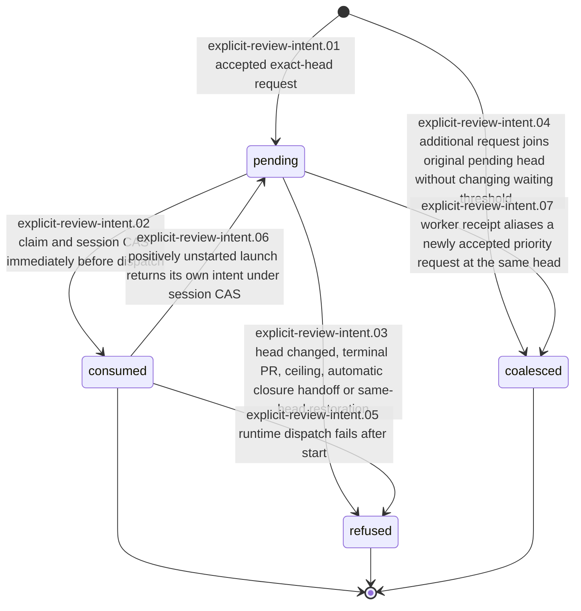
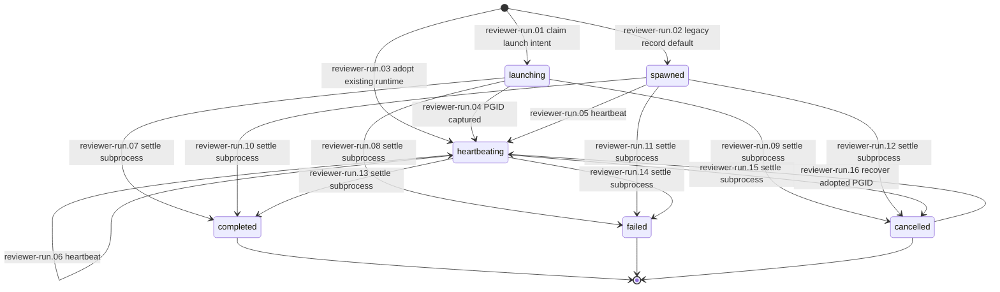
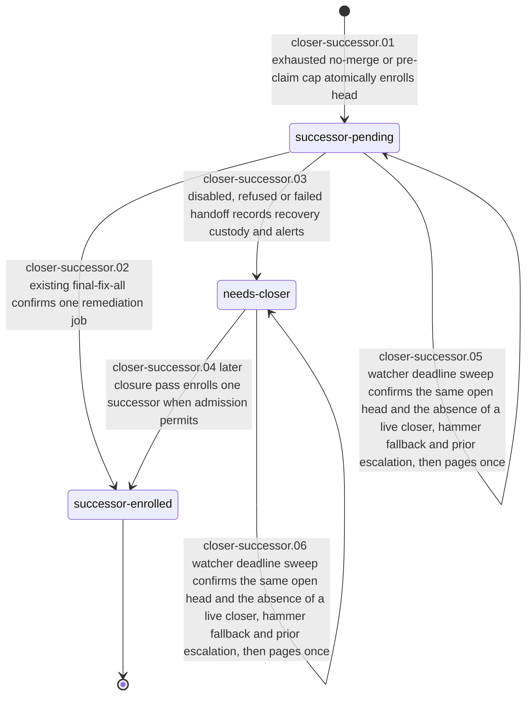

# State machines and smoke verification (SMV v1)

Retained final-fix verification follows the matching repair owner key from its
recovery launch to the managed pushed-head attestation and exact-head review.
The original failed job stays `never-spawned`.

Terminal HAM review proofs retain any-head operator vetoes. Permanent issuer
gaps return `terminal-review-issuer-unverifiable` with operator custody; transient
reads retain the five-minute recovery delay. GraphQL bot identity matches REST.
In-lane proof reads abort within a load-aware 15–30 seconds and the remaining
command budget, without invoking transport. Existing lifecycle states and smoke
commands remain unchanged; focused coverage and deployment acceptance are in the
[standing review contract](RUNBOOK-ama-closure.md#standing-operator-reviews-and-the-merge-writer-lac-2305).

Automatic exhausted-head verdict requests remain pending while a matching native
merge lease retains custody. The watcher checks custody before dedup preflight
and capacity reservation, records a suppressed lane and leaves capacity wake
priority unretained. The claim fence rechecks the lease under its mutation lock
using liveness observed outside that lock; changed matching leases and
unavailable repository/lease state defer. Existing states, merge gates and smoke
commands are unchanged. See the
[lease service contract](RUNBOOK-ama-closure.md#leasefair-01-fair-merge-lease-service).

Remediation closer priority hints terminate without dispatch for unmanaged
repositories or missing PRs. Malformed JSON moves unchanged to `dead-letter/`
under the queue directory and stays excluded after watcher restart; filesystem
and decision errors retain retry custody. Offline coverage is in
`test/remediation-closer-queue.test.mjs`. Existing smoke commands are unchanged.

Classified transient closer history stops record `history-read-failed` with
the class in audit `reasonDetail`; the audit is `deferred` and enters the
watcher's existing inconclusive retry. Permanent history stops remain counted.
Non-history primary-change helper failures retain a terminal failure audit.
Focused offline coverage runs the audit CLI and controller fixtures in
`test/finalclose-01.test.mjs` and `test/hamcontrollerscript-01.test.mjs`.
Existing smoke commands are unchanged.

When the watcher reconciles an ended `canonical-validation-deferred` launch
whose retained custody requires operator action, it appends a `park`
continuation to each matching latest deferred audit across the dispatch and
current heads, including when custody and audit use different heads. A hold
belonging to another launch alone cannot park this launch's audit during
reconciliation. The original attempt and audit status are preserved, and the
park attempt carries forward `reasonDetail` and `overloadEvidence` when present.
The early audit checks its resolved head, the validation remote head and the
dispatch target in order, skipping clean holds to find custody requiring a park.
This early check is PR/head-scoped, not launch-scoped: a non-continued dirty
hold from an earlier launch can park the current launch's audit even if its
own hold is clean. The audit's launch ID identifies the reporting launch;
inspect the candidate heads' custody markers for the owning `launchRequestId`
and evidence path before recovery. Reconciliation retains the launch filter above.
Confirmed cleanup of clean source
matching the target retains the existing watcher backoff. Offline coverage is in
`test/inconclusiveretry-01b.test.mjs`. Existing smoke commands are unchanged.

The PR's remediation budget charges a closer launch when it publishes a
distinct head or reaches a substantive terminal. An unpublished infrastructure
deferral spends zero. The next watcher pass recomputes historical charges from
launch-bound evidence and preserves explicit operator custody. After ordinary
deployment, check natural backlog and closer outcomes for recovery without
operator repair. [SEV1 report](postmortems/SEV1-ROUNDBUDGETDEFER-01-unpublished-closer-rounds-exhausted-review-budget.md)

The recovery check includes automatic handoffs with both a completed re-review
and an unpublished closer exit. A genuinely exhausted re-review cap still holds.

HAMCIAUTH-01: a validation timeout or load stop with no local failure, on a
clean committed head, in a repository with declared required contexts, defers
validation to the exact-head required GitHub checks, including under the hammer
controller and with partial coverage. A controller-stopped round is re-judged
from its final check receipt after the controller confirms drain. Late failed
checks or process-inspection refusals keep custody. The launcher reads the
current conflict binding and can run one fresh round after interruption or an
explicit local-validation deferral. The watcher releases qualifying published
source custody under lock using launch-bound cleanup and finalized exact-head
checks. For old controller cleanup receipts, the watcher verifies the original
run and persists the finalized proof before release. Offline fixtures verify
recovery on a later pass and custody when original evidence is unavailable.
Queue-v2 admission preserves the authenticated audit's UNKNOWN result,
so configured no-CI proof cannot authorize merge. Offline coverage is in
`test/hamciauth-01.test.mjs`, `test/hamcontrollerscript-01.test.mjs` and
`test/finalization-queue-production.test.mjs`. Deployed smoke commands are unchanged.

Merge-ready exact heads with durable identity absence retain page ownership
under `daemon-identity-absent-parked` and record one stable park observation per
pass. Unverified exact-head attestations retain the fail-closed hammer handoff.
Focused offline coverage is in `test/interactiveprident-02.test.mjs`; the reviewed
orchestration projection is refreshed without changing the lifecycle graph or
existing smoke commands.

Reviewer pass outcomes become terminal before delivery handoff and asynchronous
token accounting. Late accounting enriches the same session atomically while
retaining its terminal outcome, end time and final review evidence. Primary and
fallback passes keep distinct ledger attempts and artifacts. Reaper transactions
recheck pass state before charging delivery or recovery budgets; existing
reattach recovery handles interruption before delivery settles and retains live
owners. Offline coverage is in `test/reviewer-pass-settlement.test.mjs`. Existing
smoke commands are unchanged; passive deployment acceptance is declared in
`post-merge-verify.json`.

Absent runtime head inputs omit the optional pass-completion head fence.
Posted-success recovery removes persisted and incoming failure metadata; timeout
recovery preserves attribution added after its scan. The spawn's outer `finally`
reclaims in-memory and persisted spawn records even if outcome and error
settlement both throw. Focused offline fixtures cover these boundaries.

Watcher startup reaps stale `launching` agy holder records regardless of the
current identity/runtime plan, including undeclared owner-only pools and runtimes
that no longer lease agy holders. This uses the existing `launching → failed`
transition; verified live leaders retain their records. Offline coverage is in
`test/agystalelaunch-01.test.mjs`; existing smoke commands are unchanged.

Follow-up admission defers to observed live HQ PR owners and unreadable
ownership evidence without leaving `pending` or charging a round. A durable
filename cursor rotates the scan after each exhausted 25-lookup budget, so later
jobs receive lookup opportunities across passes and restarts. The spawn path
re-asks HQ just before the worker starts and returns a claimed job to pending,
budget neutral, while HQ reports a live or unreadable owner. Offline coverage is in
`test/remediationowner-01.test.mjs` and `test/remediationowner-01-spawn.test.mjs`. Existing lifecycle states and automated smoke
commands are unchanged; source validation does not prove deployed exclusivity.
See the [queue contract](data-model/follow-up-jobs.md#live-pr-owner-admission-snapshot-remediationowner-01).

Alternate-owner workspace and publication authorization refusals record
`remediation-owner-auth-hold`. Workspace and publisher reads use the
reviewer's declared App role carried on the follow-up job. The role is
recorded independently of the execution model. Before spawn the claim returns
to pending without charging a round. After publication refusal the stopped job
retains the local commit and workspace. The runtime owner verifies launch and
publication separately after delivery. See the
[follow-up runbook](follow-up-runbook.md#alternate-owner-follow-up-git).

Closer intents use distinct per-attempt worker IDs. A terminal launch and its
complete terminal retry chain release closure ownership independently of retained
directory teardown; live, parked, unknown and replacement owners still hold.
After deployment and the registered watcher/follow-up restart, SRE verifies PID
start times and a natural failed closer getting its next closer or queued
re-review within one pass without a retry-directory collision. Existing lifecycle
states and automated smoke commands are unchanged.

Consecutive nonblocking-cap refusals remain `stopped/max-rounds-reached` and
carry an actionable `finalCapResult` for operator canonical rescue. The result
records the nullable job revision at stop time and finding accounting and
explicitly says no successor was dispatched. Requeue, infrastructure release,
admission and later stops clear old evidence. Consume emits the structured
`remediation.final_cap_operator_action_required` warning for the refused claim. Offline coverage is in
`test/finalcaphandoff-01.test.mjs`; after deployment, passively inspect the next
natural cap refusal for that result. Live rescue and loaded revision proof
remain operator work. See [the queue contract](data-model/follow-up-jobs.md).

The follow-up daemon repairs missing or unrecognized code-PR builder tags from
agreeing recorded PR authorship before remediator selection, and persists
canonical forms of legacy tags with recovery evidence. Unavailable PR or transient
opener reads requeue for 60 seconds without spending a remediation round. Settled
missing or conflicting evidence transitions the claimed job to `stopped`, with a named
operator owner and escalation/retrigger action in its stop receipt and output.
Recovered jobs retain the cross-family remediation requirement. The existing
explicit retrigger transition resumes these stops after evidence correction.
Grok subject-policy refusals before spawn, including after assignment, also
transition to `stopped` with `subject-refused` and an operator correction/retrigger
action under the existing cap; they create no quota hold or automatic retry.
The [follow-up job model](data-model/follow-up-jobs.md) describes the receipt;
deployed smoke commands are unchanged.

Review verdict consistency is enforced before closure: disagreement between
Blocking issues and Verdict yields `verdict_inconsistent: true`, request-changes
and an unknown blocking state. The reviewer consumes one durable reservation per
PR head before reconciliation. Repeated inconsistency or unavailable recovery
retains a blocking review and operator notice. Chunked and caller-post reviews
share this budget. The recovery receipt moves from `reserved` to `reconciled`
or `operator-required`; interrupted reservations stay consumed. Watcher lifecycle
values and deployed smoke commands are unchanged. See
[reviewer verdict recovery](data-model/reviewer-verdict-recovery.md).

HAMEMPTYPRIMARY-01 preserves author commits before conflict-only publication;
its local proof does not alter lifecycle states or merge authority.
When that proof stops with `conflict-primary-unproven`, the watcher queues
one builder-tag-routed remediation per PR head before further closer admission.
The job's `closureHandoff` records the reason and full-review requirement.
Pending remediation owns that head through admission delays; its new pushed
head returns to normal review. Timeout retains the existing closer retry.
See [the handoff contract](data-model/follow-up-jobs.md#conflict-primary-handoff-hamconflictowner-01).
Offline Git
fixtures establish source behavior. The runtime owner separately observes the
next natural replay after normal deployment, retaining the primary, exact head,
checks, authenticated audit and custody outcome as declared in
`post-merge-verify.json`. [LAC-2159's SEV3 report](postmortems/SEV3-HAMEMPTYPRIMARY-01-LAC-2159.md)
tracks pending organic acceptance; no production probe is added.

BASEFETCH-01 preserves closer states and merge gates while isolating base
capture and distinguishing invalid validation evidence from fetch failure.
Existing smoke commands are unchanged. After the build manager confirms float
and watcher restart, natural-traffic acceptance follows the closure runbook's
verify-head change note; offline fixtures do not establish runtime recovery.

CODEXHOMEISO-01 keeps the existing bounded infrastructure-refund transition for
prefixed Codex tool-host failures and complete in-run timeout evidence with no
executed command. Native Codex remediation, reviewer and discovery processes use
isolated reviewed config homes with existing auth/model/security contracts.
Discovery retains the base OAuth path, local sessions persist independently of
credential materialization, and HQ log classification uses worker class. Missing
worker records defer refunds; reviewer preparation errors clean service homes.
Native spawns fetch a catalog using their own binary and staged auth. Local
remediation requires the direct-tools catalog and pins its direct-tool feature
settings at exec. Direct Responses Lite launches omit standalone web search,
and declared regular Responses capabilities can use cached hosted search.
Reviewer execution and discovery preserve the selected binary's catalog
metadata, with a CLI override for reviewer exec and server fallback if seeding
fails. Native reviewer exec failures retain bounded,
redacted terminal diagnostics for the existing failure classifier and recovery.
LAC-2131 requires the selected CLI to recognize ChatGPT auth in the isolated
file store before catalog retrieval or execution; auth failure uses the existing
OAuth preflight failure state. Broker refresh stays separate, staging ownership
is preserved, and matching terminal-worker receipts remove service auth while
retaining sessions. Dummy-only offline CLI/file-store and serialized-reconcile
fixtures cover these boundaries. Source review/merge, parent pointer and
deployment precede the separate organic recovery proof.
Offline fixtures cover these boundaries and refund behavior. After ordinary deployment,
SRE observes the next organic direct remediation's source work, re-review
request, isolated `CODEX_HOME`, config digest and pinned catalog.
See [the workspace runbook](RUNBOOK-reviewer-workspace.md). No new smoke
command or CI check is added.

HOSTOBSDENIAL-01 keeps registry entitlement denials and not-found replies in the
existing failed state as configuration faults, outside infrastructure retry and
auto-recovery budgets. Timeouts and unavailability retain bounded retry behavior.
Synthetic host-observation refusal fixtures cover redaction, sync diagnostics,
terminal settlement and recovery after a successful async read. Existing smoke
commands and merge authority remain unchanged.

CLOSERORPHAN-01 reclaims a self-owned closer worktree lacking launch metadata
only after the current PR/head has settled `no-launch` evidence from a successful
empty idempotency-key query. The host receives one teardown request without
`--force` before a replacement intent overwrites that proof. Refusal retains
custody and the proof, with one structured event per unchanged host reason
across polls/restarts; success resumes ordinary dispatch. Plain unknown and
launch-bound runs retain their existing holds and settled proof before any
replacement intent is written. Synthetic branch-holder and
dispatch-priority fixtures cover recovery and refusal. Lifecycle states and
smoke promises are unchanged; deployed recovery awaits natural observation.

CLOSERCUSTODYLRQ-01 resolves self-owned closer custody from its durable launch
receipt before worker observations or replacement intent publication. The
lease also retains worker identity and dispatch time through terminalization.
Terminal launch/retry evidence permits host teardown with `--force` to bypass
the open-PR guard, followed by the next budgeted dispatch. Host custody checks
remain mandatory; live/parked launches retain custody and launch-read outages
keep the bounded wait/page and receipt across restart. After deployment,
restart the watcher; SRE verifies a natural terminal hammer release within one
tick, with launch ID/status/reason in the reclaim event and another dispatch
when budgets permit. Synthetic dispatch-priority fixtures cover this path.

CLOSERDEADSLOT-02 resolves a self-owned closer's recorded slot launch through
the public workspace inventory when dispatch-files cannot identify it. A single
matching terminal ledger run permits ordinary host teardown, including a failed
`spawn_never_registered` run missing from worker-id observations. Active,
ambiguous, mismatched or unreadable evidence holds custody; deferred events name
the liveness reason and known launch ID. Host teardown refusal prevents another
dispatch into the retained slot. The no-launch orphan bridge is unchanged.
Focused synthetic dispatch-priority fixtures cover release and refusal; no new
lifecycle state or smoke promise is added. Natural deployed recovery remains an
operator observation after normal deployment and companion CLOSERDEADSLOT-01.

TIMEOUTSWEEP-01 scales nominal hammer/closer operation waits with host load.
Timeouts retain unknown evidence and next-pass recovery; failed companion reads
cannot reuse a stale closed/merged classification, and uncertain teardown cannot
claim removal or authorize a disk fallback. Existing lifecycle states and smoke
promises remain unchanged. Offline coverage is in `test/timeoutsweep-control.test.mjs`
and `test/companion-stop-wait.test.mjs`; see the
[inventory](architecture/ARCH-control-path-timeouts.md) for follow-up surfaces.

CIBLOCKINFRA-01 keeps zero-step and Actions billing/quota failures in a bounded,
visible CI wait without spending remediation rounds or arming automated stops.
One durable workflow/head rerun has a CI recovery owner; repeated blocks page
the operator. Proven publications and unpublished commits precede holds; stale
waits clear under lock and max-rounds stops stay charged.
Successful current-head replacements release only infrastructure-only old stops,
with one-time audit refunds; real and mixed failures keep their normal handling.
The existing disposable `smv-refusals` smoke covers the wait, bounded rerun, recovery and real
failure distinction. Focused offline evidence is in
`test/ci-infrastructure.test.mjs`; runtime owners verify the recorded wait and
refund reasons after normal deployment using the
[runbook](RUNBOOK-ama-closure.md#actions-billingquota-blocks-ciblockinfra-01).

CIBLOCKRESUME-01 makes `hammer-context` and the verify-head closing phase record
`failed-without-merge` / `ci-infrastructure` with exact-head failed-check evidence
and end the round before acquiring a merge lease. CI capacity is never an HQ
decision. Successful replacements for all recorded failures plus the ordinary
required-context classifier release the stop. In that same watcher pass, local
custody for a matching legacy `blocked_needs_decision` launch is retired under
the PR intent lock and lease CAS, then normal closure selection runs again.
Unknown descendants, active retries, unrelated launches, moved heads, missing
checks and real failures retain their existing safety behavior. This changes
ownership only; every merge predicate and lease remains mandatory.
Historical stops with missing steps use the evaluator's enriched exact-head
result for that same custody release without rewriting the audit. Failed job
evidence reads remain unknown and retry after a 60-second process-local cache
TTL keyed by repository, head and job URL. Offline regressions cover a real
parked dispatch record and lease; existing lifecycle edges and smoke promises
remain unchanged.

The failed-job rerun requires fresh exact-head zero-step capacity annotation
proof for every unsuccessful job in each affected workflow, including optional
siblings, since `rerun-failed-jobs` affects the whole run. Annotation-only proof
can come from the job's check-run annotations endpoint. Unannotated zero-step
failures still wait as infrastructure but do not authorize a rerun. Incomplete
job pages refuse recovery. The durable one-rerun workflow/head bound remains;
a consumed retry is never replenished by capacity returning.


RCV-08 adds permanent no-work charge/refund receipts and serialized hammer budget
accounting. The existing launch-terminal reconciliation edge now requires the
RCV-07 versioned verdict for full refunds; terminal PR and hammer review authority
remain unchanged. Focused offline `ama-hammer-retry-cap`, `ama-dead-hammer-rearm`,
`hamrefund-01`, `closerreuse-01-replay`, `session-ledger-read-adapter` and
`load-aware-operational-waits` fixtures cover accounting and waits. Existing smoke
promises remain unchanged. After normal deployment, the owner runs the separate
[read-only activation probe](RUNBOOK-ama-closure.md#recovery-no-work-accounting-rcv-08);
missing runtime observations remain pending for RCV-09 operator activation. Wait
evidence retains the latest actual dispatch snapshot with its own 24-hour age
limit when a later recovered charge has no snapshot. This verification promise
lives in `post-merge-verify.json`; RCV-08 introduces no new state machine.


LAC-2100 changes Gemini timeout allocation within the existing aggregate ceiling.
Current-head review, cross-model selection, verdict validation and merge gates
remain required. Lifecycle states and disposable smoke promises are unchanged;
focused offline fixtures cover observed sizing, saturation, allocated agy print
timeouts, parent/lease budgets and ownership fencing. Read-only organic acceptance after normal deployment is
declared in `post-merge-verify.json`; see the [RCA](RCA-LAC-2100-chunk-budget-2026-10-24.md).

FINDINGSBATCH-02 retains non-blocking findings in the existing SQLite review
store and cuts capped batches until all eligible open findings are assigned.
There is no per-area active or daily ceiling. Severity and age determine priority;
HQ normal-priority admission owns worker capacity and budget. Claims and
collection run hourly by default; local environment settings configure cadence,
size and the oldest-open alert bound. Applied findings require a marked result PR
that is merged or open on a head attached to the review pipeline. Drops require
a fixed reason code and current-main justification; already-fixed drops verify
the merged fix PR and out-of-scope drops cite a ticket. Empty outcomes fail.

Decision-only preparation pushes tested fixes; one PR-shaped follow-up publishes
on that same branch. Nullable repository metadata and absent push milestones are
handled using keyed launch evidence and the actual remote branch/head. Native
absolute workspace repository projections are display metadata; repository
authority comes from the exact public keyed launch identity and independent
remote tested-head or marked-PR evidence. No workspace field is required. Historical invalid outcomes require
owner adjudication under the [bounded recovery procedure](follow-up-runbook.md#findings-batch-publication-custody-findingsbatchcustody-01). Explicit
failed pushes or failed preparation still refuse publication. Durable batch IDs,
launch receipts, a per-batch lock and submission intent fence duplicate workers
and publishers. With no publisher row and all keyed launches terminal, an intent
past its recorded dispatch timeout plus a 10-minute grace permits one atomic,
same-key publisher resubmission. Configure the positive grace in milliseconds with
`ADVERSARIAL_FINDINGS_BATCH_PUBLISH_RECEIPT_GRACE_MS`; legacy intents use file mtime.
Unreadable evidence and live launches hold custody; any publisher receipt fences
resubmission. A second absence retains the existing stale release/requeue path.
Existing failed publishers stay visible for same-launch repair. A single validated
marked branch PR recovers a missing artifact PR number/head after publication.
Numbered outcomes ordinarily skip further preparation status reads. A launched
batch with a recognized historical V8 settlement JSON error first verifies terminal preparation,
then clears the legacy error once numbered outcomes are valid. Numbered legacy
artifacts retain custody if the old preparation status has an invalid shape or
contradictory launch/repository identity; they retry rather than release or publish.
Unrelated diagnostic prefixes and JSON-position suffixes do not trigger recovery. Empty or
malformed GitHub or HQ preparation-status stdout, and literal `null` from a
GitHub publication read, retain batch custody and log the
operation and byte count. GitHub PR view, PR list and branch-ref JSON reads retry
twice locally after 50 and 100 ms before deferring. Failed reads preserve the
stored error and attempt counts. Strictly past the batch timeout, they record
`batch-publication-read-malformed` in `hold_json` for the existing held-batch
alert; repeated failures retain the original hold time. Definitive legacy
recovery failures follow ordinary release rules. Persistently malformed
outcomes and malformed publisher intents record errors for the existing
timeout and terminal-custody release path. Empty, malformed or null decision
supersession stdout retries the bound lifecycle operation on the next pass,
allowing an already canceled source to re-emit its receipt. It uses the same
overdue read hold; a valid but mismatched receipt remains a hard receipt error. After
normal deployment, the runtime owner
observes ordinary collection for eligible legacy errors settling to their
existing PRs, checks for fresh JSON parse errors in the batch error summary and
retains any naturally occurring overdue read hold in the existing health receipt.
Offline fixtures cover local retry exhaustion and canceled-source receipt recovery;
no additional live smoke action is authorized.
Simplicity advisories keep their final-review enrollment and validated outcome
rules, sharing the cap and marked result PR with findings. Failed initial dispatch
subprocesses retain the same batch/key for retry, even after the batch timeout,
without consuming finding attempts or resetting invalid-receipt charges. Legacy
raw command failures reset the old dispatch counter once. Only successful dispatch responses with invalid receipts
consume the three-response dispatch cap; terminal/absent ledger evidence still
fences charged release. See the [release contract](data-model/review-findings.md#releasing-batches-whose-launch-ended-findingsrequeue-01).

After deployment, restart the watcher, then SRE runs
`node bin/findings-batch-backfill.mjs --root <review-root> --db <review-root>/data/reviews.db --concurrency 2 --batch-size 100`.
This is explicit and idempotent; concurrency bounds submissions while existing
HQ admission bounds running workers. The backfill waits up to five seconds for a
SQLite writer lock. No automatic deployment backfill runs.
For a frozen graded selection, add `--manifest <selection.json>`. This validates
the selection hash and reviewed-head pins, claims only selected real findings
from merged sources, and dispatches/collects only that selection's batches.
Workers still check applicability on current main. Settlement appends structured
grades; lifecycle and stale outcomes remain indeterminate. Omitting the flag
preserves the default drain. Selected rows remain excluded after release; only
an explicit selection rechecks consensus and retries them. The ticker collects
already-started selected work but never starts an undispatched selected batch.
Backlog health counts cover the automatic drain; `selectedBacklog` separately
reports per-manifest open, unbatched, errored and undispatched finding counts.
Rerun the manifest explicitly to recover failed dispatches or released findings.
See the [selection contract](data-model/review-findings.md#graded-selection-remediation).
`pipeline-health` JSON `nonBlockingBacklog` exposes open and unbatched finding
counts, oldest open age, applied/dropped by UTC day and batch error counts. Its
`progress` object (also printed by `node bin/review-findings.mjs backlog --db <db>`)
tracks the drain: `open` = `unbatched` + `batched` + `stranded`, plus `retrying`,
`exhausted` and `releasedBatches`. Drained means `open` is 0.
The existing alert path reports batchable findings older than 48 hours by default,
and any never-claimed automatic findings outside the merge-age window.
Released findings remain eligible for retry regardless of source age until
settlement or third-attempt exhaustion; selected findings still require their
explicit manifest. Health summaries use the same configured window as alerts.
Expired never-claimed findings, including ungraded work, can be previewed with
`node bin/review-findings.mjs retire-expired --db <db> --repo <owner/repo> --limit 100 --reason '<rationale>'`.
An operator-authorized repeat with `--apply` records an `out-of-window:`
disposition and terminal timestamp, retaining the source evidence. It excludes
owned, retried and selected work. No live execution is authorized by this change.
Unassigned excluded advice stays out of area counts and is reported separately
as `notesHistorical` and `notesOutOfWindow`; assigned advice stays monitored.
Within 24 hours, SRE retains a receipt showing the open backlog trends down,
visible applied/dropped daily counts and no evidence-format losses, including
the deploy-time `outOfWindow`, `notesOutOfWindow` and `notesHistorical` baseline.
See the
[batch lifecycle and recovery contract](data-model/review-findings.md#non-blocking-backlog-findingsbatch-01)
and `post-merge-verify.json`. No new CI check or smoke step is added.

DOCSFASTPATH-01 sends Markdown/image-only changes under `docs/` to the existing
daemon merge lane, with a signed docs-fast-path attestation and green exact-head
checks. Under the merge lease, every attempt revalidates live gates before
recording an attestation. Base tip advancement requires a fresh docs-only range
on the same base branch; terminal audit metadata records that refreshed range.
Explicit review requests keep full review, withdrawing the waiver with a pending
gate status at admission, classification or live merge checks. Failed withdrawal
retains the fast-path wait for retry. Pending checks and unknown mergeability
keep the docs waiver while the watcher rechecks the same head. A settled check
failure or definite mergeability refusal withdraws it and admits ordinary review.
The exact-head withdrawal receipt keeps ordinary admission active while routing waits.
Its gate-record flag survives reviewer assignment, running status and routing
reset, including nullish reviewer fields; new heads are classified independently.
Discovery wait rows use the existing pending state and stay out of the reviewer
queue until routing. Offline
regressions are in `test/docs-fast-path.test.mjs` and
`test/ama-daemon-merge.test.mjs`. Deploy the companion signer/ledger migration first.
SRE separately observes the next three docs-only merges within about ten minutes
of green checks, without reviewer/closer and with recorded attestations, plus a
non-docs change receiving review. See the
[closure runbook](RUNBOOK-ama-closure.md#docs-only-daemon-merge-docsfastpath-01).

Docs fast-path record failures release the merge lease and remain deferred.
The watcher preserves child stdin and observes subprocess rejection without
changing process handlers. Missing/invalid stdin fails promptly if the child
cannot be terminated; late rejection remains observed. Audit diagnostics include
the exit code (including zero) and a redacted stderr tail bounded to 2,000
characters, without repeated diagnostic suffixes. The exact-head audit allows
three failed record attempts with 60-second then 120-second backoff, then parks
as `attestation-record-retry-exhausted` with `needsOperator`. A new head starts
a new budget. These transitions are covered by offline fixtures; after deployment,
SRE verifies a natural docs-only merge records its attestation and the watcher
stays running. See the [closure runbook](RUNBOOK-ama-closure.md).


REVIEWSIMPLE-01 adds an optional simplicity/cost note to review records and an
observational applied flag to existing remediation completions/audit text.
The note has no lifecycle, verdict, strict-mode or round-budget authority.
Offline fixtures `simplicity-note.test.mjs` and `simplicity-note-prompts.test.mjs`
cover those boundaries. After normal deployment, the SRE session separately
samples the next 20 reviews, counts notes, and confirms none changed verdicts
or added rounds; this read-only observation is declared in
`post-merge-verify.json`, outside the smoke harness.

LAC-2093 bounds validation through `bin/hammer-validate.mjs`; LAC-2097 runs it
outside the shared lease. The absolute ceiling scales from 360 seconds.
The idle ceiling scales from 120 seconds and stays below the absolute deadline.
Either timeout returns 124 with validation unknown. A canonical deadline or an
explicit process-inspection no-verdict hands the current head to recovery once
and prevents another local battery on that head in the same run. After confirmed
cleanup, the close command can publish a completed conflict repair with an
UNKNOWN verdict and let the exact published head's required CI decide. If
required CI authority is unavailable, the watcher retries the published head
under a fresh lease. A validation stop that requires supervisor cleanup leaves
one fresh close round to publish after drain. Verify-head reuses a successful
local validation or confirmed CI deferral for the same published head. A
genuine local failure blocks publication. If the conflict repair's publication
evidence is blocked, the close reports `source-publication-refused`.
The no-verdict line applies only to `telegram-responder-guard`; quoted output
from other checks retains its result. UNKNOWN takes precedence over import-fault
fallback, while operator cancellation retains its outcome even with unconfirmed
drain. Across launches, the watcher records these deferrals as owned inconclusive
retries: full refunds, exponential backoff from the configured attempt threshold,
and one notification, using the existing last-phase receipt without a final
terminal-stop receipt.

A retained Telegram guard process-inspection refusal holds the exact target
for operator recovery, including when a previous watcher continued the source
hold. This refusal is ineligible for CI continuation. For an already published
SHA, standalone native recovery requires operator closure under the normal
merge gates. See the [closure runbook](RUNBOOK-ama-closure.md) for recovery and
hold release.

If the record for an observed ended inconclusive launch is unreadable, the
watcher holds that head's retry and sends one operator notice. Teardown paces
retention failures per hold and accepts continued custody with exact-source
publication.
Pytest reports real collection and test
phase boundaries and uses local ledger routing; explicit disposable-Postgres
test settings remain intact. Standalone TERM/INT/HUP cancellation initiates group TERM,
with KILL after five seconds even if its leader has exited. Standalone cleanup
after EPERM can finish when the child's pipes close and the group is absent
or a bounded census observes only exited members. A live member of any UID,
an unreadable census or unclosed pipes returns 125 and retains private scratch
for canonical teardown. Failure exits through
the existing lease-release trap before any validated-head audit or merge. Head,
base and file-overlap gates remain mandatory. Existing review-row and closer-lease
states and smoke promises remain unchanged. Offline regressions: `test/run-bounded.test.mjs`; deployment
acceptance and historical evidence: [LAC-2093](validation/lac-2093.md).
HAMCLEANUPEPERM-01 adds offline coverage for exact-head CI handoff after
confirmed standalone drain in `test/hammer-validation-deferral.test.mjs`.
After ordinary deployment, observe a naturally timed-out hammer whose
cleanup is confirmed, whose remediation is published, and whose PR closes
on green required CI for that same commit.

LAC-2093 recurrence: newly rendered closers run their persistent script through
`bin/hammer-controller.mjs run`. A private registration binds the exact HQ launch
to the shell group before execution; dispatched acquisition refuses an
unregistered shell. Validators share that group. HAMVALTIMEOUTFLAKE-01 requires
unreadable evidence as well as elapsed grace to record `launch-unreadable`;
a delayed poll with readable evidence cannot mask `validation-stopped`.
Terminal/parked launch evidence, failed launch reads past a bounded grace window
(HAMCTLPOLL-01; lease and merge steps still require a fresh permitted read, with
a bounded three-read load-aware gate budget that the unreadable grace
accommodates) and signals
transition `running` → `stopping` → `quiescent`,
or `cleanup-unconfirmed` on missing drain proof. Cancellation defers trap release
until confirmed drain; the existing full lease-generation fence protects other
holders. An empty census before the shell exit event waits for that event,
preserves the script's exit status and grants no signaling or lease-release
authority by itself. FD-4 handshakes correlate replies by per-request UUID and
advertise gate timeout budgets; stale replies cannot authorize a later step.
[Controller data](data-model/hammer-controllers.md) describes the
two-second TERM grace, one-second drain bound and retained scratch. Focused
offline `hammer-controller` tests extend source acceptance; the existing
`smv-handoff` smoke promise is unchanged. Deployed organic cancellation and
next-contender progress remain separate runtime-owner acceptance.

Source publication stops with `head-changed` when the live PR head advances
beyond the local candidate, or `source-publication-refused` when source or
ownership evidence is unavailable. Both preserve local work and release
custody through the controller. Git fallback requires an explicit
pre-mutation decision and independently verifies the exact source lease.
For divergent histories, missing or malformed `HAM_BASE_HEAD` is a source
refusal; a valid different source is `head-changed`. A failed API mutation
re-reads the source branch to classify movement without claiming a foreign
head or clearing uncertain custody. Local rewrite proofs cover only exact
replays or the exact conflict-repair head, with no subsequent commits.

Supported canonical CI-mirror checks inherit the registered group. A deadline
stops the battery and requests bounded cleanup by the controller. Private
command logs are retained beside the validation receipt as output arrives.
Use the controller registration to verify drain and the validation receipt
to inspect the retained failure, including when the close result is missing.

LAC-2108 restores the controller's required read-only census inside the macOS
worker boundary: the packaged stdlib Python helper reads one kernel-filtered
`kern.proc.pgrp` sysctl snapshot of exact PID/PGID/birth records (the records
`ps` reads, with no same-user restriction on setuid members), while owner
assertion uses `getpgid`. Darwin never executes setuid `/bin/ps`; a refusal
names the helper and states that no operator process-introspection change is
needed. Python resolves through the existing `HQ_PYTHON3` / `AGENT_OS_PY` /
`python3` convention with isolated imports. Both operations retain a two-second
bound; denied, incomplete or inconsistent evidence fails closed. Other hosts
retain `ps`. QCP-08 keeps one helper per controller round: each tick sends it a
request and gets a fresh kernel read, so the round no longer starts a Python child
per tick. No sandbox or ledger policy changes. Actual-provider offline tests
cover readiness, exit 7 and complete matching-group drain; [RCA and acceptance](validation/lac-2108.md)
separate those fixtures from loaded organic worker proof. Existing lifecycle
states and the `smv-handoff` smoke promise are unchanged.


Launch evidence uses the pinned SDK 0.4.0 `readDispatchStatus` and public
`statusVocabulary`. Explicit terminal/succeeded false values win independently;
missing booleans fall back to vocabulary. Legacy launch aliases remain unknown.
The SDK artifact is installed through the npm lockfile before service startup.
Offline consumer regressions use its recorded token-refresh, fleet-quota,
worker-class and launch-row examples, with per-producer version/hash diagnostics.
See the [fixture refresh procedure](producer-contract-readers.md#recorded-producer-examples-lvr-10).
Wire-only terminal evidence is recorded even without a status string: closer
records use `succeeded` or `failed`, and explicit `succeeded: false` prevents a
success record. Merge cancellation may confirm terminality without a status
string; remediation success requires both terminal and succeeded evidence.
These observations do not prove that a PR merged.
Wire-only terminal ledger rows also override stale `starting`/`running` worker
observations and enter final-cap reconciliation. Successful launches persist
`lastObservedStatus: unverified-terminal-success` until independent closure
evidence is available; launch success alone never proves a merge. Merge-agent
retry predicates resolve missing statuses to `succeeded`/`failed` only after
terminality is confirmed, retaining the existing retry budget and label gates.
Normalized terminal events retain both SDK booleans; status probes accept
wire-only evidence and preserve explicit false values. Terminal wire evidence paired with an active or
unknown status string is persisted as `succeeded` or `failed`, rather than an
active closer status. Merge-agent phantom-handoff reconciliation and pending
comment retries project `status: succeeded` with explicit `succeeded: false`
as `failed` before crossing the status-string boundary.
Decision-blocked and waiting launches release active closer leases and capacity,
while their dispatch receipts retain PR ownership through decision resolution
and resumed execution. Resumed workers fence both redispatch and inline daemon
merge on subsequent polls until confirmed terminal launch/retry evidence.
Positive resumed execution also restores fleet capacity accounting, including
when the deferred lease was rekeyed to the worker's new head.
Confirmed terminal ledger evidence overrides a stored parked observation;
unknown ledger evidence preserves parked ownership.
GSR-03 `suspended` launches are non-terminal and unparked: their closer lease stays
`dispatched` and held until resume, operator abandon or the ledger age bound.
GSR-07 boot-time resume re-adopts it for a resumed launch, rebinds it (and the
dispatch record) to a re-dispatched successor, or releases it once the ledger
proves the launch and its retries no longer own the PR (`bin/gsr-closer-lease.mjs`).
Parked, live and unknown evidence retains the dispatched lease. Successor
rebinding searches all retained lease heads for the source dispatch record.
The release CLI prepares its authenticated dispatch-read session before probing;
bootstrap failure preserves the lease and exits nonzero. Mutation collisions
report aggregate `busy` when no lease changed. Targeted offline regressions are
in `test/gsr-closer-lease.test.mjs`; existing smoke promises remain unchanged.
Producer-terminal decision states retain ownership; wire-only live probes with
no status string return an `unknown` wait reason without interrupting arbitration.
The offline `test/hq-dispatch-status-json.test.mjs` uses public SDK serializer
examples across reviewer, remediation and merge-agent boundaries, including
negative false/alias/malformed mutations. `test/agent-runtime-os-dispatch.test.mjs`
covers the app-contract projection, including nested live status and explicit
false precedence. The `test/launch-request-status.test.mjs` table covers every vocabulary
status, wire precedence, retry descendants, and parked/resumed ownership without a
second dispatch. The clean sandbox smoke also verifies repeated resumed-owner
fences and terminal release. No live action or configuration change is required after deploy.

LAC-2082 adds one selected-role broker remint and identity re-pin when required
PR-context capture rejects a reviewer credential. Existing lifecycle states,
outage settlement, budgets and smoke promises are unchanged. After normal
deployment, verify a naturally scheduled context capture and exact-head review
posted under that bot identity using the
[owner runbook](RUNBOOK-gemini-reviewer-app.md#required-pr-context-reads-lac-2082);
source publication alone is not live recovery.

HAMATTEST-02 records authenticated hammer publication provenance before CI can
stop a run. Pushed edges carry the reviewed verdict through the same chain
reader as validated edges; exact-head CI remains mandatory. An explicit
`rereview-exact-head` decision executes through the existing pending-review
transition and per-head orphan reservation as soon as ownership is certainly
absent. The reasons persist in watchdog evidence. The clean sandbox smoke
checks that closure ownership honors that head-bound decision even at the review
ceiling, and carries an attested clean verdict into ordinary merge eligibility.
Immediate review requests start the ownerless idle clocks; a failed or refused
request reaches bounded review recovery and one exhaustion page. Known API
publications survive scratch-sync failures without a fallback push, and transient
post-rebase snapshot reads retry within the update-branch cap.
No lifecycle states are added. Focused offline acceptance is in
`test/hammer-pushed-attestation.test.mjs`, `test/remorphan-01.test.mjs` and the
rendered publish/rebase and watcher claim-loop fixtures.

Review-body capture records individual findings and remediation evidence in
`data/reviews.db`. The read-only JSON command
`node bin/review-findings.mjs show --db <database>` exposes them to corpus
readers. Bounded, offline `backfill` and `link-job` commands repair historical
records from stored bodies and jobs. See the
[finding data model](data-model/review-findings.md) for schemas, cursors,
attribution limits and replay instructions. Finding statuses are historical
read projections; existing lifecycle transitions and smoke promises are unchanged.
Reads batch linked evidence in three queries per populated page; attribution
uses one multi-path diff per commit. Disputes wait for a posted comment and
nonempty evidence head, and CLI failures retain their diagnostic on stderr.

REMEDBRANCH-01: follow-up creation holds unresolved PR head branches in pending
and retries without a worker or round charge; three failed lookups stop for
operator inspection, with explicit requeue resetting the attempt budget. The
handoff smoke checks hold, bounded exhaustion and recovery. Settled clean reviews
bypass branch reads and legacy branch holds;
the handoff smoke verifies settlement without a worker or round charge and
that unchanged workspace HEADs cannot acquire publication debt from reply hashes.
Reviewer pass/run metadata preserves branch and builder tag across
runtime paths. A `committed-unpublished` stop retains the local commit/workspace,
names the local commit and observed live head, and reports failed publication
without an operator-decision notice. Stable patch equivalence can prove a rebased
live head from a stale worker checkout. On failed current-head CI, proven stopped
debt recovers under the queue lock: validated final completion restores hammer
ownership, or the remaining normal round budget owns the regression. Recovery
preserves spent rounds and the original cap. HQ publication uses the
repository selected by the launch owner's status and verifies the live PR
and destination ref. Incomplete evidence retains the publication debt, and a
conflicting terminal destination preserves the source job.
See the [queue contract](data-model/follow-up-jobs.md#branch-and-publication-contract-remedbranch-01).

PRM-06 activation requires a read-only `hq fleet quota status --json` check on
the deployed producer before a submodule bump or reader deployment: both
`openai-oauth` and `openai-oauth-corp` floors must contain measured weekly
objects with finite numeric percentages in [0, 100]. Hold activation otherwise.
Repeat after deployment, inspecting probe/broker state and account hold reasons.
Weekly reset/expiry can hold accounts until the next successful weekly probe;
unknown evidence alone does not trigger AFH fallback. This live check is separate
from the unchanged offline smoke promises. See the [activation contract](producer-contract-readers.md#activation-and-verification).

OPDECPAGE-01: operator-decision notices observe closure ownership without changing
lifecycle states or merge authority. In-flight hammer launches and pending retries
hold delivery at any age; the idle backstop scales from 45 minutes with host load.
Pages name `no-route`, `retry-cap`, `non-retryable: <outcome>` or `backstop`.
NOTICEHOLD-01: a current next action owned by the remediator holds its notice
only while a pending/in-progress remediation job exists, including historical
`inProgress` status. A stopped, failed or missing job releases `no-route` immediately,
with the recorded stop or failure details and decision needed.
A retained `remediation-job-missing` route is ownerless for accounting; it cannot
claim an active hammer lane. Closer-owned work with a live closer still holds.
See [operator decision notices](follow-up-runbook.md#operator-decision-notices-reviewnotice-01).

LIVEPACKREMEDIATE-01: registered waiver findings page immediately on the
current open reviewed head, even while other findings have an active remediator.
Reviews with ordinary blocking findings keep remediation ownership and preserve
intended pack edits. Advisory notes do not prevent a hold when all blocking
findings require waivers. Closure then parks as
`operator-label-required:<label>` without waiting for a missing remediation job.
A fresh review observing the waiver returns to ordinary closeout; real operator
decision stops retain `remediation-stopped`. Existing smoke promises are unchanged.

ITP-11: Gemini logins are token holders for `gemini-reviewer`. Durable holder
claims fence independent watcher admission, retain live processes across
restart and terminal run states, and preserve auth-probe backoff. Cleanup or drain
failures retain the durable claim; dead-owner recovery retries workspace cleanup.
Release retains its local receipt and admission guard until durable persistence,
so overlapping readiness passes recognize the watcher's own claim.
Terminal records without PGIDs do not hold admission, and proven recycled PGIDs
are excluded by start-time identity checks. The clean smoke exercises two synthetic
holders under one identity, refuses a third independent lease, verifies durable
cleanup/drain fencing, retains the local receipt during an in-flight release
and concurrent readiness, re-admits a terminal pre-spawn failure, and starts
authenticated recovery immediately after a failed review releases a drained
holder. A successful probe for an obsolete declaration keeps admission fenced
without adding authentication backoff.
When the raw pool mapping has no `gemini-reviewer` entry, the holder plan keeps
`reviewer.gemini.identities` (or the HQ owner) even if another role's pool is
invalid or conflicts with a legacy account policy. Declared reviewer pools
still fail closed, including mismatched legacy holder order. Conflicts warn as
`pool-config-conflict` with only the key path, once per key per process.
The scoped reviewer config cache cannot weaken ordinary config validation.
AGYPINNEDDRIFT-01: each readiness pass calls Agent OS's read-only
`agy-reviewer-identities currency` command for the same pinned-copy warning
contract bootstrap uses. Drift alone keeps serving with `pinned-copy-stale` in
snapshot warnings; security and auth failures retain isolation. The existing
alert outbox deduplicates the sorted drifted file digest fingerprint across
holders and watcher restarts. The notice names the operator-only commands
`sudo scripts/setup-reviewer-os-user.sh --apply`, then
`sudo scripts/verify-reviewer-os-user.sh --user <user>` from the deploy checkout.
Matching copies clear the warning; unknown currency is separately visible as
`pinned-copy-currency-unavailable`. Deploy the companion Agent OS command before
this reader; no automatic root repair or service restart is performed.
Synthetic regressions are in `test/agy-reviewer-identities.test.mjs` and
`test/config-token-pool-migration.test.mjs`; existing smoke promises are unchanged.
Operator cutover still requires ITP-19 approval;
model-ID/display-name declaration compatibility must be resolved first. See the
[Gemini holder runbook](RUNBOOK-antigravity-gemini-reviewer.md#gemini-reviewer-token-holders-itp-11-ccx-08-compatibility).

HAMMERQUOTAREAD-01: quota status retries may use a snapshot under ten minutes old.
Missing usable evidence defers before launch with the resolver's hold reason in
AMA audits; no new launch state is introduced. After deployment, inspect
`harnessResolution` for evidence source and age when investigating quota holds.

BRANCHPROBE-01: null head-repository metadata requires Git confirmation before
branch-missing abandonment. Failed confirmation reuses the transient dispatch
state, releases the unlaunched pending lease and preserves retry budget for the
next poll (30-second hint). The handoff smoke verifies confirmation and recovery;
after deployment, existing branches must never receive `live-head-branch-missing`.
Unidentified forks retain a per-head six-hour window, then stop in `no-dispatch`
with `live-head-fork-unresolved` and require operator inspection. The smoke also
verifies expiry preserves launch budget and prevents further same-head probes.

MERGESIGNAL-01: after head advancement, only a merged completion signal for the
target head can settle closure as succeeded. An obsolete reviewed-head signal
follows the absent-signal path and cannot suppress target hammer dispatch.
The offline `ama-closer-dispatch-priority` fixtures verify target dispatch,
lease outcome and one mismatch diagnostic; existing smoke promises are unchanged.

[state-machines.json](../state-machines.json) declares owned lifecycle objects
and related operational verification records, including launch custody
freshness and queue maintenance holds. Successor requests recreate receipts
lost before the locked read; settlement of an absent receipt defers without
dispatch or alert. Merged lease release warns on publication retirement failure
while preserving its successful result; retained publication custody remains
subject to controller liveness and its six-hour lifetime.
Receipt-less closer custody probes the
predecessor lease's stored worker ID, including its attempt suffix, and preserves
that lease on live or unknown evidence so later ticks inspect the same slot.
Custody ingestion requires an existing,
owner-matched app store and does not advance queue merge eligibility currency.
GSR receipts distinguish absent stores, accepted drains and released holds;
token mismatches exit nonzero without changing the hold.
Final-round exact-head Comment-only reviews with non-blocking or demoted
findings receive one durable builder fix-all round before findings closure.
The closer takes a proven fix-all publication and validates its exact head
against the original findings, source preservation and required checks before
eligible merge. Pending fix-all work retains ownership through admission delays;
conflict and CI-only repair keep their hammer routes. A fix-all primary-line
reversal requires worker-generated finding citations, a durable job bound to
the reviewed head, and exact-commit produced attestation matching its owner
launch/class. A later clean review cannot supply that authorization. See the
[closure runbook](RUNBOOK-ama-closure.md#final-findings-remediation-through-the-builder-laneauto-01)
for the state contract and SRE's natural-traffic acceptance procedure.
MLR-13 adds launch custody observations with an explicit freshness bound and
original source identity. These events grant no closure authority. The queue
executor joins GSR through an original-token maintenance hold that fences
claims and remote operation intents while preserving ambiguous work. Deploy
the additive GSR schema and reload affected writers through the registered SRE
procedure before activation; MLR-08 owns organic read-only custody receipts
and the separately authorized drain rehearsal before canary. Existing smoke
promises remain unchanged; bounded synthetic coverage is recorded in
[the MLR-13 fragment](changes/MLR-13.md).
LAC-2092 keeps Linear incident acceptance with its external owner: live
incident/severity labels and legacy leading SEV issue titles suppress terminal
pipeline sync and stale reopening. Already-matched state sync skips label reads
without writing or retrying. Ordinary ticket synchronization and all six
review/closure lifecycles retain their behavior. The deterministic
`operator-incident-acceptance` fixture verifies the LAC-2089 chronology offline;
deployment and behavioral acceptance follow the
[operator procedure](follow-up-runbook.md#comment-only-to-merge-example).
A terminal flag means this attempt or decision is quiescent; explicit recovery
may start another attempt. Closure owner is a computed decision, not a stored PR
status. Its initial/final node is an evaluation boundary. Lease removal is not
permission to merge. Semantic source fingerprints track state writers, guards and terminal sets:
review the state/edge inventory, update the map and independent graph snapshot,
then regenerate the diagrams with `diagrams()` in `test/helpers/smv-contracts.mjs`.

Producer contract readers preserve each caller’s literal terminal policy and fail
loudly if its canonical members drift from the producer vocabulary. Legacy aliases
remain local compatibility policy. Dispatch-status probes have a separate vocabulary;
parser diagnostics add no lifecycle states or retry authority. The reviewer-run and
hammer-dispatch state/edge inventory and smoke promises are unchanged.

NXA-01: posted-review consumers receive the same immutable observational
`passSnapshot`; adopted callers share the resulting decision and retain live mutation checks.
The [read-lifetime contract](RUNBOOK-ama-closure.md#posted-review-read-lifetime-watcherlatency-01)
documents generation invalidation, partial-read provenance and durable timing
anchors. `node test/run-tests.mjs test/merge-agent-pass-snapshot.test.mjs` verifies
source counts across consumers/passes, head/effect invalidation, immutable history,
terminal/retry launch evidence, runner-less checks and action evidence parity with
synthetic I/O. No lifecycle state, transition or smoke promise changes.

Closer decision snapshots retain queued preflight and stop-recovery generations
through in-flight status reads and dispatch results. Explicit operator/safety
holds override stale automated no-progress decisions, even during drain. Valid
semantic and attested clean review carries retain ordinary merge eligibility at
the review ceiling; exact-head checks and merge predicates remain mandatory.

CIREDOWNER-01: red CI with remediation rounds left belongs to the remediator
while a pending/in-progress job exists for the PR, regardless of revision and
repository-name case, or a posted current-head review has findings awaiting job
creation. Closure reuses the gate's live-job observation and reads terminal
history only when no live job exists. A same-head terminal job created before
the latest review cannot suppress that review's job-creation wait. That wait
expires at the existing five-minute deadline, using the closure-wait durable
anchor. NXA-04 also preserves admission for a completed non-final round at its
pushed head with a review of the prior head: watcher CI admission requeues red
CI for the remaining round. An active non-final job without a proven publish
retains its existing failed-CI retry owner even when its review head is missing.
Otherwise clean verdicts, terminal jobs and expired
missing-job waits select the hammer with `ci-red-clean-verdict`. Wait reports
use `active-remediation-job` only for a live PR job; otherwise they use
`remediation-job-missing`.
The hammer still re-proves findings remediation, exact-head review, green checks
and lease ownership before merge. After normal deployment, observe the next
naturally clean-reviewed red-CI head selecting hammer; offline fixtures alone
do not establish production recovery. Existing smoke promises are unchanged.

NXA-02: `nextAction(snapshot)` (`src/pr-next-action.mjs`) is the pure, total
successor to `decideClosureOwner`. NXA-03 adopts it for hammer wake routing and
NXA-04 for remediation closeout; HAMATTEST-03 executes its head-bound exact-head
review decision through the ownerless watchdog, before the historical review
ceiling. Explicit decisions and selected review intents bind both the current and reviewed heads; NXA-05 reports retain the selected workflow through bounded waits and pages;
watchdog queueing still requires proven ownership absence. Closer routing and
recovery now adopt the same decision; compatibility adapters project the selected workflow.
Disagreements and overdue decisions go to a bounded local log. Overdue alerts use the closure-wait
path only with `AMA_NEXT_ACTION_OVERDUE_ALERTS=1`. The
[shadow runbook](RUNBOOK-ama-closure.md#shared-next-action-shadow-nxa-02) and
[reason inventory](NEXT-ACTION-REASON-INVENTORY.md) describe rows, sources
and rollout acceptance. `node test/run-tests.mjs test/pr-next-action.test.mjs
test/pr-next-action-shadow.test.mjs test/next-action-disagreements.test.mjs`
verifies them with synthetic I/O. No lifecycle state, transition, state
projection or smoke promise changes.

NXA-05: closer routing, queued preflight, stop reports and no-progress ownership
consume the shared decision. Rescue adapters retain recovery/deferral and head
bindings. Legacy comment-only final jobs remain final for red-CI repair even
when their nominal round counter is below the global ceiling. Alerts and real
retry caps retain a recovery actor;
only explicit intent selects operator hold. Changed proof or PR facts create a
new immutable generation. Unchanged facts share the original decision. Existing daemon CI/bootstrap preflight refreshes the shared generation before
mutation; qualified repair fallback remains head-bound and capped. Existing
closure-wait storage supplies a durable anchor when progress evidence is absent.
The no-progress ledger optionally retains `nextAction`; drain preserves its debt.
Lease/receipt reconciliation, real capacity caps, pending launch reservations,
physical worktree checks, semantic reversal proof and all merge safety stay in
force. The handoff smoke checks selected ownership through drain/capacity and
safety-stop observations. Live operator/SRE acceptance remains pending; no live
operation or rollout is performed by this change. See the
[caller adoption procedure](RUNBOOK-ama-closure.md#closer-and-recovery-adoption-nxa-05).

NXA-07 removes the replaced decision tables, repair reason allowlists,
final-round resume/grace branches, independent rescue/recovery selection and
background mergeability refusal. Every adopted adapter consumes the same
snapshot/decision generation; changed execution facts invalidate it. Physical
merge predicates, reversal/content/identity/HCP proof, terminal settlement,
claim CAS, leases, bounded retries, queues and external class caps remain.
The offline adapter matrix covers seven synthetic incident families and
combined unknown/stop evidence. Rollback uses source revision `4d06237c`.
First live hammer observations for each earlier caller remain pending separate
operator/SRE rollout evidence. This source change performs no live operation.

CLOSERREFRESHLOOP-01 retries explicit transient declines at the same head after
changed live gate observations supersede transient execution evidence and
current R15 predicates pass. Unchanged declines select snapshot-refresh. Missing
identity is transient only with explicit identity read-failure details.
Unknown/permanent and missing-attestation refusals retain their owners. Three unchanged settled snapshot-refresh cycles
persist a blocker naming the daemon reason and page through the existing
closure-wait receipt, including across restarts. Submissions retain the count;
new facts/head or settled progress reset it. Collection reordering and stale
decline details from older heads do not reset debt. Existing owner states and
smoke promises are unchanged; scoped pr-next-action, daemon-next-action,
closure-refresh-loop and background dispatch fixtures cover recovery, refusal,
wrapped observations, stable fingerprints and deduplicated paging. Natural
deployed recovery remains runtime-owner observation.

NXA-06: daemon selection and decline handoff consume that same generation.
Live head/check/source-proof changes re-decide before mutation. Live facts
returned in `liveGate` survive adoption of `nextActionShared`. Same-head
daemon retry exhaustion selects capped hammer repair before operator approval;
existing ownership, holds and safety refusals retain priority. Confirmed terminal
and explicit hold decisions return before alternate admission. Unknown reads
retain recovery ownership, and command success retains receipt reconciliation
until remote termination is confirmed. The shared lease, strict/domain policy,
HCP/identity and exact-head merge safety remain authoritative. Decline evidence feeds the shared policy. Focused offline evidence:
`node test/run-tests.mjs test/daemon-next-action.test.mjs
 test/closer-next-action.test.mjs test/ama-daemon-merge.test.mjs
 test/watcher-daemon-clean-merge.test.mjs test/daemon-route-disagreement.test.mjs`.
The handoff smoke checks changed daemon CI evidence, operator-approved retry
exhaustion, live hammer ownership and unconfirmed merge receipts. Operator/SRE
observation of the first natural daemon candidate and first decline-routed hammer remains pending; an unneeded hammer
observation stays explicitly pending. See the
[daemon adoption procedure](RUNBOOK-ama-closure.md#daemon-decisions-and-decline-recovery-nxa-06--cidedupe-01).

NXA-04: normal and recovered remediation closeout use one shared successor.
`reReview.nextAction` supplies suppression and comments with one owner, reason,
head and anchored UTC deadline. Pending CI completes the worker round under an
observer. Non-final rounds register durable re-review intent during closeout
and signal the watcher when that request is accepted or already pending;
the watcher holds admission until green CI or requeues remediation on red CI,
including recovered publication whose CI is already red. Proven publications
delegate failed-CI retries to watcher admission; in-job retries cover unproven heads.
Final pushed heads retain their existing hammer observer and suppression.
A proven final publication remains a completed source round when the
worker's bounded CI watch ends with pending checks or read-only auth failure.
The watcher retains exact-head CI observation. An unresolved permission or
policy denial names the operator for recovery.
A proven final push goes to hammer after settlement or as failed-CI repair. Unproven heads retain exact-head review. Verdicts, round/retry budgets,
delivery claims, authenticated cancellation and execution safety remain intact.
The handoff smoke checks pending-to-hammer redecision; scoped coverage is
`node test/run-tests.mjs test/remediation-closeout-next-action.test.mjs
 test/follow-up-reconcile.test.mjs test/remediation-completion-comments.test.mjs`.
Live acceptance awaits a separately authorized first suppressed-push hammer,
including remote merge evidence. Rollback reverts this closeout adapter while
retaining accepted wake adoption. No production operation is part of this PR.

NXA-03: the closure wake consumes the shared immutable snapshot/decision pair.
Repair intent may wake on failed required CI, conflict or proven final push;
execution still enforces existing launch and merge safety. Attempt keys rearm
one wake per reconciled retryable no-merge launch on the same head, including
after lease removal. Live owners and unreadable retry chains keep ownership.
Initial wake deliveries start a fresh admission budget at reservation, retaining
the original decision deadline for diagnostics. Expired unacted wakes reserve
deterministic successor attempts only with complete absent/terminal closer
evidence. Each successor links its predecessor
and gets a fresh admission window; unexpired successors dedupe concurrent calls.
With no reviewed SHA, AMA refuses new dispatch with `ama-reviewed-head-unavailable`
(or `ama-head-unavailable` if neither head is known), after reconciling existing
closer custody. A durably deduplicated closure-wait alert identifies the missing
evidence. Wake targets never replace live-head metadata or reviewed provenance.
The handoff smoke verifies shared routing and attempt rearming. Offline coverage:
`node test/run-tests.mjs test/hammer-wake-next-action.test.mjs
 test/event-driven-hammer-wake.test.mjs test/wake-closeout.test.mjs`.
Live acceptance remains pending: separately approved classification of 20 live
shadow disagreements and the first eligible hammer through its terminal audit,
remote outcome and next watcher pass. Workers do not perform this watch or deploy.
Rollback restores source revision `4d06237c`, including the matching caller contracts.
No launch or merge authority, lifecycle state, CI cadence or runner change.

LEASEDEADPID-01: ownership ignores pending leases whose local watcher is dead or
whose pending reclaim window expired, using the same predicates as closer dispatch.
PID probes require a matching `holderHost` or a legacy hostless lease; foreign
hosts use only age expiry. Both reclaim predicates accept ISO time or numeric
epoch milliseconds (including zero) for `now`.
LEASELIVE-01: dispatched leases retain a recorded in-flight launch at any age,
using the same launch-status check as closure ownership, including live retries.
Known-terminal launches retain the 30-minute age/outcome rule and sticky success.
Missing launch IDs or unreadable status use the existing worker execution timeout
schema ceiling (24 hours) plus a 30-minute margin. Dispatch, periodic reclamation,
closure arbitration and remediation exclusion share this rule. Dead watcher PIDs
only shorten pending-lease recovery. Offline launch fixtures cover both dispatch
sites and the periodic reaper. After deployment, a running launch older than
30 minutes must retain its lease without another closer being dispatched. Live pending leases still wait and page at the existing bound.
The next evaluation routes a reclaimable lease through ordinary arbitration;
the acquisition path owns reclamation. The offline `ci-blocked` smoke verifies
dead-watcher final comment findings route to hammer, live watchers wait, foreign
watchers expire by age using a numeric clock, and ownership evaluation leaves the
lease intact. No operator action is needed.

Each object's `codeSources` includes every transition's source file. The draft
column and shared admission-depth query affect queue eligibility; account holds
use the existing pre-spawn claim release and do not add lifecycle states.
ITP-12 account holds settle against the effective result session UUID, including
after a fallback replaces the original session. Unreadable fleet quota remains
unavailable when all declared pool selections are held; those holds still reach
account admission. Runtime adapters with no declared ID hold leased accounts just
like other unsupported runtimes. These repairs retain the existing smoke promises;
the offline reviewer-account consumer tests cover these refusal paths.
ITP-14 uses the same selection owner for declared hammer/remediator pools.
REMEDIATORCORP-01: `roles.remediator: remediator-codex-corp` explicitly pins the
corporate Codex account. `codex-corp` is an alias normalized by the config loader,
including `AGENT_OS_ROLES_REMEDIATOR` and `ADVERSARIAL_REVIEW_DEFAULT_REMEDIATOR`.
The Node loader also normalizes `codex-corp` in `roles.remediator_fallback`
items, including `AGENT_OS_ROLES_REMEDIATOR_FALLBACK` and
`ADVERSARIAL_REVIEW_REMEDIATOR_WORKER_CLASS_FALLBACK`, to `remediator-codex-corp`.
The pin bypasses pooled and automatic personal-account substitution, including
when personal Codex is ready; declared `roles.remediator_fallback` entries remain
eligible when corporate is capped. Offline coverage includes role config,
worker routing and real remediation-claim fixtures. After both config readers
deploy, an operator can set the host overlay and observe the next natural
remediation dispatch's worker class and corporate broker provider.
ITPREMEDHOLD-01 keeps remediators on the legacy class path when their pool is
undeclared or has no usable evidence; a selected account takes managed dispatch
even when config or health routing selects local execution. Only positive pool
exhaustion holds a pooled remediator. Hammer unknown-evidence deferral is unchanged.
There are no new lifecycle states or live smoke promises. Offline acceptance is in
`test/worker-token-pool.test.mjs` and `test/verify-reviewer-token-owner.py`.
Posted-orphan recovery can heal an empty stored reviewer head from the GitHub
review's commit ID. Settlement requires a non-empty recovered head and retains
null-safe comparisons against the inspected session and prior head, so a
replacement claim cannot be posted by an older reconciliation.
The suppressed comment-only final round hands its recorded worker-pushed head
to the hammer. A green-CI wake accepts that exact head despite the older review;
merge still requires HAM terminal validation. Unrecorded pushes stay stale.
PENDINGCIOWNER-01: a `kind: "pending-ci"` operational blocker is CI-owned
unless it reports an explicit approval requirement, carries a declared non-CI
code, or includes an explicit `needsHumanInput` request. Negated need prose
keeps CI ownership. Only the complete legacy CI-to-review sentence is accepted
in `needsHumanInput`; appended access requests
remain human-owned. Other tagged kinds remain human-owned. Offline ownership,
final-round, follow-up and comment fixtures cover completion and CI handoff.
After normal deployment, SRE observes the next natural comment-only final round
waiting on CI handing off rather than stopping for human input.
HAMREDCI-01 also resumes that proven final-round handoff when CI fails: the
hammer owns check repair before exact-head green CI and merge, even with zero
remaining findings or strict non-blocking remediation disabled. Non-conflicting
heads with only pending CI or a known rollup without external checks keep their
bounded wait from the proven push; empty rollups remain non-green. Blocking or
unknown blocking findings, structural blocks, hard-stop labels and merge leases
retain their gates.
Ownerless recovery routes settled final rounds and exhausted review cycles to
the hammer even after head movement, using shared review-admission evidence.
Transient quota-status (including explicit `holdReason` without an outer reason)
and stacked-base read failures refund recovery attempts;
genuine quota exhaustion still spends them. Exhausted pages name both outcomes'
reasons. The existing lifecycle states and smoke promises are unchanged.
The offline `test/wake-closeout.test.mjs` regression exercises the pending-to-green
handoff through the real closer dispatcher and preserves re-review suppression.
Certified HAM contention parks retain bounded deferral recovery while GitHub
mergeability is UNKNOWN, including alongside pending CI. Queue backoff and expiry
remain authoritative; recovery waits for green CI and resolved mergeability
before a daemon merge, and red CI still routes to bounded repair.
Retryable UNKNOWN deferral requires an open PR at the validated head; moved
heads and closed PRs retain their terminal refusal. A shared CI deadline reached
before the next snapshot retains that classification from the last exact-head
UNKNOWN snapshot; real hold reasons still receive their ordinary refusal.
HOLDGATEVERSION-01 records the loaded review-service commit (or packaged
version) and optional predicate version on deterministic refusal holds. A new
nonempty revision releases with `gate-revision-change`, including in skipped
subject sweeps. The release receipt survives polls and restarts; a subsequent
stop under the new revision holds again. Legacy records without provenance
anchor at the first known observation; unavailable provenance defers anchoring.
Normal admission and skipped-subject sweeps durably upgrade version-1 records
without resetting deadlines or delivery receipts. Transient and companion
recovery, leases, exact-head merge gates and all retry caps retain their existing authority. After normal
deployment, SRE observes the next organic gate fix releasing its held PRs without
a head nudge; offline fixtures do not establish that live receipt.

CLOSERSTOPTRANSIENT-01 restricts input-change holds to the explicit audited
`DETERMINISTIC_STOP_REASONS` allowlist. Finding and review-evidence refusals
remain held; CI, lane contention, auth/environment and unclassified merge
failures use a durable five-minute transient backoff (`hammer-stop-transient-backoff`).
Changed inputs may release sooner. Each new stop gets its own window, while
repeated polls retain a released stop. Legacy transient-only holds release once
on upgrade with `transient-stop-upgrade`; release audits name reasons and stop
keys. Next-action carries the transient classification through both projections.
Per-head, series and lifetime caps and terminal-PR guards still apply; no
executed attempts are refunded. See [the hold-store contract](data-model/hammer-stop-hold.md)
for the vocabulary audit and migration shape.

SAFETYSTOPOWNER-01 gives an R05 deterministic refusal with a recorded repair
one scoped PR-update executor per head/refusal key. Its brief carries the exact
missing-evidence line and protected regions. Recovery reserves the existing
hammer budgets before submission; missing, permanently unavailable or exhausted
repair pages through closure recovery with the refusal key. Proven pre-submission
holds, disabled execution, fleet stops, occupied/uncertain ownership and transient
GitHub reads defer without spending budget or paging; the next poll rechecks
admission. Ambiguous submission errors retain the one-shot reservation. Holds,
merge predicates, safety core and leases remain in force. Later immutable review snapshots can
prove a finding-cited original reversal on the finding's reviewed parent;
uncited and wrong-region reversals remain refused. See the
[recovery contract](data-model/ama-automated-recovery.md#budget-and-exhaustion).

HOLDCONTRACT-01 unifies deterministic/transient hammer stops, companion waits,
operator-label holds and stacked-base holds under a validated owner, predicate
list, absolute deadline, escalation identifier and reason. Legacy records retain
their paging horizons and delivery receipts. One evaluator serves existing owners
and the poll sweep, including subjects skipped by the no-progress scheduler;
remote evidence probes keep their existing cadence. Fresh evidence or receipts
are re-evaluated within a poll; operator-label CI clearance excludes the stored
pipeline contexts and requires readable gate names and exclusion policy. Subject
snapshots retain the observed default branch for stacked-base clearance. Poll
claims recover after the load-aware paging lease and process receipt memory is
bounded to 10,000 entries. Release
precedes escalation and still grants no dispatch or merge authority. See the
[shared hold contract](data-model/closer-holds.md) for predicates and writer inventory.

COMPANIONFLOAT-01 gives pure companion stops a separate event wait. Closure
recovery polls the companion PR and base submodule gitlink every five minutes;
normal submodule float owns the update. Merge re-evaluates the wait; only a
base gitlink containing the authoritative merge commit allows ordinary closer
admission. Unrelated base movement and transient timers cannot dispatch it.
Exact pure-wait charges are credited once, while genuine blockers retain their
caps. Closed-unmerged companions or a missing float after the 24-hour backstop
plus one-hour margin escalate once, naming the dependency and automated owner.
See the hold-store companion contract for fields, migration and offline fixtures.

Packaging stops and deferrals retain earlier deterministic hammer refusals until
success. Packaging-only audit history also reasserts an unreleased persisted
refusal before all dispatch routes, including ownerless recovery, without state
writes or another page when inputs are unchanged; changed base, mergeability,
checks or review inputs release the persisted refusal normally. Unknown or
transient predicates prevent classification as a pure packaging stop.
The closer evaluates legacy infrastructure cleanup even without audit history.
Stops combining packaging and deterministic reasons
retain the refusal after packaging reasons are stripped.
Legacy infrastructure cleanup without a current stop returns `none` after
marking release, preserving ordinary admission. Release write failures log and
retain the current decision; no dispatch statuses or lifecycle edges are added.
NXA-03 exhausted CI repair wakes under the shared next-action decision,
including the stale verdict on the unreviewed head and current-head final
adjudication. Rescue projects a
`[ci-regression-stopped]` or `[ci-regression-hammer-owned]` row with exhausted
remediation or recorded final-round evidence to the final hammer only with live
failed external checks on the candidate head, restricted to configured required
contexts when present, carrying those names into its prompt. Ownership and wake admission
exclude the pipeline's adversarial-gate status; an empty same-head verdict
alone cannot establish an unreviewed CI-repair head. LAC-2081 supersedes wake-refusal cleanup. Unknown `dispatching` intents retain
same-PR/head exclusion until receipt or successful absence proof. CLOSERGATE-01 excludes all pre-receipt
intents from global launch admission and capacity; keyless legacy records retain
stale/orphan active-record escapes, and terminal PR metadata bypasses holds.
CLOSERINTENTRECON-01 makes closure orchestration and the recovery reaper invoke
that same fenced reconciliation before deferring to an unresolved intent, at
most once per named intent per pass and only for a dead/expired lease holder or
an elapsed intent deadline. The intent is located at
`lease.rekeyedFromHeadSha || lease.headSha`; per-PR admission also includes that
pre-rebase head. Reconciliation validates the current rekeyed lease and compares
its full snapshot across yielded reads before mutating it under the existing
lease lock. Proven absence defers the current lease on that pass; a canonical
receipt promotes it; unreadable or ambiguous evidence preserves the wait.
A unique receipt carrying the intent's own key may have an empty ticket only
when its worker class is a closer and repository/head metadata matches when
present. Foreign tickets and ambiguous identity retain the fence. Terminal
receipt recovery invokes ordinary terminal lease reconciliation before watcher
admission; live retries and success/merge evidence retain their authority.
The audited operator settlement tool also supports this terminal receipt case.
Live submitters within the deadline retain ownership. Query budgets, absence
rules and retry charging are unchanged.

Admission treats an unreadable current-head lease as held (`lease-unreadable`)
and logs a warning; confirmed terminal PRs still stop dispatch. A failed intent
reconciliation in the recovery reaper warns and leaves that lease excluded from
age-only release while processing other leases. Successful absence recovery
returns the persisted terminal/deferred lease snapshot, including its updated
timestamp, rather than the pending discovery snapshot. Closure rekeys a live
older-head lease before reading the current-head handoff lease, then refreshes
the held lease by its own identity after reconciliation. These guards
change no durable states, transitions or existing smoke promises.

Native per-PR snapshots and bounded live directory/CLI PR reads retire confirmed
closed/merged intents as `completed` (`pr-terminal`) without changing leases or
retry budgets. Terminal state discovered during reconciliation stops downstream
dispatch admission. Unreadable PR state permits canonical exact-key local receipt
recovery; otherwise it holds without mutation or paging. Live PR reads allow one
transient retry within a 5-second total budget (3 seconds per call).
Inspection raises one durable page per attempt naming PR, head and reason.
A unique HQ idempotency key and a fenced
prepared/submitting boundary let native reconciliation recover an exact receipt
or settle proven no-submission. CLOSERPENDINGDEAD-01 also re-takes a matching
pending submitting intent on the first poll after restart when its local watcher
and submitter are proven gone, a bounded process scan finds no dispatch key and
the subsequent exact-key ledger read is empty. New intents record watcher/child
PID and start time; child identity writes preserve missing, replaced or settled
intents. Process argument continuation lines remain part of dispatch-key
matching. System PID 0 rows are accepted without permitting zero-valued
process handles. A scanned watcher overrides earlier ESRCH evidence: matching
identity is live, verified reuse is gone, and unverified identity holds.
Unknown liveness preserves the original deadline. The
existing lease and admission gates still control the new launch; no merge
permission is added. Focused offline regressions are in
`test/ama-pre-receipt-intent.test.mjs` and
`test/ama-closer-dispatch-priority.test.mjs`; `smv-ci-blocked` covers early release,
live-child refusal, macOS PID 0 scanning and unverified-watcher retention. SRE
acceptance: at the next watcher restart with a pending closer intent whose submitter is proven dead and
key absent, observe hammer dispatch on the first poll. LEGACYINTENT-01 also
settles a legacy no-key intent when the canonical ticket ledger has no rows at or after its attempt
time. The audited single-PR command defaults to dry-run and shares automatic
reconciliation. CLOSERINTENT-01 also settles keyed intents after their dispatch deadline
on successful empty-key evidence, or through audited empty closer-ticket evidence.
New attempts never inherit predecessor receipt IDs; adoption requires the closer ticket
and matching supplied repository/head context. Absent or null ledger repository
metadata supports older schemas; a missing closer ticket or explicit identity mismatch
still refuses adoption. Explicit foreign receipts settle only the new attempt as
`no-dispatch`, supersede its pending lease, refund its retry increment and clean
unused artifacts. Live-claim retry probe failures settle `dispatch-failed`, release
the new pending lease and preserve predecessor evidence on its original head;
the existing bounded failure charge remains. Load-aware ledger reads retry transient failures
and preserve reason/detail evidence; unchanged failures log once. Unprovable absence reaches a fixed diagnostic
inspection deadline and retains ownership; no lease, budget or merge gate is
waived. See [the owner runbook](follow-up-runbook.md#interrupted-dispatch-intents-lac-2081).
Hammer launch ownership includes all transitive dispatcher retries. A live
logical-job claim refusal restores ownership only after a fresh probe proves a
live descendant of a non-null predecessor LRQ. The original head keeps the LRQ,
scratch and prompt; a different target head records only a `no-dispatch` pointer.
Later admissions resolve that pointer back to its owning launch before probing
liveness. Live descendants are selected by newest update and stable launch ID,
and retain their own complete status projection.
Unproven refusals consume the existing bounded failure budget. Prompts are unique
per attempt. Malformed metadata cannot break unrelated chain reads; incomplete
retry evidence retains the base status but prevents cleanup and re-dispatch.
Terminal retry chains permit cleanup after closure custody settles. For a
confirmed-merged PR, local recovery releases the merge-lane and closer leases
and records the closing audit before removing scratch; an ended controller
requires no further PR-bound dispatch or operator decision (LEASEORPHAN-01).
Per-poll closer death observation reads at most 50 records from a 250-entry
lexical page and persists its own cursor across ticks and restarts; large
histories require multiple batches. Directory-name enumeration remains complete.
Age pruning has an independent cursor. Merge-lane inspection is read-only;
acquisition and reaper observation own fenced dead-holder reclamation. Ordinary successful reconciliation
preserves the worker audit reason; `confirmed-merged-closeout` identifies only
parked-controller merge discovery.
Repository fallback inputs share the
same ownership identity, including PR-number fallbacks from dispatch context,
PR metadata and top-level input; interrupted admission preserves the current PR's deferred predecessor artifacts;
other PRs' terminal scratch is reclaimed immediately. Unlaunched attempts remove
their own prompt and scratch. SCRATCHLEAK-01 additionally retains recorded live
processes and launch lease holders during terminal cleanup, gives pytest one
replaceable `tmp-tests` base under scratch, and sweeps aged terminal backlog
without a recursive in-use probe or an unbounded size prerequisite. Cwd probe
timeouts have a bounded terminal-only escape while positive process/lease/retry
evidence remains protective. SCRATCHLEAK-02 persists an oldest-first candidate
cursor across passes and restarts; ledger timeouts retain and advance past
inconclusive candidates without spending the scan budget. The offline scratch
suites pin retention, eventual backlog reclamation and admission races.
Final-round closure stall receipts remain independent of immediate primary-change
alerts; successful launch/head progress restarts the stall deadline. A retained
running/starting closer advances the deadline from its recorded launch or confirmed
dispatched lease progress, including on existing wait rows. Only running/starting retained dispatches supply launch progress; stalled,
blocked, unknown and succeeded-awaiting-audit-or-merged-signal holds supply none. Future-dated
timestamps seed new rows at the first observation but cannot advance existing
waits until reached. Repeated polls do not reset that clock. LOADAR-01 scales
the thirty-minute base (including the existing env override) through the shared
load-aware helper; confirmed live launches report "still running after N minutes"
at the bound. Retry cadence, page receipts and ownership remain unchanged.
Operational budgets, probes, reads and lease deadlines share that policy; see
the [wait inventory](load-aware-wait-inventory.md) for bases and fixed exceptions. Other blockers and immediate pages retain their
existing behavior. See the
[closure wait data model](data-model/ama-closure-waits.md) for receipt scope.

WATCHERTIMER-01: load-aware helpers accept nominal budgets and scale each once.
Every result is bounded by Node's `2^31 - 1` ms timer limit, including disabled
scaling, oversized nominal values and `Infinity` policy caps. Seconds round
down at the platform ceiling so conversion to milliseconds stays safe. Derived
reviewer timers clamp sums and slack without another multiplier. The
timer clamp (`timerDelayMs`) rejects `NaN` and non-numeric inputs with a
`TypeError`; numeric infinities saturate at the 1 ms/platform bounds. The poll
deadline consumes the already-scaled reviewer timeout and retains its 30-minute
floor, with a fixed 24-hour ceiling for both workload and configured deadlines.
Configured deadlines must resolve to positive finite numbers; invalid numeric
or function results throw before the watchdog timer or poll work starts.
The ceiling permits a full idle-host single-repo pass (50 × 15 minutes plus
slack) but treats a pass still running after one day as hung. The existing
`smv-refusals` sandbox smoke covers the 20-repo/5x-load deadline and timer cap;
focused poll-guard tests additionally exercise real timers and capture overflow
warnings. After deployment, confirm org discovery completes without
`TimeoutOverflowWarning` or immediate `POLL_DEADLINE_EXCEEDED` exits. See the
[call-site audit](load-aware-wait-inventory.md#watchertimer-01-timer-safety-audit).

LVR-12 adds the opt-in offline kit at `test/helpers/load-time-kit.mjs`, extending
the existing idle-host timeout fixture. Its camelCase exports correspond to the
LVR-11 helpers: `underMaxLoad(t, { maxMultiplier })`, `assertTimerCeiling(ms,
{ baseMs, ceilingMs })`, `assertScaledOnce(ms, { baseMs, multiplier, ceilingMs,
scaleInputs })`, `FakeClock`, and `runConcurrently(actions, { schedule, timeoutMs })`.
`underMaxLoad` configures synthetic load and CPU evidence at the selected policy
maximum (default 6, supported range 1–20), with test-context cleanup. Assertions
honor the nominal floor, policy cap and platform timer ceiling; pass `scaleInputs`
when a saturated cap could conceal repeated scaling.

`new FakeClock(t, { monotonic, wall })` supplies independent monotonic and wall
milliseconds through `monotonic()` and `time()`, plus mocked Date and Node timers.
`await clock.advance(ms, { wallMs })` advances timers and drains bounded Promise
continuations; advance polling loops one interval at a time. Wall adjustments
do not advance timers. Context mocks restore automatically. `runConcurrently`
starts small cooperative async jobs behind a barrier, returns results in input
order and accepts unique ordered checkpoint labels. Each job receives an async
checkpoint function; its real-time deadline remains active under fake timers.
Jobs must clean up their own effects; this helper does not terminate processes.

Run `node test/run-tests.mjs load-time-kit.test.mjs load-time-regressions.test.mjs`
for kit tests and the synthetic CLOSERINTENT-01, GEMTIMEOUT-01, LEASEFAIR-04 and
timer-overflow regressions. The existing `lvr-12-review-kit` deployment assertion
remains pending (exit 75) until the kit reaches the deployed checkout through the
ordinary submodule float. Production budgets, lifecycle states and stores do not
change.

ALERTTIMEOUT-01: canonical alert delivery scales its nominal 35-second child
budget once, capped at five minutes and the platform timer maximum. Transient
failures use the existing bounded exponential retries; permanent request or
sink errors dead-letter immediately. A dead-lettered SEV1 persists an
`alert-delivery-failed` record naming the event and PR in sink health and the
watcher heartbeat's `alert_delivery_failure` field. This independent local
signal survives subsequent polls and restarts without sending another page
through the failed transport. Existing lifecycle states and smoke promises
are unchanged. Offline regressions are in `test/alert-delivery-timeout.test.mjs`
and `test/alert-delivery.test.mjs`; see the
[delivery contract](data-model/alert-delivery-state.md). After watcher
deployment, inspect the effective timeout in any timeout error and the heartbeat
field when investigating a failed SEV1 delivery; no live test page is required.

The follow-up graph maps operator-only review holds and preservation-refusal
failures. A matching refusal sidecar fails an exited worker's round; successful
publication clears that sidecar before reporting success.
Deploy drain refusals persist `deferred-by-drain` and the drain epoch. These
heads bypass no-progress backoff for at most five minutes after each confirmed
drain observation; drain waits preserve existing debt and charge no counters.
The lane retires stale hints even when closure never runs, and either AMA kill
switch retires hints immediately when observed. Each closer pass checks drain
status without reaping. Clearance resumes normal ordered and capped
admission that pass, including background mode. Status-read failures fall back
to ordinary dispatch; other refusals retain their current handling.
Before closer admission, terminal launch evidence updates that PR's dispatch
record and lease. An open same-head no-merge exit without armed auto-merge
releases ownership after the readable 60-second terminal grace (immediately
when the timestamp is missing) under the ordinary retry caps; merged success remains sticky. Capacity scans
explicitly share a read-only ledger snapshot through the watcher status wrapper
so terminal launches stop holding other PRs. Missing, unreadable or budget-skipped
records reserve capacity inside the bounded pending-launch window. An armed
GitHub auto-merge retains ownership for at most the 30-minute dispatched-lease
window; expiry emits `ama_closer.auto_merge_hold_released` and permits a bounded
no-merge retry. A no-merge audit bypasses the hold.
A delivered wake may re-fire once per reconciled no-merge launch. The handoff
smoke scenario verifies terminal lease release, capacity release and wake retry.
Normal `npm test` checks semantic producer fingerprints, SQL state inventory, graph and
README equivalence; mutation tests alter both a state and a CAS edge in source.

Run `node bin/smv-smoke.mjs` from this checkout. It emits one JSON verdict per
step followed by the aggregate report. `SMV_COMMIT` overrides Git metadata lookup;
lookup failures emit failed step rows and an aggregate failure with commit `unknown`.
The isolated child PATH includes `/usr/local/bin` and `/opt/homebrew/bin` for
package-managed Git, after the fake external commands and system directories.
Setup, closed stdin, process group kill,
child wait and disposable-store cleanup fit within the 180-second total budget.
Each child has isolated state, a credential-free environment, network refusal,
fake external commands and a file-only Git remote. The watcher entry is the
production posted-review phase (`handlePostedReviewRow`) used by `pollOnce`;
the consumer, closer dispatcher, handoff and daemon merge functions are real.
The existing claim-loop suite continues to verify `pollOnce` admission itself,
including startup refill after lifecycle/session recovery, refusal during drain
mode, and admission on the first poll after drain clears.

The posted-review scheduler prioritizes settled current-head reviews with green
CI, preserves budget-deferred order, and runs up to four handlers concurrently.
It retains timed-out work in its concurrency accounting and preserves the
existing hammer launch cap. Per-tick readiness counts and rolling launch-latency
percentiles are described in the [closure runbook](RUNBOOK-ama-closure.md).
These scheduling changes introduce no lifecycle states or SMV edge changes.
STOPHOLDREVIEW-01 likewise adds no lifecycle state or SMV edge: an exact-head
review posted after a review-required hammer stop releases retry admission,
including before the first hold observation, without a hold page. Strict
remediation policy, merge gates, leases and retry caps still apply.
Review baselines retain the closer's canonical fingerprint; eligibility-trace
summaries cannot release an unchanged review or suppress its hold page.
CEILINGPUSH-01 retains hammer ownership when a non-hammer push moves the head
after the review ceiling. The old findings remain input to terminal remediation;
the live head remains unvalidated until the hammer verifies it. Repeated ceiling
observations do not rewrite/log another transition, and closeout wakes settle as
`review-ceiling-hammer-owned`. The existing final-round wait pages once if closure
cannot act. Ceiling wake admission is independent of the legacy exhaustion
dispatch reason or exhaustion snapshot. No review round or merge authority is added.
CEILINGOWNER-01 shares ceiling ownership between review admission and next-action
evidence. A capped non-closer head with an explicit rereview recommendation belongs
to the final hammer. An impossible reviewer assignment records one contract
violation and uses the existing closure-wait bound and `needsOperator` escalation.

<a id="smv-clean"></a>**smv-clean:** synthetic reviewer lease intents survive a lost
transport response, failed release stays retryable, and live leases renew until
process drain is confirmed, independently of delivery rows. An approved
exact-head, zero-finding review merges autonomously and the bare remote records that SHA. The synthetic commit
is unsigned: an ordinary reviewed head does not require fleet identity proof.
CEILINGOWNER-01 verifies final-hammer ownership at the review ceiling, including
an explicit head-bound rereview decision. HAMATTEST-03 verifies exact-head review
selection below the ceiling and production coexistence with a bounded closure wait:
live or uncertain hammer ownership suppresses re-review and retains the wait
owner; after confirmed absence, a head-bound review decision queues in the same
poll and promotes the owner to review, once per head. SRE verifies the next
deployed hammer that publishes and stops without merging reaches merge or an
admitted exact-head review within one poll without manual rescue. After normal
deployment, observe a naturally capped non-closer head reaching its final hammer;
no forced live state change or new smoke command is required.

RECOVERYDEADLINE-01: every closure-recovery deadline is handled on its first due
wake. Readable ownerless receipt/lease recovery enters hammer admission under
existing caps and lease; input-dependent or unreadable evidence escalates once
with row, reason and evidence. The handoff smoke and scoped recovery-deadline
fixtures cover dispatch, escalation, duplicate protection, retained recovery clocks
and existing running notices for proven live closers. After deployment,
SRE observes no open recovery deadline more than one wake overdue; see
[the recovery runbook](RUNBOOK-ama-closure.md#every-recovery-deadline-recoverydeadline-01)
and SEVDOCS-333. No worker live action is authorized.

RECOVERYSTALL-01 adds focused offline custody recovery coverage: overdue R04
re-reads the exact-head lease and launch/retries even without a receipt, then
uses ordinary locked admission for one replacement closer. Live or unreadable
custody stays fenced. Durable attempts, deadline and last evidence appear in
closure status; unresolved recovery pages every six hours. Existing smoke
promises remain unchanged. Refresh advances retained snapshots to the current
observation time without moving their deadline anchor. Diagnostic database
failures warn while preserving the refreshed decision for admission; health
reads custody evidence only for the oldest 50 reported deadlines.
After ordinary deployment, SRE records no open PR
with `closure-recovery-ownership-unresolved` more than one recovery cycle past
its deadline; a persistent ledger outage remains an explicit unresolved incident.
No worker live action is authorized.

<a id="smv-handoff"></a>**smv-handoff:** Trailerless closer publication defers automatic review under a publication barrier; confirmed merged release retires custody. Exhausted no-merge and ordinary pre-claim caps enroll a head-scoped successor once or persist `needs-closer` recovery custody and alert through closure-wait. Later passes recheck admission, including from legacy `ownerless-closer-no-merge` receipts. The sandbox smoke verifies publication deferral, retirement, refusal alerting and exactly one later enrollment (`closer-successor.04`). A spent final fix-all returns control to normal hammer admission only when a strict exact-head review with findings selects hammer, including CI repair; other routes retain the needs-closer refusal and page. The watcher independently checks successor receipts after 1800 seconds from the original request and pages once for a confirmed open exact head without a live closer. Poll updates do not extend the deadline. Hammer fallback records `fallbackAt` and owns deadline escalation across retry gaps and caps. Successful refusal or overdue delivery records `escalatedAt` and ends deadline paging. The sweep checks enrolled, escalated and hammer-owned receipts for retirement on a daily cadence and backs off deadline probes for live closers, unreadable closer evidence or unreadable PRs for five minutes. Confirmed terminal or moved heads retire, and their JSON is pruned after seven days while holding and then unlinking its lock. The smoke verifies retirement, deadline backoff across watcher restarts and hammer ownership. Ended unpublished remediation requeues within its unchanged round budget; spent rounds select hammer without an operator override. Final-round non-blocking findings enqueue one builder fix-all job before any hammer. A terminal no-progress receipt permits the existing hammer fallback; publication/full-review/clean-daemon coverage is pinned by the focused lane fixtures. Expired wake admission verifies a deterministic replacement, replacement dedupe and a named missing-head refusal with one durable alert. OWNERUNREADABLE-02 verifies snapshot-only resolution of terminal lease/receipt placeholders, live retry ownership, failed/partial read fences and one deduplicated hammer wake. After ordinary deployment SRE checks that no terminal ledger launch remains in an R04 retry-chain-unreadable skip more than one wake past its deadline (SEVDOCS-335). HAMRESUMEOWED-01 verifies pending-to-green hammer resume and idempotent audit settlement. Outstanding exact-head receipts receive closure priority each poll without an unrelated wake; red/head movement settle the debt for normal handling. Existing merge gates, leases and caps remain mandatory. After deployment SRE observes the next natural pending-CI stop merging its green recorded head without manual action; offline smoke alone does not establish this live receipt. OWNERUNREADABLE-01 verifies terminal ownership recovery after its anchored deadline selects hammer without re-review while unreadable retry evidence remains fenced. Focused offline fixtures also cover one-read placeholder replacement, bounded backoff, transient recovery, live retries and outage recovery. After deployment SRE observes the next natural R04 case exit within its budget and merge; no worker live operation is authorized. NXA-07 also verifies exact-head validated terminal HAM proof crossing retry selection into pending, failed or green CI gates; mismatched proof retains hammer retry ownership. NXA-07 verifies the common adapter matrix and retains lease/retry settlement; NXA-06 verifies daemon CI changes, operator-approved retry exhaustion selecting R08 hammer repair, live hammer ownership and remote-unconfirmed receipt recovery through the shared decision. NXA-05 verifies that drain/capacity observations
retain hammer intent and its deadline, and current deterministic automatic stops retain
closure-recovery ownership. STOPSTALE-01 / STOPSTALE-02 verify that all four
R07 variants (deterministic stop, retry cap, lifetime cap and final no-merge)
share a daemon-only supersession path. A strictly newer eligible exact-head
review with a trustworthy stop/cap/terminal timestamp can select daemon merge with
`stop-superseded-by-exact-head-review` and the superseded reason in decision refs.
Missing time fails closed; cap accounting stays unchanged. After deployment SRE
observes daemon selection within one watcher pass and the stranded PR merging.
STOPSTALE-03 verifies that continuous cap alerts retain their first timestamp,
and complete confirmed lifetime accounting recovers a budget boundary when an
older writer overwrote the alert time. A newer comment-only exact-head review
with non-blocking findings can select daemon merge under `strict_mode=false`;
every evaluated supersession that keeps its stop names why in
`supersession-not-fired:<reason>`. Partial accounting retains the alert fallback.
A head needing repair retains its stop and cannot
relaunch hammer. NXA-04 verifies one closeout successor through pending, green
and red CI without another remediation round, plus durable re-review admission
intent for a pending non-final round. NXA-03 verifies shared immutable
decision wake routing, live-owner suppression and one wake per reconciled
no-merge attempt at the same head; the next shadow consumer receives the same
decision. No merge permission is granted. Null same-repository head metadata
requires Git confirmation; unknown reads release the lease and preserve launch
budget, then resume after confirmation recovers. Unidentified forks still
unresolved after six hours stop for operator inspection without charging launch
budget or continuing same-head GitHub probes. Terminal scratch cleanup retains a draining
recorded process, removes its test tree after exit, and pins private pytest temp
with retention one. The synthetic sweep also proves timeout recovery after the
existing launch/lease grace, oldest-first cursor resumption after a restart,
live-owner retention and ledger timeouts independent of the scan budget.
Existing handoff promises: drain refusal persists an epoch without
charging no-progress counters; the first clear pass resumes dispatch. A stale
hint expires after five minutes without closer polling and normal backoff
resumes. Findings dispatch one hammer through the
real closer, with a durable dispatch record and lease. The fake worker repairs
local Git. A legacy handoff invocation releases for another hammer without
requesting review; a fresh hammer validates the full range from the reviewed head
through the real range and eligibility predicates, then merges disposable Git.
Publication widens an unprovable remediation base to that reviewed head; live-head
movement and failed validation release for the next hammer. Lease/CAS, required
checks, primary-change preservation and authenticated head-bound evidence remain mandatory.
An in-flight re-review request preserves its claim; settlement records the
reviewed head or releases without charging, and a legacy headless posted row
requeues once at its matching live revision without changing retry budgets.
A synthetic terminal no-merge launch releases its lease and capacity, and its
delivered wake re-arms exactly once for that finished LRQ. An armed auto-merge
retains the lease inside the 30-minute bound and releases for retry at expiry;
unreadable fresh receipted launch reservations retain fleet capacity.

LABELREARM-01: when the latest delivered exact-head review has only registered
operator-gated blocking findings, discovery first checks that every required
label appears in the cached PR labels. It then shares the asynchronous operator
label observation cache with the generic wake and retrigger consumers, without
additional synchronous GitHub reads. Every label must still be present, with an
event ID, actor, matching head and application time strictly after that review.
Missing, removed, stale or incomplete evidence retains the hold. If a label was
applied before the gated review, remove and reapply it to request observation.
Mixed actionable blockers retain normal remediation. Present labels are observed
once per discovery cycle so a new remove/reapply event remains visible; no
cross-cycle cache hides new gestures.

Discovery requests one `operator-waiver-observation` exact-head review through
`requestReviewRereview`, atomically recording an existing explicit-review intent
keyed by head and label event IDs. The receipt survives restarts and prevents an
unchanged gesture from requesting another review, even after refusal or
consumption. No new budget or merge override is granted. Only newly accepted
intent clears the operator-blocked lane and alert debounce before posted-row
admission; spent, refused or already-pending requests leave both intact. Stopped
follow-up jobs retain their stop code and round count, including at the cap:
the fresh review determines subsequent work rather than requeueing an old gated
review body. The fresh reviewer reads live labels again; historical findings
are never erased by label presence.
After ordinary deployment, SRE observes the next natural label application on
an already-reviewed gate-held PR scheduling review within one watcher cycle,
without a head change or rescue. This live receipt remains pending; no worker
service restart, label mutation or synthetic production traffic is authorized.

LABELSTOPOWNER-01: a follow-up stopped as
`operator-label-required:<label>` can requeue only after a live label read
confirms presence and an attributable application event. The round plan durably retains
`operatorLabelSatisfactions[]` (label, event ID, actor, application/observation time,
repo, PR and observed head). CLI requeues use that observed head when no revision
is supplied; a mismatched supplied head refuses requeue. Existing approval labels
also enter the operator wake path. Re-review still requires green external CI.
Failed external CI queues remediation at the current head with an actionable CI
finding, preserving prior findings and round accounting. The populated blocking
section drops its empty sentinel and a comment-only verdict becomes
`Request changes`; fenced examples and other sections remain intact. Active
remediation retains ownership without a requeue attempt or failure warning.
When no job remains, a fresh job seeds its count and cap from the existing
PR-wide remediation ledger.
The newest archived stop is recovered when no queue record remains; archival
does not waive its label requirement or budget.
A terminal stop, missing/unreadable label or spent budget emits
`ama.closure_blocker` with `ci-regression-ownerless`, the stop state and failure
reason, and immediately pages through the existing closure-wait path. Its
`ci-regression-ownerless` receipt deduplicates per PR/head; failed delivery stays
retryable. Repeating a stop on its own terminal path preserves the record.
Completed final-round hammer handoffs keep their existing provenance and owner.
No check, label, config key or budget is added.

<a id="smv-ci-blocked"></a>**smv-ci-blocked:** same-head failed CI parks the real
review claim; a missing job with a spent PR-wide budget, and exhausted/no-progress
remediation, assign the hammer, while the shared merge predicate refuses a merge over red CI.
The smoke checks shared failed-CI repair admission, including final-round
findings; merge permission still requires the existing findings, proof, CI and
structural gates. A completed comment-only final-round handoff stays
completed under failed-CI admission and direct requeue refusal, including at the
round cap; its start/result edge still proves the hammer's starting base. Suppression without the canonical
`finalRound: "comment-only"` marker retains ordinary requeue handling.
The native exhausted unreviewed head also clears wake admission, and a later refused handoff preserves the earlier intent, pending lease and prompt
regardless of wake outcome or caller death. LAC-2081's deterministic offline
SIGKILL and concurrency regressions additionally cover keyed receipt recovery,
prepared no-submission settlement, fixed unknown inspection diagnostics and
idempotent retry accounting (`test/ama-pre-receipt-intent.test.mjs`). LEGACYINTENT-01
extends the smoke with legacy unreadable-evidence holds and empty ticket/time
settlement to a deferred lease; unit fixtures cover in-range evidence and audited
operator dry-run/apply. CLOSERINTENT-01 additionally tests deadline-bound keyed absence,
foreign receipt refusal and immediate next-poll readmission in the smoke, plus
same/moved-head refusal-time retry probe settlement and predecessor preservation,
missing/null repository compatibility in exact-key and live-retry unit fixtures, scaled timeouts, transient retries, failure detail/deduplication
and audited keyed settlement. CLOSERPENDINGDEAD-01 accepts macOS PID 0 scan rows
and holds an observed watcher with unverified identity despite earlier ESRCH.
CLOSERGATE-01 also verifies one inspection page and zero fleet capacity for unresolved intents, and terminal PR intent retirement without paging. Wake and
ownership agree for `FAILURE`, `TIMED_OUT`, `CANCELLED`, `STARTUP_FAILURE`,
`ACTION_REQUIRED` and `ERROR`.
The smoke also verifies foreign-host pending ownership waits without a local PID
probe, then expires at the age boundary with numeric epoch milliseconds.
A green moved head at the review ceiling wakes terminal
remediation independently of the legacy exhaustion reason/snapshot, keeps the older
review identity, and logs only one routing transition.

<a id="smv-refusals"></a>**smv-refusals:** lease expiry alone cannot steal a
claim; exhaustion selects operator paging. WATCHERTIMER-01 sizes a 20-repo poll
from a once-scaled 5x reviewer budget within the fixed 24-hour hang ceiling;
unbounded-policy milliseconds and converted seconds remain timer-safe.
Final-round waits honor a retained
closer's launch timestamp on existing rows and still exhaust when that timestamp
ages past thirty minutes. Future-dated progress cannot refresh existing rows
on every poll or suppress their stall page.
Background dispatches borrow a fixed execution window; successful settlement
persists the launch timestamp across SQLite reopen, while refusal restores the
original wait debt. Both still exhaust once without further progress.
Disposable halt files return distinct
`fleet-stop-active` and `fleet-stop-merge-kill` refusals and unlinking each
restores eligibility without reloading. Fleet identity proof requires a valid
GitHub signature (the signature metadata is faked, not cryptographically tested).
A fake GitHub signed-commit policy refuses the unsigned head through the real
daemon merge attempt. CIBLOCKRESUME-01 records a typed capacity stop without an
HQ decision, retires matching legacy decision-blocked custody on exact-head green
checks and reselects the ordinary closer in the same pass. The bounded rerun
requires capacity-annotated zero-step workflow jobs. Infrastructure-only CI waits keep the round uncharged;
successful replacements recover failed/stopped synthetic jobs, while executed
failing steps retain ordinary CI failure classification. The real consumer stops exhausted rounds and operator-only
findings; the latter page and comment once without spawning a remediator, after
lifecycle admission. Packaging stops preserve a deterministic refusal, and
ownerless recovery stays fenced even when only packaging audit history remains;
no repeat page or external command is allowed. The closure phase refuses a
stale head. These checks do not waive any exact-head or primary-change predicate.

The primary-change predicate can prove generated documentation preserved by
regenerating a declared block at the final head. Declarations live in the target
repository's existing `package.json` manifest and must be unchanged from the
merge base. A bounded, network-denied scratch generator must reproduce the block
exactly; marker lines and changes outside the block remain protected. See
DERIVEDBLOCK-01 in the [AMA closure runbook](RUNBOOK-ama-closure.md).
LAC-2101 additionally rejects a generator that changes surrounding bytes,
including paragraph separators. Explicit secondary finding locations and literal
brace path lists retain per-path line coverage; prose does not grant authority.
Legacy npm archives can use an owner-registered exact-head fixed-pack receipt,
followed by fresh sandbox reproduction. See the
[receipt procedure](RUNBOOK-ama-closure.md#legacy-review-required-npm-rebuilds-lac-2101)
and [RCA with residual renderer scope](INCIDENT-2026-10-24-legacy-artifact-and-finding-preservation.md).
Offline regressions are `primary-change-lines`, `primary-change-store`,
`derived-artifacts` and `primary-change-generated-blocks` under `test/`.

Primary-change collection has a nominal 90-second load-scaled deadline across
history reads and optional proofs (HAMHISTORYBUDGET-01 / HISTREADLOAD-01). Explicit
effective caller budgets are honored without rescaling. An inner timeout returns
retryable `history-read-failed` evidence and an in-lease merge attempt releases
custody before returning. Native immutable reads may finish after a shorter
tick expires, within that verification limit. Standalone rescue readers defer
exhausted quota; cancellation kills history command groups and prevents late
read results from continuing verification. The hammer supervisor can expire
before the inner deadline under load, producing timeout/overload deferral instead
of classified helper JSON; see the [history contract](RUNBOOK-ama-closure.md).
The existing exact-head, preservation and finding-authorized reversal gates
still apply.
Lifecycle states, transitions and existing smoke promises are unchanged; native
receipt registration and live recovery are separate operator work.

[post-merge-verify.json](../post-merge-verify.json) is the SMV-01 declaration for the
registered `tools/adversarial-review` repository integration. Parent discovery
reads it from the repository root and invokes this same command from the deploy root;
there is no parent policy import or second runner here. After deployment, SRE
runs `SMV_HOST_CANARY_APPROVED=1 hq smoke adversarial-review --mode host --json`
from the deployed parent checkout, outside a worker. Host mode is an explicitly
approved disposable offline safe canary of deployed code; it does not inspect
live queues, credentials or running daemon freshness. This worker does not run
host mode. Node dependencies and local Git must already be installed.

The hammer edit-plan helper permits one correction of any plan-originated error
per run (exit 21, never a conflict) before any edit; a second refusal exits 1.
This includes malformed JSON, arrays/non-objects, citation and field mistakes.
Use one object per invocation, once per finding for multiple edits. Correction
feedback lists both parsed finding sections, the required shape and the field
fault; correction never authorizes an edit. Review-evidence and run faults remain
terminal. Cited plans
retain their citations during correction; policy refusals retain their existing
outcomes. A valid cited non-blocking `in-place` plan is a shape error: on exit 21,
re-plan as `additive`. Non-blocking findings never permit in-place edits.
An otherwise authorized `author-lines` plan outside its cited ranges also receives
exit 21, naming those ranges. Re-plan within a cited range or as `additive` if no
existing author line is removed or replaced; uncovered author-line edits remain
disallowed.
The CLI takes the controller-pinned head via `--reviewed-head SHA`
(or `HAM_REVIEWED_SHA`), fills omitted, non-string or empty plan heads, and rejects
malformed heads correctably. Heads that differ from the cited review's
`commit_id` remain terminal.
For citations from another reviewed head, set the plan's `reviewedHead` to that
review's `commit_id`; the controller pin remains required. `--help` and `-h`
print accepted shapes and exit 0 separately from plan-check authorization.
After the submodule float and follow-up/watcher restart, SRE verifies PID start
times (kickstarting through the existing service owner if the bounce skipped
either process) and observes 24 hours: no plan-invalid or finding-evidence-invalid
closer stop without prior correction for plan faults; corrected closers reach an
edit or a reasoned stop. Retain the receipt declared in `post-merge-verify.json` and the
[closure runbook](RUNBOOK-ama-closure.md). Existing smoke commands are unchanged.

LAC-2096: closer recovery reads canonical Postgres request/lineage work-item and
logical-job identity without assuming launch ticket/head columns. Conflicting
or unidentified evidence preserves ownership; operator settlement requires its
ticket-wide absence proof. SQLite compatibility, lifecycle states and smoke
steps remain unchanged. After normal deployment, the runtime owner can record an
owner-qualified dry-run with the explicit canonical target as described in the
[closure runbook](RUNBOOK-ama-closure.md) and `post-merge-verify.json`.
Source validation does not authorize apply or incident recovery.

REVIEWEVIDENCE-01: new PR blockers need a resolvable head file/line and a concrete
input/state plus wrong outcome. Unsupported findings remain visible as
non-blocking with a reason. An evidence-backed dispute of every blocker can
finish the remediation round on an unchanged head. The watcher verifies the
retained reply against that head and review body, then routes independent
adjudication. Only a trusted disposition can settle the finding. The offline regression uses real SQLite and a Node
reproduction (`test/review-evidence.test.mjs`). Existing smoke coverage and merge
safety remain; SRE samples 20 deployed reviews and repeats the noise audit as
recorded in `post-merge-verify.json` and the closure runbook.
Missing repository metadata or an absent/malformed head SHA preserves blockers;
grounding retains fenced reproductions and wrapped card explanations. Factual
dispute citations accept complete comma- or semicolon-separated range lists.
Failed reads and exhausted file budgets preserve blockers and verdicts. Hosted
result verdicts follow the grounded body. Complete citations disambiguate repeated
titles; known non-blocking acknowledgements can accompany evidence-only completion
but claimed blocker repairs cannot.
Focused evidence fixtures cover these cases; lifecycle states and deployed
smoke promises are unchanged.


The shared consumer records every step, pages once with module/step/commit on
failure, opens no revert PR and does not hold later deploys. This repository
only declares `onFailure=page`; notification delivery belongs to that consumer.
No workflow, CI cadence, runner or merge-locking behavior changes here.

Known dead ends below are proposals, all **enforcement=missing**. Existing retry,
heartbeat, stall-page and attempt caps are conditional recovery, not universal
elapsed-time exits. Repair is outside SMV-03. Terminal malformed/failed/orphan
attempts retain their documented operator recovery; “terminal” promises no
automatic landing. Every missing nonterminal state is listed in the table.

| Object / states | Proposed exit owner / bound / overdue recipient | Missing enforcement |
|---|---|---|
| review-row: pending, pending-upstream, reviewing, ci-blocked, argus-security-queued, fast_merge_skipped | watcher / 1800 s / adversarial-review operator | No unconditional elapsed-time exit across holds, unavailable providers, Argus and bypass dependencies. |
| follow-up-job: pending, in_progress | follow-up daemon / 1800 s / adversarial-review operator | Retry/queue pressure or repeated quota holds can prevent an elapsed-time exit. |
| reviewer-run: launching, spawned, heartbeating | reviewer runtime / 1800 s / adversarial-review operator | Ledger alone has no mandatory expiry; runtime recovery and timeout configuration are external dependencies. |
| closer-lease: handed-to-review | watcher / closer / 1800 s / adversarial-review operator | Completed review is required for reclaim; record has no independent handoff deadline. |
| hammer-dispatch: dispatch-deferred-transient, dispatch-blocked-branch-holder | closer dispatcher / 1800 s / adversarial-review operator | Budget-neutral transport retries and holder retries lack a universal time exit. |

The lease and launch bounds in the map are default recovery thresholds, not a
promise to reclaim uncertain ownership. Corrupt timestamps or unavailable
liveness evidence can still prevent reclamation; proposed operator bound is
1800 seconds with enforcement missing for those invalid-record cases.

REMEDIATORLANE-01 uses follow-up-job.10 for a native orchestration-mode
refusal: in_progress returns to pending before launch, without charging a round
or recording worker failure. Routing falls through to a runnable declared lane
when available; otherwise `remediation-lane-unrunnable-in-mode` and modeRefusals
retain the hold diagnostics. OS mode is unchanged. Focused mode-routing fixtures
verify the hold and fallthrough alongside the existing four smoke promises.
After ordinary deployment and approved reload, SRE retains an organic native
fallthrough/hold and OS-mode comparison; offline tests establish no live recovery.

Pending rescue overload receipts are retried by this watcher at startup and on a
30-second recovery timer, with one bounded child and fair PR selection. Each
tick scans at most 100 directory entries asynchronously, retaining its cursor;
receipts older than 24 hours by file modification time are skipped across
restarts. Each window drains its due queue before the cursor advances, so a
rotation includes queued children and their 30-second cadence. Live AMA
enablement and execution switches gate each tick. Child failures and successful
no-op rescues back off per PR from 30 seconds to 30 minutes in memory; restart
resets that backoff. Shutdown aborts and settles the active rescue process group
in parallel with watcher signal cleanup; process exit synchronously sends
SIGKILL to the recorded active rescue group. A companion rejection of
`--retry-overload-only` logs once and suspends retries until watcher restart
after companion deployment. Only PR identity goes to retry-only rescue; fresh
intent and launch custody are re-evaluated there. At helper exhaustion the AMA pass emits
one PR/head alert, archives overload debt and releases its hold to normal capped
closer selection. Sustained overload can spend the ordinary attempt budget within
minutes during inherited releases. Before deployment, warn on-call that the first
AMA pass can emit one SEV1 page for every already-exhausted PR/head. Existing
smoke steps and merge predicates are unchanged. After
both revisions deploy, SRE retains the loaded watcher PID/start time and
observes natural retry progress without manual rescue pumping. See
[OVERLOADDEFER-01b](../changes/OVERLOADDEFER-01b.md).

<!-- smv:diagrams:start -->

### explicit-review-intent

A durable exact-head receipt records accepted review admission. Worker completion follows ordinary deduplication and ceilings. A priority request can supersede an unconsumed worker receipt while preserving its waiting threshold. Capacity, credentials and queue depth retain pending intent. The waiting threshold produces a notice. Only a positively unstarted launch may return its consumed receipt to pending under the session CAS. Automatic closure and same-head restoration refuse worker receipts under the matching row transaction; asynchronous cycle-cap routing rechecks the original row snapshot before settlement.



### review-row

```mermaid
stateDiagram-v2
    state "pending" as s0
    state "pending-upstream" as s1
    state "reviewing" as s2
    state "ci-blocked" as s3
    state "posted" as s4
    state "failed" as s5
    state "failed-orphan" as s6
    state "malformed" as s7
    state "unroutable-bot-author" as s8
    state "argus-security-queued" as s9
    state "skipped" as s10
    state "fast_merge_skipped" as s11
    [*] --> s0: review-row.01 discover tagged subject
    [*] --> s7: review-row.02 title rejected
    [*] --> s9: review-row.03 route bot
    [*] --> s8: review-row.04 bot route disabled
    s8 --> s9: review-row.05 legacy bot recovery
    s9 --> s9: review-row.06 enqueue new head
    s0 --> s2: review-row.07 claim CAS (startup: recovery complete, drain inactive)
    s1 --> s2: review-row.08 claim after hold (startup: recovery complete, drain inactive)
    s5 --> s2: review-row.09 eligible retry CAS
    s2 --> s4: review-row.10 deliver review with matching session and recorded reviewed head
    s2 --> s5: review-row.11 dispatch or reviewer failure
    s2 --> s6: review-row.12 startup cannot prove recovery or recorded builder/reviewer family matches
    s2 --> s0: review-row.13 operator reset after confirmed reviewer exit
    s2 --> s1: review-row.14 provider hold
    s0 --> s1: review-row.15 upstream outage
    s1 --> s0: review-row.16 provider recovery
    s2 --> s3: review-row.17 red CI without remediation
    s3 --> s0: review-row.18 confirmed current-head green CI
    s4 --> s0: review-row.19 accepted rereview
    s5 --> s0: review-row.20 new head archives failure
    s6 --> s4: review-row.21 reconcile posted review with null-safe claim match and non-empty GitHub or stored head
    s6 --> s0: review-row.22 operator verified reset
    s4 --> s4: review-row.23 closure maintenance
    s0 --> s10: review-row.24 PR already merged
    s1 --> s10: review-row.25 PR already merged
    s2 --> s10: review-row.26 PR already merged
    [*] --> s11: review-row.27 authorized bypass
    s11 --> s0: review-row.28 authorization withdrawn or head moved
    s2 --> s0: review-row.29 stale head, missing reviewed head, lost claim match or pre-model GitHub budget deferral; no charge
    s4 --> s0: review-row.30 repair empty reviewed head at matching live revision once; no charge
    s5 --> s0: review-row.31 recovered post cannot settle its reviewed head; no charge
    s6 --> s0: review-row.32 recovered post cannot match its claim; no charge
    s2 --> s2: review-row.33 defer rereview request while claim is in flight
    s0 --> s4: review-row.34 automatic hammer-owned-head or completed final-round push request restored to delivered review identity with request CAS
    s1 --> s4: review-row.35 automatic hammer-owned-head or completed final-round push request restored to delivered review identity with request CAS
    s3 --> s4: review-row.36 automatic hammer-owned-head or completed final-round push request restored for closure CI evaluation with request CAS
    s0 --> s4: review-row.37 certain budget suppression restores latest delivered review identity under queued request CAS; live closure gates remain required
    s1 --> s4: review-row.38 certain budget suppression restores latest delivered review identity under queued request CAS; live closure gates remain required
    s3 --> s4: review-row.39 certain budget suppression restores latest delivered review identity under queued request CAS; live closure gates remain required
    s0 --> s2: review-row.40 restore the verified live daemon-bounce claim for the exact head, session and group before admission
    s5 --> s2: review-row.41 restore the verified live daemon-bounce claim for the exact head, session and group before admission
    s2 --> s4: review-row.42 settle the exact GitHub review artifact after an adopted bounce claim drains
    s2 --> s0: review-row.43 adopted bounce claim has confirmed exit and no posted review; return to bounded recovery without spending an attempt
    s2 --> s5: review-row.44 adopted bounce claim has confirmed exit and no posted review while lease recovery is disabled; preserve counters
    s4 --> [*]
    s5 --> [*]
    s6 --> [*]
    s7 --> [*]
    s8 --> [*]
    s10 --> [*]
```



### follow-up-job

```mermaid
stateDiagram-v2
    state "pending" as s0
    state "in_progress" as s1
    state "completed" as s2
    state "failed" as s3
    state "stopped" as s4
    state "cancelled" as s5
    [*] --> s0: follow-up-job.01 create from delivered review
    s0 --> s1: follow-up-job.02 resolve head branch, claim and start round
    s0 --> s4: follow-up-job.03 settled clean bypasses branch hold, exhausted branch lookups or rounds; settled clean is merge authority's strict-mode predicate in the watcher release too (STRICTSETTLED-01)
    s0 --> s3: follow-up-job.04 claim failure
    s0 --> s5: follow-up-job.05 operator cancellation
    s1 --> s2: follow-up-job.06 validated worker reply; final fix-all requires all advisory fixes and native exact-head publication proof; proven publication precedes infrastructure hold and legacy published wait completes on green
    s1 --> s3: follow-up-job.07 worker failure
    s1 --> s4: follow-up-job.08 lifecycle, budget, subject-refused before spawn, committed-unpublished or incomplete final fix-all stop
    s1 --> s5: follow-up-job.09 operator cancellation
    s1 --> s0: follow-up-job.10 transient retry, credential-broker readiness deferral or proven credential-only publication failure, unpublished infrastructure-only CI recovery or orchestration-mode refusal hold without round charge
    s2 --> s0: follow-up-job.11 next round unless a completed final remediation owns closure
    s3 --> s0: follow-up-job.12 explicit retrigger, all-infrastructure CI stop with successful current-head replacement checks, or ended execution failure with remaining ordinary round budget and no live owner; automatic recovery preserves spent rounds and backoff
    s4 --> s0: follow-up-job.13 allowlisted explicit retrigger or live satisfied required-label event with unchanged round cap; branch-unresolved resets lookup attempts; all-infrastructure CI stops except max-rounds recover on successful current-head replacements; ended unpublished/no-progress/execution stops automatically requeue once per head/spent round within ordinary budget, preserving retained work; explicit worker-authenticated recovery may attempt publication first; STRICTSETTLED-01 settled-clean release recovery remains once per PR head
    s1 --> s4: follow-up-job.14 stacked-base-merged: hold before worker spawn and request rebase/retarget
    s1 --> s0: follow-up-job.15 base evidence unreadable: budget-neutral delayed recheck
    s1 --> s4: follow-up-job.16 operator-only findings after lifecycle admission: hold without spawning
    s1 --> s3: follow-up-job.17 exited worker has a matching preservation-refusal sidecar
    s0 --> s0: follow-up-job.18 branch-unresolved remediation: up to three delayed head lookups without worker or round charge
    s1 --> s1: follow-up-job.19 infrastructure-only CI without retained publication work: bounded wait; moved/terminal head clears wait under lock
    s4 --> s2: follow-up-job.20 committed-unpublished live publication proven: ordinary completion/re-review without another worker; strict final-round reply validation restores hammer ownership; preserve spent rounds
    s4 --> s4: follow-up-job.21 committed-unpublished live publication proven but ordinary round budget exhausted; clear publication debt and escalate max-rounds without another round
    s1 --> s1: follow-up-job.22 lifecycle cancellation refused, failed or pending: retain spawned execution custody, latest receipt and cancellationHold; reconcile authoritative status/reply next tick
    s2 --> [*]
    s3 --> [*]
    s4 --> [*]
    s5 --> [*]
```

### reviewer-run



### closer-lease

CLOSERLEASEDEAD-01 records `abandoned-holder-dead` or `abandoned-timeout` for
launch-less pending leases with a confirmed absent/reused same-host watcher PID
or an elapsed dispatch timeout on a foreign host. Unknown same-host identity retains custody. Closer and merge-lane leases share one host/PID/start-time liveness predicate (LEASEORPHAN-01). Local leases record
optional `watcherStartedAt`; exact start mismatch proves PID reuse even before
acquisition (DEADWATCHERLEASE-01). Confirmed live owners survive expiry; reclaim
audit names the old PID and start identity. The existing startup sweep runs once
before the normal periodic ticker. CLAIMPIDSTALE-01 includes legacy leases without
holderHost in local PID checks; dead owners leave the terminal receipt and
abandonment log at startup or the next closure evaluation, even without a
dispatch timeout. Dead hostless owners also enter pre-receipt reconciliation
before the intent deadline; existing ledger proof must settle absence before
deferring the lease and refunding the intent retry once. Startup sweeps log
releases; closure resumes normal next-action admission that pass. Uncertain probes cannot refresh the
deadline. Existing submission fences, current-process leases, review handoffs,
launch ownership and operator holds remain. Offline coverage is in the closer
lease, finalclose, dispatch-priority and recovery-reaper suites; existing smoke
promises are unchanged. After normal deployment, observe natural abandonment
and next-owner admission read-only; no restart or manual recovery is part of
this change.

```mermaid
stateDiagram-v2
    state "pending" as s0
    state "dispatched" as s1
    state "handed-to-review" as s2
    state "terminal" as s3
    [*] --> s0: closer-lease.01 exclusive acquisition
    s0 --> s1: closer-lease.02 launch receipt
    s0 --> s3: closer-lease.03 terminal observed before launch or launch-less holder abandoned after local death/PID reuse or dispatch timeout
    s1 --> s3: closer-lease.04 terminal settlement after readable 60s grace; armed auto-merge holds only inside fixed 30-minute dispatched-lease window unless no-merge audit resolves exit
    s0 --> s2: closer-lease.05 bounded review request accepted
    s1 --> s2: closer-lease.06 bounded review request accepted
    s2 --> s0: closer-lease.07 review completed; locked reclaim
    s2 --> s3: closer-lease.08 external terminal outcome
    s0 --> [*]: closer-lease.09 expired pending lease reclaimed
    s1 --> [*]: closer-lease.10 superseded launch releases matching rekeyed lease; otherwise terminal launch aged out or unknown launch exceeded execution ceiling plus margin; live launch retained
    s3 --> [*]: closer-lease.11 non-merge terminal with ended or absent launch reclaimed; live or unproven launch retained; succeeded sticky
    s1 --> s1: closer-lease.12 GSR-07 boot resume re-adopts a resumed launch's lease in place, or rebinds it and its dispatch record to the re-dispatched successor launch
    s1 --> s3: closer-lease.13 GSR-07 boot resume releases (superseded) only once the ledger proves the suspended launch ended before it could resume
    s1 --> [*]: closer-lease.14 authenticated terminal non-success launch and complete retry chain release the exact carried lease bound to its original dispatch receipt
    s3 --> [*]
```

### closure-owner

```mermaid
stateDiagram-v2
    state "wait" as s0
    state "hammer" as s1
    state "review" as s2
    state "remediation" as s3
    state "daemon-merge" as s4
    state "operator-hold" as s5
    state "done" as s6
    [*] --> s1: closure-owner.01 empty-diff closure recovery until remote termination
    [*] --> s1: closure-owner.02 current automatic stops or exhaustion retain closure-recovery actor unless a newer eligible exact-head review selects daemon merge
    [*] --> s0: closure-owner.03 project shared next action: wait, including infrastructure-only CI without hammer or automated-stop charge
    [*] --> s1: closure-owner.04 project shared next action: hammer, including readable ownerless recovery at expiry under existing caps and lease
    [*] --> s2: closure-owner.05 project shared next action: review (including a head-bound shared rereview-exact-head decision before historical review ceiling or hammer ownership)
    [*] --> s3: closure-owner.06 project shared next action: remediation, including a pending conflict-primary-unproven builder handoff
    [*] --> s3: closure-owner.07 proven live remediation owner retained
    [*] --> s1: closure-owner.08 confirmed conflict selects capped repair unless a conflict-primary-unproven builder handoff owns the head; merge safety retained
    [*] --> s4: closure-owner.09 project shared next action: daemon-merge, including any R07 deterministic stop, retry cap, lifetime cap or final no-merge superseded by a strictly newer eligible exact-head review with trustworthy recorded time; hammer caps stay binding; continuous cap alerts preserve time, complete confirmed lifetime charges can recover the budget boundary, and non-firing supersessions name why
    s0 --> [*]: closure-owner.10 next bounded observation; every recovery deadline dispatches or escalates once with row reason and evidence
    [*] --> s5: closure-owner.11 explicit hold, draft or disabled execution intent
    [*] --> s6: closure-owner.12 confirmed merged or closed PR
    s1 --> [*]
    s2 --> [*]
    s3 --> [*]
    s4 --> [*]
    s5 --> [*]
    s6 --> [*]
```

### hammer-dispatch

```mermaid
stateDiagram-v2
    state "dispatching" as s0
    state "dispatch-interrupted" as s1
    state "dispatched" as s2
    state "launch-terminal" as s3
    state "deferred-by-drain" as s4
    state "dispatch-deferred-transient" as s5
    state "dispatch-blocked-branch-holder" as s6
    state "dispatch-branch-holder-block-exhausted" as s7
    state "dispatch-failed" as s8
    state "dispatch-configuration-refused" as s9
    state "no-dispatch" as s10
    state "completed" as s11
    state "operator-escalated" as s12
    s0 --> s1: hammer-dispatch.33 watcher shutdown abort listener synchronously persists interrupted attempt under native intent lock before exit
    s1 --> s2: hammer-dispatch.34 recover exact canonical keyed receipt without launching again
    s1 --> s10: hammer-dispatch.35 fenced conclusive no-launch proof defers pending lease and refunds intent once
    s1 --> s11: hammer-dispatch.36 authoritative PR termination retires hold without asserting no launch
    s0 --> s2: hammer-dispatch.29 recover one canonical receipt by exact attempt key, AMA ticket and repository even with unreadable PR state; preserve retry charge once
    s0 --> s10: hammer-dispatch.30 closure orchestration, recovery reaper and per-PR admission reconcile the named intent including a rekeyed lease; fenced prepared attempt with dead matching owner and absent key, submitting attempt with dead watcher and submitter plus absent process key then empty ledger key, expired successful empty-key query, or successful empty ticket/time query (legacy automatic or keyed audited) proves no launch; defer lease and refund intent retry once
    s0 --> s11: hammer-dispatch.32 authoritative closed/merged PR state retires intent as pr-terminal under fence; preserve lease and budgets; unreadable PR state permits exact-key receipt recovery but otherwise holds without paging
    s0 --> s0: hammer-dispatch.31 unprovable launch absence: fixed inspection deadline pages once; retain only own PR/head ownership with no fleet launch admission or capacity; legacy active listings retain stale/orphan escapes
    s0 --> s4: hammer-dispatch.24 exit 6 drain refusal: persist epoch, preserve budget, release pending lease
    s4 --> s10: hammer-dispatch.25 drain clears, expires, is unreadable or AMA is disabled: retire hint before ordinary accounting/admission
    s5 --> s10: hammer-dispatch.27 retire legacy drain-only hint on clearance, expiry, unreadable status or AMA disabled
    s4 --> s4: hammer-dispatch.26 active drain status keeps deferral without attempt or no-progress charge
    [*] --> s0: hammer-dispatch.01 persist launch intent with empty receipt IDs; adopt only own closer ticket and matching repo/head context
    s0 --> s2: hammer-dispatch.02 launch result: dispatched
    s0 --> s5: hammer-dispatch.03 transient launch refusal or unknown live head branch within fork horizon: release pending lease and preserve budget
    s0 --> s10: hammer-dispatch.28 unidentified fork still unresolved after six hours: release pending lease, preserve budget, stop same-head probes for operator inspection
    s0 --> s6: hammer-dispatch.04 launch result: dispatch-blocked-branch-holder
    s0 --> s7: hammer-dispatch.05 launch result: dispatch-branch-holder-block-exhausted
    s0 --> s8: hammer-dispatch.06 explicit launch failure, including unreadable/mismatched refusal-time retry probe: release new pending lease, charge bounded failure, preserve predecessor receipt/artifacts on original head; later wake refusal cannot settle an earlier interrupted intent
    s0 --> s10: hammer-dispatch.07 explicit foreign receipt: supersede new pending lease, refund attempt and clean unused artifacts without adopting foreign launch
    s0 --> s11: hammer-dispatch.08 launch result: completed
    s2 --> s3: hammer-dispatch.09 terminal chain observed on PR decision path or shared capacity snapshot (no live retry or unresolved quota intent)
    s2 --> s8: hammer-dispatch.10 failed outcome reconciled; terminal named missing-phase refusal or launch-bound audit clears receipt for one bounded input replacement
    s3 --> s0: hammer-dispatch.11 bounded same-head retry or changed context; green lease exhaustion resumes next pass without failure charge; legacy lane-busy refunds failure credit with 2-minute exponential backoff capped at 30 minutes and durable third-launch same-head page; only succeeded/failed rewrite for uncertified repair; merged success stays sticky
    s5 --> s0: hammer-dispatch.12 bounded retry, next-poll branch confirmation or changed context
    s6 --> s0: hammer-dispatch.13 bounded retry or changed context
    s8 --> s0: hammer-dispatch.14 bounded retry or changed context; missing-phase replacement obtains fresh scratch/lease after exact-charge PR/head credit once, retaining lifetime ceiling
    s10 --> s0: hammer-dispatch.15 bounded retry or changed context
    s2 --> s10: hammer-dispatch.16 foreign ticket retires mistaken ownership and charge
    s3 --> s10: hammer-dispatch.17 foreign ticket corrects terminal launch attribution
    s0 --> s9: hammer-dispatch.18 repo_unregistered: release pending lease and page repository once
    s5 --> s9: hammer-dispatch.19 reclassify legacy configuration refusal
    s8 --> s9: hammer-dispatch.20 reclassify legacy configuration refusal
    s9 --> s0: hammer-dispatch.21 normal backoff due, re-probe dispatch, admission clears blocker
    s0 --> s2: hammer-dispatch.22 proven live retry restores same-head ownership and artifacts
    s3 --> s2: hammer-dispatch.23 proven live retry restores original-head ownership
    s0 --> s12: hammer-dispatch.37 Explicit zero-output ticket refusal without a launch: clear slow retry, record operator custody and page once per head; changed head uses its own record
    s8 --> s12: hammer-dispatch.38 Explicit zero-output ticket refusal without a launch: clear slow retry, record operator custody and page once per head; changed head uses its own record
    s5 --> s12: hammer-dispatch.39 Explicit zero-output ticket refusal without a launch: clear slow retry, record operator custody and page once per head; changed head uses its own record
    s3 --> [*]
    s7 --> [*]
    s8 --> [*]
    s9 --> [*]
    s10 --> [*]
    s11 --> [*]
    s12 --> [*]
```

### closer-successor

Head-scoped exhausted closer and pre-claim-cap successor custody; never merge authority. Legacy `ownerless-closer-no-merge` receipts follow the `needs-closer` transitions. Retirement overlays the status via `retiredAt`: terminal PRs and moved heads retire, retired receipts prune after seven days, and fresh admission to a returned head can clear retirement for non-enrolled receipts.



<!-- smv:diagrams:end -->
