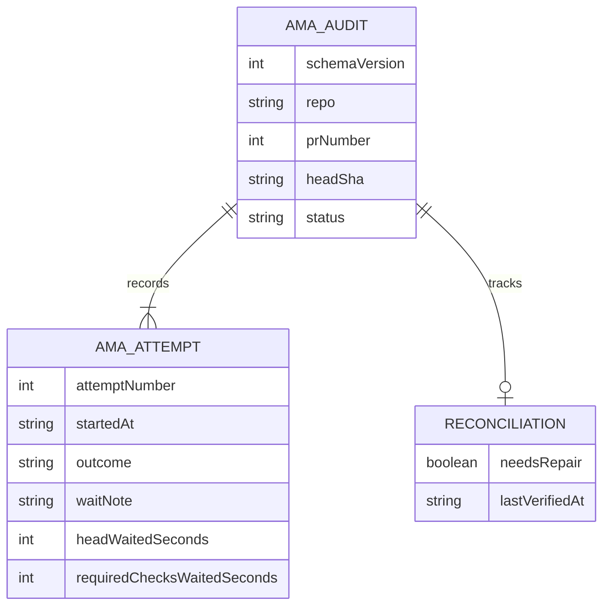

# Data Model - AMA Closure Audit

**Owner:** AMA merge authority
**Store:** `$HQ_ROOT/dispatch/audit/adversarial-merge-authority/`
**Source of truth:** `src/ama/audit.mjs`
**Runtime surface:** `bin/ama-audit.mjs`, `bin/hammer-publish.sh`, `bin/hammer-pending-attestation.mjs`, `src/ama/hammer-pending-attestation.mjs`, `templates/hammer-prompt.md`, `bin/hammer-merge.sh`, `bin/hammer-verify-head.sh`, `src/ama/daemon-merge.mjs`, `src/ama/closing-keywords.mjs`, `src/ama/no-ci-configured.mjs`, `src/daemon-clean-merge.mjs`, `src/ama/hammer-stop-hold.mjs`

## Purpose

One JSON document records closure attempts for a `(repo, prNumber, headSha)`
tuple. Its filename is `<repo-with-slashes-replaced>-pr-<number>-<head>.json`.
The writer serializes appends with a sibling lock file and writes JSON atomically
at mode `0640`.

| Field | Shape | Contract |
|---|---|---|
| `schemaVersion` | number | Current value is `1`. |
| `repo`, `prNumber`, `headSha` | string, number, string | Immutable record identity. |
| `createdAt`, `updatedAt` | ISO timestamps | First write and latest append. |
| `status` | string | Latest attempt outcome, except `succeeded` stays sticky. |
| `attempts` | array | Immutable ordered attempt history. |
| `appendedRecords` | optional array | Compatibility evidence recovered from trailing JSONL after the leading JSON document. Parsed lines retain their original shape; malformed lines become `{ unparsed: string }` with at most 2000 characters. Preserved by subsequent atomic rewrites, without changing `status` or numbering `attempts`. |
| `attempts[].attemptNumber` | positive integer | Sequential, starting at `1`. |
| `attempts[].startedAt` | ISO timestamp | Append time. |
| `attempts[].outcome` | string | `in_progress`, `deferred`, `superseded`, `succeeded`, or `failed-without-merge`. Other attempt fields carry caller evidence, including `closingStatus` for gate-cap parks. |
| `attempts[].waited_s` | optional number or null | Merge-lease timeout elapsed seconds from the lease CLI; missing or null duration evidence is recorded as JSON `null` so the deferred audit remains valid. |
| `attempts[].configured_s` | optional number | Procedure-enforced merge-lease wait budget in seconds for a timeout attempt. |
| `attempts[].pendingAttestation` | optional object | Hammer audit-delivery failure after a successful range proof: `baseHead` (last reviewed SHA), `validatedHead` (document head), `identity` (`login`, numeric `databaseId`), and `validationSummary` (`rangeVerified: true`, non-negative `total`, `blocking`, `nonBlocking` counts). Fixed fields only; no secrets, stderr or arbitrary bodies. |
| `attempts[].attemptPhase`, `attempts[].path` | optional strings | Per-attempt producer provenance. Daemon phases are `daemon-pre-merge`, `daemon-merged`, `daemon-deferred`, and `daemon-failed`; `path` names its closure authority, including `ham-terminal-remediation` for a daemon call on a HAM-certified head. Hammer phases include `hammer-gh-pr-merge`, `hammer-gate-attempt-cap` and `hammer-lease-admission`. Document-level authority alone does not identify the producer of a marked attempt. |
| `attempts[].guardReversals` | optional array of `{ authorization, paths, failedCheckRun, passingCheckRun, failedHead, passingHead }` | Independently verified required-guard reversal authority from the latest completed in-lease eligibility evaluation. Daemon terminal attempts retain it on both success and failure, including when an independent gate such as CI refuses merge. Omitted when that evaluation returns no verified reversals. `authorization` is `Reversal-Authorized-By: guard:<check name>`; paths, run IDs and exact head SHAs identify the proof. This evidence does not waive other merge gates. |
| `reconciliation.needsRepair` | boolean | Latest append's repair signal. Present on records auto-created by append. |
| `reconciliation.lastVerifiedAt` | ISO timestamp | Latest append time. Present on records auto-created by append. |
| `closingKeywordRewrites` | optional array | Title and body rewrites computed by the daemon; absent on older records. Each item is `{original, referencedNumber, referencedRepo, replacement}`. |
| `attempts[].closingKeywordRewrites` | optional array | Per-attempt message rewrites, including hammer shell attempts. Same item shape as the top-level field. |
| `attempts[].resumeOwed` | optional boolean | Hammer terminal attempts set this to `true` only for `reason: required-checks-pending`; other reasons write `false`. Audit-only evidence that the bounded worker deferred for pending CI. Older and non-hammer attempts may omit it. |
| `attempts[].resumeHead` | optional string or null | The exact validated head SHA when `resumeOwed` is `true`; otherwise `null`. Diagnostic evidence for operators, not a dispatch trigger or merge authorization. |
| `attempts[].waitNote` | optional string | Terminal hammer merge phase formats the published-head and required-check elapsed seconds into a diagnostic note on every terminal append. |
| `attempts[].headWaitedSeconds` | optional non-negative integer | Elapsed published-head visibility wait in seconds, measured by verify-head and persisted by the terminal merge phase. `0` means the wait never started. |
| `attempts[].requiredChecksWaitedSeconds` | optional non-negative integer | Elapsed exact-head required-check wait in seconds, measured and persisted by the merge phase. `0` means the wait never started. |
| `attempts[].remoteCiStatus` | optional string | UNKNOWN deferral uses `mergeability-unknown` when checks passed and `mergeability-unknown-ci-timeout` when CI remained unsettled at the deadline. The reason stays `pr-mergeability-unknown` for recovery routing. Deadline expiry before the next read preserves this classification from the last validated-head snapshot when no other hold is present. |
| `attempts[].githubGate` | optional object | Last exact-head gate snapshot, including `checksConclusion`, `state`, `headMatches`, and mergeability; preserves pending or unreadable CI evidence alongside UNKNOWN deferral. |
| `closureAuthority`, `reviewer`, `riskClass`, `flagState`, `ciMode` | optional provenance | Watcher-owned metadata, or caller-provided metadata when an append creates a missing record. `ciMode` is `github-checks` or `no-ci-bootstrap`. |
| `ciConfigurationAdmission`, `attempts[].ciConfiguration` | optional `{ reason, repo, base, head, baseHead, checkedAt }` | Only the operator-authorized no-CI daemon route. Top-level admission metadata holds the pre-lease proof; the successful `daemon-merged` attempt holds its latest in-lease proof. All identity fields are strings; `checkedAt` is an ISO timestamp and `reason` is `no CI configured`. |

`harnessResolution` and `attempts[].harnessResolution` record the closer's
physical `workerClass`, resolver `reason`, `hold` boolean, and quota provenance:
`evidenceSource`, `evidenceAgeMs`, `evidenceReadAt` (epoch milliseconds), and
`liveReadReason`. Evidence fields are null when unavailable. Optional `diagnostics` is an array
of producer/field strings explaining unreadable or unavailable account evidence;
it does not change the hold reason, admission policy or retry authority. Snapshot use is
recorded even when the class stays unchanged. Resolver holds write a `deferred`
attempt with `reason: harness-hold:<resolver reason>`; genuine exhausted fallback
sets preserve `all-fallbacks-grounded`. The same reason is returned to dispatch
callers, along with `holdReason`. See the
[quota snapshot contract](ama-closer-quota-snapshot.md).

ITP-14 adds optional `harnessResolution.accountProposal` (and the same nested
field per attempt): `{ identity, tokenAccountId, brokerProvider, reason,
evidenceGeneration }`. Account/provider/generation are null when no selection
was proposed. Both corporate and primary keep the canonical hammer role;
`fellBack` denotes only an eligible declared cross-family role change. These
fields convey no merge authority and are not a lease receipt. Managed dispatch
revalidates admission and owns the actual durable account binding. Pool holds
use the existing `deferred` audit outcome and `harness-hold:<reason>`; the legacy
quota snapshot is not an alternative source of pooled admission evidence.

`appendAmaAuditAttempt` may create a missing head record. That first append
includes the reconciliation block and any supplied provenance metadata. Later
appends preserve existing metadata and update reconciliation. A successful
record cannot be demoted by a later append.

`parseAmaAuditDocument` accepts a valid leading object followed by non-empty
JSONL lines and exposes them as `appendedRecords`; unrelated parse failures
still throw. This is recovery for historical hand-appended hammer evidence,
not a second writer protocol. Records can carry `outcome`, `reason`, `head` /
`currentHead` / `headSha` / `validatedHead`, `closingStatus`, `next`, and
`timestamp` / `recordedAt` without the numbered-attempt shape.

The [hammer stop hold](hammer-stop-hold.md) reads both arrays for the live and
reviewed heads, choosing the latest matching hammer terminal decision by
`startedAt` / `timestamp` / `recordedAt`, then array order. Explicit hammer
phases (`hammer-*` or `before-hammer-*`) are accepted only with no path or a
hammer path (`hammer`, `ham-terminal-remediation`); other explicit phases are
excluded. A path without a phase must be a hammer path. Legacy entries with
neither marker are accepted only when document `closureAuthority` is absent
or a hammer path. Explicit hammer provenance wins over document metadata;
daemon attempts never set or clear a hammer decision. A latest hammer
`failed-without-merge` or legacy `no-merge` starts a hold; a later hammer defer
or success clears it.

Pre-acquire live admission refusals append an attempt with
`attemptPhase: hammer-lease-admission`, `reason: merge-lease-admission:<reason>`,
`reviewedHead` and `validatedHead`. Reasons are `head-changed`, `pr-not-open`,
`pr-is-draft` or `operator-hold`. Confirmed already-merged PRs produce no refusal
record. `operator-hold` and `pr-is-draft` outcomes are `deferred`; `head-changed`
is `superseded`; `pr-not-open` is `failed-without-merge`. Thus transient live gates
do not create hammer stop holds. These attempts use the existing audit fields
and sticky-success guard. Admission has no held-lease merge decision and is
exempt from merge-action receipts; its audit records the refusal.
The hammer itself never uses historical
terminal stops as admission input after the closer releases a hold.

The pre-merge stacked-base check records `outcome: deferred` with
`reason: stacked-base-merged` or `stacked-base-read-failed` and releases the
merge lease. A merged-parent hold must not create a `failed-without-merge`
stop: retargeting can restore eligibility without changing the PR head.
The hammer reads the CLI's last non-empty output line as the reason, preserving
the merged-parent classification when preceding persistence diagnostics exist.

`resumeOwed` / `resumeHead` have no runtime consumer. The watcher independently
proves the closer-only ancestry from the reviewed head on each tick and reads
live exact-head CI. Pending-only checks hold without charging automated recovery;
green checks permit the normal leased resume, and failed checks reach the capped
hammer repair lane. Missing audit markers do not suppress those evaluations.

For primary-change evidence, a post-lease `primary-change-read-failed` or
`primary-change-unknown` gate
writes `reason: gate-read-failed`, `permanent: false`, and the concrete reason
in `eligibilityReasons` / `preMergeReasons`. It omits `manualCloseRequired`,
so a later tick may retry the same head after GitHub reads recover.

`closingKeywordRewrites` records the explicit merge subject and body sanitization,
with title rewrites before body rewrites. `original` and `replacement` are raw
author-text snippets (including whitespace), not trusted commands or markup;
consumers must escape them when rendering. `referencedNumber` is numeric and
`referencedRepo` is `null` for local `#N` / `GH-N`, or the referenced owner/repo
for qualified and GitHub URL references. Actual self-PR references are exempt.
An empty array means no supported closing-keyword adjacency was rewritten; it
is not proof that other merge surfaces or individual commits are sanitized.
The top-level field describes the daemon's bootstrap message; immutable
attempt entries are authoritative for later attempts.

The hammer exports `HAM_AMA_TRAILERS` from the canonical dispatch-time
`composeAmaTrailers` block, preserving reviewer family, eligibility reason and
`ama-audit:<repo>:pr-<number>:head-<sha>` trace identity. Its message helper fails
closed when that block is missing; it never synthesizes substitute provenance.
No-CI evidence corroborates the operator's explicit repository declaration in
`roles.adversarial.merge_authority.no_ci_repositories`; it is not inferred from
an empty rollup alone. Live reads cover base/head Actions and known external-CI
configs, head check suites and commit statuses, all effective rule pages, and
classic branch protection. Live proof waives required adversarial-gate protection
only for the declared repository's daemon call; the domain policy still applies
to every call without proof.
Top-level evidence records admission intent, not proof of a successful merge;
only the successful attempt records the proof used at closure. In-lease
transient configuration lookup errors write `reason: gate-read-failed`,
`permanent: false` and omit `manualCloseRequired`. Permanent probe errors refuse
proof instead of deferring. Revoked proof or newly appearing CI records
`reason: gate-not-eligible`, `permanent: false` with the real eligibility reasons
and omits `manualCloseRequired`, permitting a later same-head retry.

Lease-admission attempts (`attemptPhase: hammer-lease-admission`) record live
head/state/draft/label refusals but neither set nor clear a hammer stop decision.
The stop reader skips them even when their outcome is deferred or failed.

HAMATTESTRETRY-01 records pending edges with `attemptPhase: hammer-audit-comment`,
`outcome: deferred`, and `reason: audit-comment-unavailable`. Recording requires
this run's successful reviewed-to-validated range proof. Recovery reads only the
matching repo/PR/head audit and selects a pending edge from that producer phase.
The current live head, last reviewed base and authenticated App login plus
numeric identity must match before posting under the next hammer's lease.
The pending object alone is never provenance: the unchanged App-comment parser
must accept the recovered comment before the normal range proof can succeed.
These immutable historical attempts need no new lifecycle state or config key.
