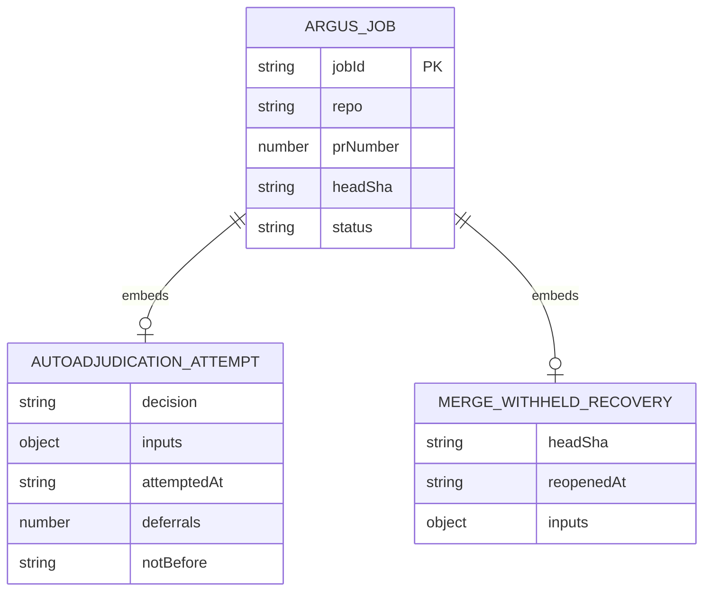

# Data Model - Argus Security Review Jobs

**Owner:** ASR-03 Argus security review queue
**Store:** `data/argus-security-jobs/`
**Source of truth:** `src/argus-security-queue.mjs`, `src/dependency-bot-autoadjudication.mjs`
**Runtime surface:** `src/argus-security-queue.mjs`
**Producer:** `src/argus-security-route.mjs`, called from `processReviewSubject`
(`src/pollonce-phases.mjs`) once per PR head (ASR-04). Narrow dependency-bot
jobs may also be resolved in-process by `src/dependency-bot-autoadjudication.mjs`.
**Consumer:** the watcher-owned drain in `src/argus-security-drain.mjs`
(ARGUSDRAIN-01), which claims, reviews (`src/argus-security-review.mjs`) and
settles jobs, and runs the backlog retirement pass in
`src/argus-backlog-retirement.mjs`. Its per-tick status lives in
`data/argus-security-drain-status.json` (see `argus-security-drain-status.md`).

## Purpose

`data/argus-security-jobs/` is the durable on-disk queue for Argus security
review work. It is intentionally separate from `data/follow-up-jobs/` so a
remediation backlog cannot starve security review, and a burst of security
reviews cannot starve normal follow-up remediation.

Each job is bound to one exact `(repo, prNumber, headSha)` identity. A re-poll
of the same PR head is idempotent, while a new head SHA creates a new job
because the prior security review only speaks for the tree it inspected.

REVIEWSIMPLE-01: model reviews and completed results retain `simplicityNote`
(optional final advisory text, or `null`). The existing findings comment displays
it separately; a note can make a clean review visible but does not enter
`findings`, severity or verdict composition, nor request remediation or re-review.
Cached reviews created before this field existed yield `null` in the result.

Jobs are produced by the watcher (ASR-04). Every open, non-terminal PR is
classified once per head by the ASR-02 security-surface classifier, and any
trigger enqueues here. Two dispositions follow from that:

- A **bot-authored PR** (no worker prefix is possible) carries
  `review_status='argus-security-queued'` in `reviews.db` for as long as the PR
  is open. That status is not terminal — it is what replaced the terminal
  `unroutable-bot-author` row that stranded `adversarial-review#909` and `#910`
  for 14 hours.
- A **routable PR** that touches a manifest or a security-sensitive path is
  enqueued here **additively**. Its normal adversarial code review is unaffected;
  Argus reviews the dependency surface and never diverts or replaces the code
  review.

The memo of which head has already been classified lives in
`reviewed_prs.argus_classified_head_sha`. It is a cache, never an authority: a new
head leaves it stale and re-classifies, so losing it costs GitHub calls and can
never cost a review. `ADVERSARIAL_ARGUS_SECURITY_ROUTE=0` disables the producer
and restores the pre-ASR-04 terminal disposition.

## Directories

Directory: `data/argus-security-jobs/`

| Path | Shape | Contract |
|---|---|---|
| `pending/*.json` | Argus job document with `status: "pending"` | Durable work waiting to be claimed. Filenames are deterministic job IDs derived from `(repo, prNumber, headSha)`. |
| `in-progress/*.json` | Argus job document with `status: "in_progress"` | Claimed work owned by a security reviewer worker. Claims are acquired by hard-linking the pending file into this lane, then unlinking the pending name. |
| `completed/*.json` | Argus job document with `status: "completed"`, `completedAt`, and `result` | Archive for answered jobs: drain reviews (`approve`, `needs_verification`, `block`), dependency-bot adjudications, and retirements with a `superseded` result. Not strictly terminal: superseded and legacy routed jobs can return to `pending/`; a dependency-bot `merge-withheld-*` completion can also recover once after live exact-head checks turn green. |
| `failed/*.json` | Argus job document with `status: "failed"`, `failedAt`, and `error` | Terminal archive for failed reviews and unreadable pending records that were quarantined out of the active queue. |

## Job Document

| Field | Shape | Contract |
|---|---|---|
| `schemaVersion` | number | Currently `1`. |
| `kind` | string | Always `argus-security-review`. |
| `status` | string | One of `pending`, `in_progress`, `completed`, or `failed`. |
| `jobId` | string | Deterministic filename stem for `(repo, prNumber, headSha)`. |
| `repo` | string or null | GitHub `owner/repo` for normal jobs; `null` only for synthetic failed records created from corrupt pending files. |
| `prNumber` | number or null | Pull request number for normal jobs; `null` only for synthetic corrupt-record failures. |
| `headSha` | string or null | Full 40- or 64-character commit object name for normal jobs; `null` only for synthetic corrupt-record failures. |
| `reasons` | array | ASR-02 trigger reason objects copied verbatim from the security-surface classifier. |
| `enqueuedAt` | string or null | ISO-8601 enqueue time for normal jobs; `null` only for synthetic corrupt-record failures. |
| `source` | string or null | Optional enqueue source label. |
| `claimedAt` | string or null | ISO-8601 claim time once moved to `in-progress`. |
| `completedAt` | string or null | ISO-8601 completion time for completed jobs. |
| `failedAt` | string or null | ISO-8601 failure time for failed jobs. |
| `result` | object or null | Result payload on completed jobs; reset to `null` when a job returns to `pending/`. Drain reviews and retirements carry `source: "argus-security-drain"` (`ARGUS_REVIEW_RESULT_SOURCE`); drain reviews carry `verdict` (`approve`, `needs_verification`, `block`), `summary`, `findings`, `reviewer`, `rubric`, `dependency`, `verification`, `completedAt`, `posted`, and a `drain` block `{claimedAt, completedAt, latencyMs, attempts}` the health surface reads for claim-to-verdict latency. Retirements carry `verdict: "superseded"`, `supersededReason` (`pr-merged-or-closed` or `head-superseded`), `observedHeadSha`, and `retiredBy: "backlog-retirement"`. `superseded` is a result verdict, not a job `status`. |
| `error` | string or null | Failure reason on failed jobs. |
| `lastAutoadjudicationAttempt` | object or null | Watcher-owned approval retry record: `{schemaVersion: 1, decision: "approve-auto-merge", reason, inputs, attemptedAt, deferrals, notBefore?, mergeDisposition?, mergeReason?, mergeReasons?}`. `deferrals` counts waits across all curable merge refusals; each refusal sets `notBefore` to ten minutes after `attemptedAt`. Recovery seeds an approval with `deferrals: 0` and no merge-attempt fields. |
| `mergeWithheldRecovery` | object or absent | Once-only recovery marker `{headSha, reopenedAt, inputs}`. `headSha` references this job's exact head; `inputs` retains the original approved dependency evidence. Persisted before returning a completed merge-withheld job to pending, and retained across retries and later completion. |
| `result.autoadjudication` | object or absent | Dependency-bot result metadata `{schemaVersion, decision, reason, inputs, completedAt, mergeDisposition?, mergeReasons?}`. A withheld merge records `decision: "route-for-review"`, a `merge-withheld-*` reason, and the daemon's disposition and reasons. |
| `routedForReview` | object or absent | ARGUSDRAIN-01. Set when the dependency-bot auto-adjudicator declines to approve a bump on its own (for example semver-major): `{schemaVersion, source: "dependency-bot-autoadjudication", decision: "route-for-review", reason, inputs, routedAt}`. The job stays in `pending/` and the drain claims it without waiting out the bot-adjudication grace. Legacy completions reopened by backlog retirement also carry `requeuedFrom: "legacy-route-for-review-completion"` and `requeuedAt`. |
| `drain` | object or absent | ARGUSDRAIN-01 drain bookkeeping, carried across claims: `attempts`, `lastError`, `lastAttemptAt`, `notBefore` (the drain does not claim the job before this ISO time), `deferrals`, `lastDeferReason`, `lastDeferredAt`, and `cachedReview` (a model review bound to `headSha`, `baseSha` and `evidenceFingerprint`, reused within its max age only after re-reading matching deterministic evidence; cleared on completion or failure). |
| `priorResult` | object or absent | The `result` a job carried before it was moved back to `pending/` (a revived `superseded` retirement or a reopened legacy `route-for-review` completion), kept for the record. |
| `revivedAt` | string or absent | ISO time the route revived a `superseded` job whose PR is open at the same head again. |

The filename/job ID is the primary key; `(repo, prNumber, headSha)` is the
logical unique identity. Retry and recovery objects are embedded in that job,
not separate records or cross-store references.

## Operational Contract

- Enqueue is write-once and idempotent per `(repo, prNumber, headSha)`. The
  same head may appear in any bucket and still suppress a duplicate enqueue; a
  different head always gets a distinct job.
- Claiming uses a hard link into `in-progress/` as the ownership boundary. If a
  worker crashes after creating the hard link but before removing the pending
  name, the next claim compares inodes and completes the pending unlink when
  both paths point at the same file. If the in-progress file is a different
  inode, the pending file remains untouched and the claimant skips it.
- If the pending pathname disappears after the in-progress hard link succeeds,
  the claim is still valid. The worker must persist the claimed record rather
  than rolling back and deleting the in-progress file.
- Unreadable pending records are moved to `failed/` as synthetic failed jobs so
  one corrupt file cannot remain the oldest pending entry forever or jam queue
  monitoring.
- Queue depth is content-free and uncapped. It counts `.json` entries in every
  bucket so Sentinel sees real backlog even when some records are corrupt.
- Listing APIs are fail-soft per record and cap only successfully parsed jobs,
  so corrupt files near the newest edge do not hide valid records below them.
- Terminal transitions rename the in-progress file into `completed/` or
  `failed/` before stamping the terminal payload. Callers may pass the in-memory
  claimed job to avoid re-reading a file that was corrupted while work was in
  flight.
- Dependency-bot auto-adjudication may complete a pending job without a separate
  Argus worker only for narrow non-major, non-native manifest updates. For this
  policy, `0.x` minor bumps are treated as major and require verification. A
  successful exact-head clean merge completes the job with an approving result;
  policy denials and permanent merge blockers complete it as
  `needs_verification`. Curable merge blockers keep the job in `pending/` and
  update `lastAutoadjudicationAttempt`, with one shared budget of 18 ten-minute
  deferrals across reasons. Ticks before `notBefore` do not attempt a merge;
  exhausted retries complete as `needs_verification`. These pending approvals
  remain watcher-owned rather than being claimed for another security review.
- A completed dependency-bot `needs_verification` job with a
  `merge-withheld-*` auto-adjudication reason may reopen once. Recovery requires
  a fresh GitHub read proving the same head is open, non-draft, mergeable and
  green under the shared external-check classifier. Before moving the file,
  it persists `mergeWithheldRecovery` and seeds the pending approval from the
  original inputs; a later title edit cannot replace that evidence. The marker
  prevents a second recovery even after restart or another withheld completion.
- Returning a job to `pending/` (`returnArgusJobToPending`: a drain retry or
  deferral, a revive, a reopened legacy completion, or a reclaimed stale claim)
  rewrites the record in place first and renames it into `pending/` second, then
  resets the file mtime to `enqueuedAt` so FIFO order and oldest-pending age are
  not reset by a retry. A crash between the two steps leaves a record with
  `status: "pending"` outside `pending/`; nothing else writes that shape.
  `resumeInterruptedArgusRequeues` finishes those moves at the start of every
  backlog retirement pass (skipping claims running in this process), and the
  route's `reviveSupersededArgusJob` finishes one it meets for an open PR, so the
  half-done state is never stranded.
- Backlog retirement (every 30 minutes, and before the drain's first claim)
  completes pending jobs whose PR is no longer open, or is open at another head,
  with a `superseded` result. It reads open PRs live from GitHub; a repo whose
  listing fails or may be truncated retires nothing. It also returns in-progress
  claims older than the claim lease and not running in this process to
  `pending/`.
- The files contain no secrets. They contain PR identity, exact head SHA,
  security trigger reasons, timestamps, and review result or failure metadata.

## Artifact and cache binding (LAC-2117)

`drain.cachedReview` additionally carries `baseSha`, `evidenceFingerprint`,
`artifactBindings` and `verifiedArtifactSources`. The SHA-256 fingerprint covers
contract generation 2, repo/PR/base/head/diff, non-CI evidence sections, rubric
findings/results, verified entries and artifact bindings. Each binding contains
manifest `dir` and per-lock-entry `artifactEvidence` with base/head `record`,
authoritative `producer` merged receipt, relative materialized filenames and
`consumerSha256`/`producerSha256`. Filenames are audit references, never later
read as durable authority. Reuse re-materializes and verifies the current facts.
Missing fingerprints, changed proof/base/head/artifact/rubric or age expiry rerun
model review; CI-only changes preserve it.

New drain results retain `headSha`, `baseSha`, `evidenceFingerprint` and
`artifactBindings`. Schema version remains 1: fields are additive, legacy
completed results keep their prior interpretation and are not rewritten. Queue
states and transition policy remain unchanged. These fields do not waive
required checks, cross-model convergence or independent reserved-high findings.

For explicit model `non_registry_source` / `source_protocol` claims only,
`packagePath` identifies the lock entry and `path` the lockfile. Exact verified
provenance changes that claim to an explanatory low; `originalFinding` retains
its normalized source, category, severity and text, with
`evidenceDowngradeReason` describing the factual reconciliation. Ambiguous
claims and all other reserved categories retain their own authority. The
visible summary derives from composed findings, never the raw model verdict.

The source record contract and rollout are in
[the provenance runbook](../RUNBOOK-argus-artifact-provenance.md).
