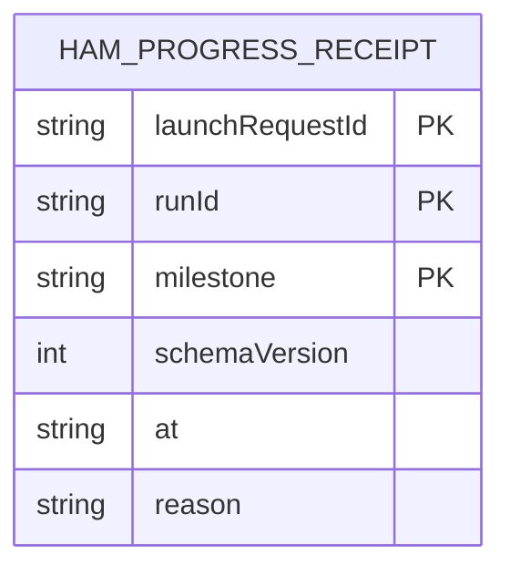

# Hammer progress receipts (HAMPROGRESS-01)

**Source of truth:** `src/ama/hammer-progress.mjs`

Owner: the active HAM worker run. Store:
`<HQ root>/dispatch/<launchRequestId>/hammer-progress/<runId>/<milestone>.json`.
The HQ root comes from `HAM_HQ_ROOT`, falling back to the shared HQ root resolver.

Each file records the first occurrence of one milestone for one launch and run.
The composite key is `(launchRequestId, runId, milestone)`; references identify
the existing HQ launch and worker run without introducing database foreign keys.

| Field | Type | Meaning |
|---|---|---|
| `schemaVersion` | integer | `1` |
| `launchRequestId` | string | Launch identity resolved by the HAM controller |
| `runId` | string | `HQ_WORKER_RUN_ID`, matching `wrun_[A-Za-z0-9-]+` |
| `milestone` | string | `verify-head`, `remediation-committed`, `validation-passed`, `validation-failed`, `remediation-pushed`, `merge-attempted`, or `terminal-stop` |
| `at` | ISO timestamp | Time of the first successful write |
| `reason` | optional string | Required only for `terminal-stop`; 1–96 characters matching `^[a-z][a-z0-9:-]{0,95}$` |

Writes use exclusive creation with mode `0600`. A repeated milestone reads and
returns the stored receipt, preserving its original timestamp and terminal
reason. Read, write, or identity failures produce one warning through
`reportHammerProgress`; callers continue without granting merge authority,
CI validation, or budget refunds. Receipts are run scoped and this producer
does not add expiry or cleanup.

The phase scripts record head verification and successful remediation
publication. `bin/metered-gh.mjs` records an actual HAM `pr merge` invocation
after known repository flags are parsed; script inspection emits no receipt.

`templates/hammer-prompt.md` invokes `bin/hammer-progress.mjs remediation-committed`
after the commit step. `bin/hammer-validate.mjs` also checks for that receipt
before running validation. Both use `reportRemediationCommit`: `HEAD` must differ
from and descend from `HAM_TARGET_REMEDIATION_SHA || HAM_REVIEWED_SHA`. The target
is the dispatch baseline; the reviewed SHA is a legacy fallback. A head already
advanced at dispatch earns no commit receipt until a further descendant exists.
Invalid identity or failed Git ancestry checks emit no receipt.

`bin/hammer-validate.mjs` records `validation-passed` for exit 0 and
`validation-failed` for exits 1–123 after a completed bounded command.
Exit 124 (timeout), cleanup uncertainty, signals and spawn failures earn neither.
These are advisory liveness signals, not proof that tests ran or passed:
an arbitrary command can succeed without validating anything, and pytest usage
errors or no tests collected also produce a completed failure receipt.
The general progress CLI refuses `validation-*` to route ordinary callers
through the bounded helper; that refusal is not an integrity boundary.
The seven first-write-only kinds bound renewal; wall/token ceilings still apply.
Deploy the seven-kind supervisor consumer before or together with this producer;
compatibility of an older consumer with unknown receipt names is unverified.

`terminal-stop` means the run is ending: the supervisor allows only a short exit
grace after it. `recordHammerProgress` refuses it unless the caller passes
`final: true`, and only the closer's explicit final exit,
`bin/hammer-terminal-audit.mjs --final <reason>`, does so. Deferred, requeued
or retryable no-merge outcomes from the merge phase, and helper early failures
the closer may still retry, keep their AMA terminal audits and merge-action
receipts but write no `terminal-stop`.
