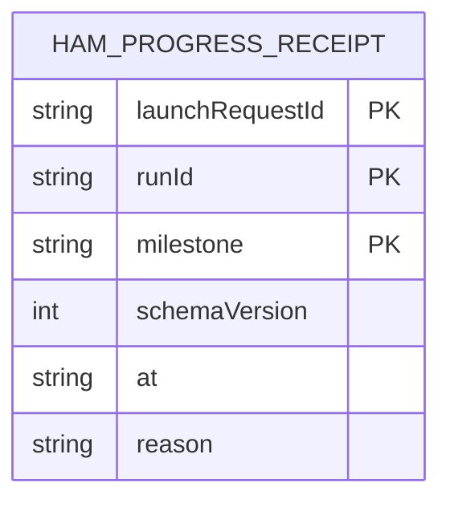

# Hammer progress receipts (HAMPROGRESS-01)

**Source of truth:** `src/ama/hammer-progress.mjs`

Owner: the active HAM worker run. Store:
`<HQ root>/dispatch/<launchRequestId>/hammer-progress/<runId>/<milestone>.json`.
The HQ root comes from `HAM_HQ_ROOT`, falling back to the shared HQ root resolver.

Each file records the first occurrence of one milestone for one launch and run.
The composite key is `(launchRequestId, runId, milestone)`; references identify
the existing HQ launch and worker run without introducing database foreign keys.

| Field | Type | Meaning |
|---|---|---|
| `schemaVersion` | integer | `1` |
| `launchRequestId` | string | Launch identity resolved by the HAM controller |
| `runId` | string | `HQ_WORKER_RUN_ID`, matching `wrun_[A-Za-z0-9-]+` |
| `milestone` | string | `verify-head`, `remediation-pushed`, `merge-attempted`, or `terminal-stop` |
| `at` | ISO timestamp | Time of the first successful write |
| `reason` | optional string | Required only for `terminal-stop`; fixed code matching `[a-z][a-z0-9:-]*` |

Writes use exclusive creation with mode `0600`. A repeated milestone reads and
returns the stored receipt, preserving its original timestamp and terminal
reason. Read, write, or identity failures produce one warning through
`reportHammerProgress`; callers continue without granting merge authority,
CI validation, or budget refunds. Receipts are run scoped and this producer
does not add expiry or cleanup.

The phase scripts record head verification and successful remediation
publication. `bin/metered-gh.mjs` records an actual HAM `pr merge` invocation
after known repository flags are parsed; script inspection emits no receipt.

`terminal-stop` means the run is ending: the supervisor allows only a short exit
grace after it. `recordHammerProgress` refuses it unless the caller passes
`final: true`, and only the closer's explicit final exit,
`bin/hammer-terminal-audit.mjs --final <reason>`, does so. Deferred, requeued
or retryable no-merge outcomes from the merge phase, and helper early failures
the closer may still retry, keep their AMA terminal audits and merge-action
receipts but write no `terminal-stop`.
