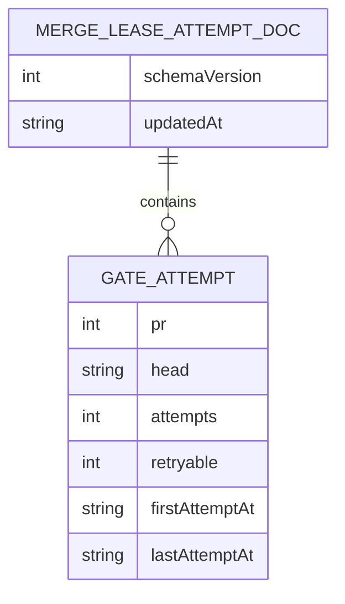

# Data Model - Merge Lease Gate Attempts

**Owner:** AMA daemon and hammer merge lane
**Store:** `data/merge-leases/<repo>__<base>.attempts.json`
**Source of truth:** `src/ama/merge-lease.mjs`
**Runtime surface:** `bin/merge-lease.mjs`, `templates/hammer-prompt.md`

## Purpose

The file records charged gate attempts and refunded retryable aborts for each
`(repo, base, PR, head)` before the hammer acquires the merge lease. The file
slug comes from `deriveLeaseKey`; the document is keyed by `(repo, base)` and
each `attempts[]` entry by `(pr, head)`.

| Field | Shape | Contract |
|---|---|---|
| `schemaVersion` | number | Current value is `1`. |
| `updatedAt` | ISO timestamp or null | Last mutation time. |
| `attempts` | array | Entries sorted by PR number, then head. |
| `attempts[].pr` | positive integer | PR number. |
| `attempts[].head` | string | PR head being gated. |
| `attempts[].attempts` | non-negative integer | Charged acquisitions; the cap uses this count. |
| `attempts[].retryable` | non-negative integer | Refunded retryable aborts, retained for diagnosis. Legacy entries without this field read as zero. |
| `attempts[].firstAttemptAt` | ISO timestamp | First attempt on this PR/head. |
| `attempts[].lastAttemptAt` | ISO timestamp | Latest attempt or refund; entries expire after 30 days. |

`acquire` records a provisional attempt and parks when the charged count
exceeds `AMG_MAX_GATE_ATTEMPTS`. A normal release leaves it charged. A
retryable-abort release or acquire wait timeout decrements one charged attempt
and increments `retryable`. `reset-attempts` removes one PR/head entry while
refusing a current lease holder. All mutations take the waiter and attempt
mutation locks; writes replace the JSON file atomically.

Optional no-merge retry fields share this existing PR/head record:
`noMergeReleases` counts non-terminal releases; `noMergeReason` and
`consecutiveNoMergeReleases` count the current consecutive failure reason;
`noMergeLeaseId` makes recording the same release idempotent.
`reenteredAt` records the latest re-entry, and `nextEligibleAt` is its earliest
next grant. Backoff starts at one second, doubles per no-merge release, and caps
at the existing watcher poll interval before being load-scaled once.
After `AMG_MAX_GATE_ATTEMPTS` consecutive releases with the same reason
(default five), `parkedReason: "repeated-no-merge-release"` refuses admission
for that head and removes its reservation. There is no new config key or merge
gate: this bounds rescheduling of failed holders. Changing the head or using
the existing fenced `reset-attempts` command resets the retry state; the
existing 30-day attempt expiry still applies. Gate charges and retryable refunds
preserve these fields and cannot erase a park.

Both normal and retryable-abort no-merge releases update this state under the
holder/waiter and attempt locks. Explicit merged or terminal releases skip
re-entry. The CLI accepts `release --merged`, `--terminal` and `--reason`;
the hammer forwards its authoritative merged exact-head observation or current
phase failure reason. The daemon forwards its actual result and permanence.
