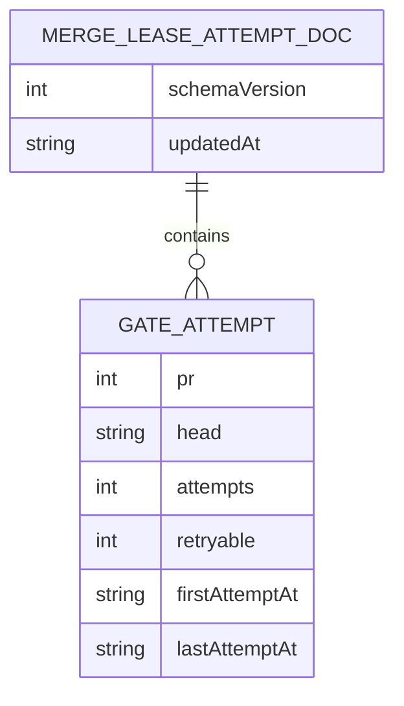

# Data Model - Merge Lease Gate Attempts

**Owner:** AMA daemon and hammer merge lane
**Store:** `data/merge-leases/<repo>__<base>.attempts.json`
**Source of truth:** `src/ama/merge-lease.mjs`
**Runtime surface:** `bin/merge-lease.mjs`, `templates/hammer-prompt.md`

## Purpose

The file records charged gate attempts and refunded retryable aborts for each
`(repo, base, PR, head)` before the hammer acquires the merge lease. The file
slug comes from `deriveLeaseKey`; the document is keyed by `(repo, base)` and
each `attempts[]` entry by `(pr, head)`.

| Field | Shape | Contract |
|---|---|---|
| `schemaVersion` | number | Current value is `1`. |
| `updatedAt` | ISO timestamp or null | Last mutation time. |
| `attempts` | array | Entries sorted by PR number, then head. |
| `attempts[].pr` | positive integer | PR number. |
| `attempts[].head` | string | PR head being gated. |
| `attempts[].attempts` | non-negative integer | Provisional acquisitions minus retryable releases; retained refusals at one head/base consume the cap. |
| `attempts[].baseSha` | optional full SHA | Observed base for the refusal budget. A changed base starts a fresh budget; legacy unbound counts are reset once when a base is first supplied. |
| `attempts[].retryable` | non-negative integer | Refunded retryable aborts, retained for diagnosis. Legacy entries without this field read as zero. |
| `attempts[].firstAttemptAt` | ISO timestamp | First attempt on this PR/head. |
| `attempts[].queueArrivedAt` | optional ISO timestamp | Original closer queue arrival, looked up by PR across heads within this repo/base while its restoration deadline is live. |
| `attempts[].queueArrivalExpiresAt` | optional ISO timestamp | Closer restoration deadline: release `nextEligibleAt` plus one configured watcher poll interval. Daemon releases preserve this deadline. Legacy arrival records derive it from `nextEligibleAt`. |
| `attempts[].lastAttemptAt` | ISO timestamp | Latest attempt or refund; entries expire after 30 days. |

`acquire` records a provisional attempt and parks when the charged count
would exceed `AMG_MAX_GATE_ATTEMPTS`, without charging the refused acquisition. A predicate-refusal release leaves it charged. Planned yields, known base-advance/server-rebase-conflict, lane-busy and lease-contention releases, a
retryable-abort release or acquire wait timeout decrement one charged attempt
and increments `retryable`. `reset-attempts` removes one PR/head entry while
refusing a current lease holder. All mutations take the waiter and attempt
mutation locks; writes replace the JSON file atomically.

Optional no-merge retry fields share this existing PR/head record:
`noMergeReleases` counts non-terminal releases; `noMergeReason` and
`consecutiveNoMergeReleases` count the current consecutive chargeable failure sequence;
`noMergeLeaseId` makes recording the same release idempotent.
`reenteredAt` records the latest re-entry, and `nextEligibleAt` is its earliest
next grant. Optional `baseSha` scopes the budget to the observed base, without changing FIFO identity. A new head uses its own fresh entry. Backoff starts at one second, doubles per no-merge release, and caps
at the existing watcher poll interval before being load-scaled once.
Planned `--yield` releases and retryable aborts reset the consecutive failure
count to zero while retaining backoff and any existing park. Successful grants
do not reset failure evidence: acquisition alone is not a successful merge gate.
After `AMG_MAX_GATE_ATTEMPTS` consecutive chargeable releases, even when reasons alternate
(default five), `parkedReason: "repeated-no-merge-release"` refuses admission
for that head and removes its reservation. There is no new config key or merge
gate: this bounds rescheduling of failed holders. Parking clears remembered
closer arrivals across all heads of that PR. Changing the head or observed base resets the refusal budget. The existing fenced `reset-attempts` diagnostic remains available, but recovery never requires it; the
existing 30-day attempt expiry still applies. Gate charges and retryable refunds
preserve these fields and cannot erase a park.

Both normal and retryable-abort no-merge releases update this state under the
holder/waiter and attempt locks. Refund and release identity persist atomically
in one attempts-file write, so retry after a later history/write failure cannot
refund twice; lock contention returns `mutation-lock-busy` without mutation.
Explicit merged or terminal releases skip re-entry. The CLI accepts mutually
exclusive `release --merged`, `--terminal`, `--yield`, or `--retryable-abort`,
plus `--reason`. The hammer uses `--yield --reason required-checks-wait` before
its first CI wait, refunding the provisional gate charge. Retryable aborts also refund
that charge. The daemon marks non-permanent failed outcomes as `yielded: true`,
so transient reads and retry exhaustion cannot cause failure parking. Unknown
exceptions remain chargeable. Repeated-failure parks carry a closing status and
use the hammer's existing audit, comment and page path for gate-cap parks.

Known `parkedReason` refuses a provisional gate acquisition without charging or rewriting the attempt. Core admission checks it before waiter registration and foreign-holder contention, then rechecks under the common holder/waiter mutation lock. Non-permanent daemon yields and retryable aborts remain non-chargeable; their total `noMergeReleases` and backoff stay visible without a hard park. Alternating chargeable reasons cannot reset the consecutive-failure cap.

A closer's first no-merge release records `queueArrivedAt` from its served
waiter (or original grant when there was no waiter). This scheduling identity is
`(repo, base, PR)`, independent of head-scoped gate counts and failure caps. A
fresh CLI waiter restores the arrival even after rebase, and observes both its
exact-head backoff and the remembered release's `nextEligibleAt`. Later ready
waiters proceed during that delay. Each subsequent closer release carries the
arrival onto its current head's record and clears it from older heads. Restoration
is allowed only before `queueArrivalExpiresAt`: the closer release's `nextEligibleAt`
plus one configured watcher poll interval (unscaled). A continuously registered
waiter retains its order through its invocation deadline; without re-registration
within that window, a returning closer joins at the tail. Legacy records without
the deadline derive it from `nextEligibleAt`; missing/invalid timing cannot restore
priority. Daemon releases preserve same-head closer memory and its fixed deadline,
without moving cross-head memory or renewing it. Daemon requeue timing is unchanged.
Merged, closed or explicit terminal release, and either parking cap, clear the PR's remembered arrival across heads without
erasing gate counts or refund evidence. Attempt expiry and explicit reset
retain their existing behavior. Legacy records without the field use a fresh
arrival. No history format change or migration is required.

## GATECAPBASE-01 recovery

The hammer supplies `acquire --base-sha` from its bounded base fetch. A base
change clears the current head's gate count, consecutive refusal count, park
and backoff while retaining retryable evidence. Each retryable release records
its reason and refunds under the existing release-identity fence; retrying a
partially persisted release cannot refund twice. Planned CI/local-validation
yields refund too, so an acquisition that did no predicate work does not spend
the refusal budget. Stable-base predicate refusals still cap normally.

At either cap, `recover-cap` reads the caller's refreshed PR snapshot. An open,
unheld, current conflicting head returns to the hammer's existing lease-free
conflict procedure (exit 21); other admissible heads use `observeClosureWait`
with class `merge-lease-cap`, immediate escalation and its durable per-head
page deduplication. Terminal, moved, draft and held heads retain admission
fences. Paging failures propagate for retry. The closing status names recovery
as the next actor and never prescribes an operator reset. Existing predicate,
expected-head and lease fences still govern every later merge.
