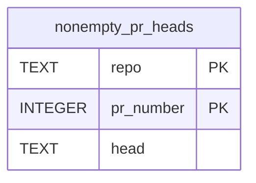

# Data Model - Nonempty PR Heads

**Owner:** watcher empty-PR admission
**Store:** `data/reviews.db`, table `nonempty_pr_heads`
**Source of truth:** `src/pollonce-phases.mjs`
**Runtime surface:** `src/empty-pr-close.mjs`

## Purpose and schema

The watcher caches the latest head that a live GitHub PR read confirmed has
changed files. This avoids repeating the empty-PR probe on each poll of that
same head. It grants no review or merge authority.

| Column | SQLite type | Contract |
|---|---|---|
| `repo` | TEXT, nullable | Repository full name; part of the composite primary key. |
| `pr_number` | INTEGER, nullable | PR number; part of the composite primary key. |
| `head` | TEXT, nullable | Head SHA confirmed nonempty by the live PR read. |

The primary key is `(repo, pr_number)`. The schema declares no `NOT NULL`
constraints or foreign keys; SQLite rowid-table composite keys permit nulls.
There are no additional indexes or timestamps.

## Lifecycle and recovery

The per-subject watcher path creates the table idempotently after terminal
subjects return. For an open, non-draft code PR without an operator hold, it
probes when the cached head differs from the current head or the snapshot
explicitly reports zero changed files. A live nonempty result upserts the head
for the repository and PR, replacing the previous cached head. Empty, failed,
or otherwise unconfirmed probes do not populate this cache.

Rows persist across watcher restarts; this path provides no TTL or pruning.
A new head triggers another live probe. An explicit zero-file snapshot still
triggers a probe even for a cached head, and empty closure independently
checks the live head, base, labels and comparison before closing the PR.
The cache is disposable optimization state, not an audit ledger. SQLite is
the only source for this table; there is no Postgres mirror.
